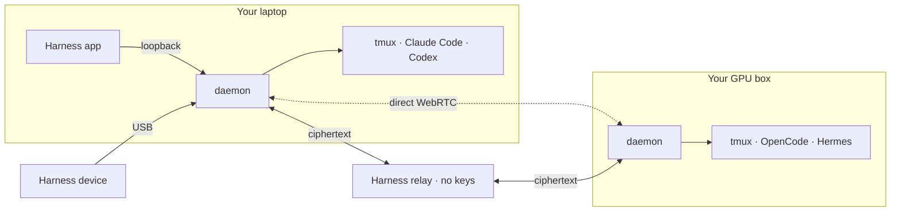

<p align="center">
  
</p>

<h1 align="center">Harness like a boss.</h1>

<p align="center">
  <b>The ultimate harness for coding agents and beyond.</b><br>
  Claude Code at work. Codex at home. Hermes in the cloud. One command center.<br>
  Start with code. Then follow your curiosity and build across disciplines: CAD, circuits, robots, games and music.
</p>

<p align="center">
  <a href="https://harness.autonomous.ai/desktop?utm_source=github&utm_medium=readme"><b>Download</b></a> ·
  <a href="#how-it-works">How it works</a> ·
  <a href="#beyond-code">Beyond code</a> ·
  <a href="#domain-specific-harnesses-dsh">Harnesses</a> ·
  <a href="#harness-device">Device</a>
</p>

### Every agent, side by side

Claude Code, Codex, Cursor, OpenCode, Devin, Amp, Copilot and seven more.

<p align="center"></p>

### Every machine, side by side

Your laptop, home server and GPU box in one window. Link each one with a password.
No SSH keys. No Tailscale. No port forwarding.

<p align="center"></p>

### Keyboard first

⌘P finds any harness on any machine. ⇧⌘I jumps to the harness waiting on you. ⌘D splits. Every key remaps.

<p align="center"></p>

### End-to-end encrypted

Code, keys and keystrokes are sealed on your machine. The relay forwards bytes it can't read.

<p align="center"></p>

### Fast and light

A native app, not Electron. Close it and your agents keep working.

Idle measurements on an M2 Max:

- **⌘N, ⌘O, ⌘T UI:** 11–13 ms median, 15–18 ms p95.
- **Local terminal echo:** 1.1 ms median, 7.2 ms p95, excluding UI rendering.
- **Desktop resources:** ~0.1% of one CPU core and 304 MiB, including terminal rendering and scrollback; agent CLIs and the daemon are excluded.

Desktop results use a Release fixture with 16 terminals and 1,000 scrollback lines each.
See the [workflow and resource benchmarks](https://github.com/autonomous-ai/openharness/blob/main/docs/performance/2026-09-23-core-experiences.md)
and [remote P2P, TURN and relay results](https://github.com/autonomous-ai/openharness/blob/main/docs/performance/2026-09-23-transport-routes.md)
for workloads, slow tails, connection failures and raw data.

### Built the way developers work

- **Real terminals.** Every agent runs in its own tmux pane. Scrollback, colors and keys just work.
- **Your CLIs, as they are.** Harness never wraps an agent. It reads transcripts and uses the vendor's own hooks.
- **A worktree per harness.** Start an agent on its own branch. Your working copy stays clean.
- **Remap every key.** One JSONC file, reloaded on save. Chords up to four strokes.
- **Local models.** Run open-weight models on your own machines with Grid, Ollama, MLX-LM and vLLM.
- **Bytes, not pixels.** Remote terminals stream text peer to peer. No remote desktop.
- **Open source, all of it.** App, CLI, daemon, relay and device, in this repo.

## How it works

In the workspace, a **harness** is one running session of an agent such as Codex
or Claude Code, with its own conversation and working context. A **tab** groups
harnesses. Use **New Harness** to start one and **New Tab** to group work.
Harnesses in the same tab can message each other with `harness send`: **Agent Messages**,
an experiment of your account, off by default and turned on in Settings ▸ Experimental.

The Store offers **harnesses** with instructions, tools, and optional viewers for
specific crafts. Install a harness, then start it in your workspace. See the
[Naming System](https://github.com/autonomous-ai/openharness/blob/main/docs/naming-system.md) for the complete naming rules.

One daemon per machine runs your agents in tmux. It dials out, so no machine opens a port.



Every path is sealed end to end: ChaCha20-Poly1305, X25519 session keys, pinned Ed25519 identities.
Harness picks the best path on its own.

**Direct.** A WebRTC channel between your machines. No server in the path.

<p align="center"></p>

**Through Cloudflare.** When a firewall blocks the direct path, the same encrypted channel runs over
Cloudflare's TURN network. Harness keeps trying for a direct path.

<p align="center"></p>

**Through our relay.** A fallback while WebRTC negotiates. The relay holds no keys and forwards ciphertext.

<p align="center"></p>

The [architecture guide](https://github.com/autonomous-ai/openharness/blob/main/docs/architecture.md) has the details.

<a id="run-it"></a>

## Get started

**[Download the app](https://harness.autonomous.ai/desktop?utm_source=github&utm_medium=readme)** for macOS or Linux.

Add a machine. Run this on it, then **Machines → Link Machine** in the app:

```bash
curl -fsSL https://harness.autonomous.ai/cli/install.sh | bash
harness login
harness remote-password set
harness start
```

**In a terminal:** the same line installs `hn` — tmux's keys and your `~/.tmux.conf`, with every
harness on every machine ([hn](https://github.com/autonomous-ai/openharness/blob/main/tui/README.md)). The first time, `hn` signs in and connects the
computer:

```bash
curl -fsSL https://harness.autonomous.ai/cli/install.sh | bash
hn
```

**For agents:** Claude Code and Codex can start, wait for and read other harnesses with the `harness` skill
([harness.autonomous.ai/agents](https://harness.autonomous.ai/agents), which has the Codex lines too):

```bash
claude plugin marketplace add autonomous-ai/openharness --sparse .claude-plugin plugins
claude plugin install harness@openharness
```

<details>
<summary><b>Build from source</b></summary>

Needs Node.js 20+, tmux, Xcode and Flutter 3.47+ / Dart 3.13+:

```bash
git clone https://github.com/autonomous-ai/openharness.git
cd openharness
(cd cli && npm ci)
make install-cli
cd desktop
flutter config --enable-swift-package-manager
flutter pub get
flutter run -d macos
```

`make install-cli` installs this checkout's CLI and restarts the local daemon. See the
[development guide](https://github.com/autonomous-ai/openharness/blob/main/docs/development.md).

</details>

<a id="beyond-code"></a>

## Beyond code: Build across disciplines

> “World-class entrepreneurs are polymaths.” — [Peter Thiel](https://www.youtube.com/watch?v=h10kXgTdhNU&t=811s)

Coding agents can build far more than software. Give one a harness and it works with the real
tools of a craft. You steer in a live viewer. Every clip below is a real session.

### Beyond code: Design

**[Blender](https://github.com/autonomous-ai/openharness/blob/main/store/agents/blender/).** Ask for a lamp and the sliders that matter. Turn them and Blender rebuilds the geometry. Keep the versions you love.

<p align="center"></p>

### Beyond code: Circuits

**[CircuitJS](https://github.com/autonomous-ai/openharness/blob/main/store/agents/circuitjs/).** Build a filter. Change one resistor. Overlay the new trace, measure the difference and keep both.

<p align="center"></p>

### Beyond code: Robotics

**[MuJoCo](https://github.com/autonomous-ai/openharness/blob/main/store/agents/mujoco/).** Pin a moment in a robot's run. Shove it with 100 N. Watch two futures split.

<p align="center"></p>

### Beyond code: Games

**[Godogen](https://github.com/autonomous-ai/openharness/blob/main/store/agents/godogen/).** Your agent makes a playable game. Miss a jump, rewind, try again. Pin the moment so the agent sees what you mean.

<p align="center"></p>

### Beyond code: Music

**[Strudel](https://github.com/autonomous-ai/openharness/blob/main/store/agents/strudel/).** The track is code you can perform. Bring voices in and out, mark the good parts, keep the WAV. [Hear it](https://github.com/user-attachments/assets/a3d4381b-5f55-406c-9d68-330cd8792fc5).

<p align="center"></p>

### Beyond code: Chemistry

**[RDKit](https://github.com/autonomous-ai/openharness/blob/main/store/agents/rdkit/).** Turn a bond and watch the molecule move. Follow the real energy curve. Keep the pose worth a closer look.

<p align="center"></p>

### Beyond code: Documents

**[Typst](https://github.com/autonomous-ai/openharness/blob/main/store/agents/typst/).** Your agent writes a real PDF. Circle a detail, quote a line, leave a note. The next draft answers it.

<p align="center"></p>

## Domain-specific harnesses (DSH)

Code is the common medium. Geometry scripts make parts. Netlists make boards. Animation code makes film.

A **domain-specific harness** turns a coding agent into a specialist. It brings the craft's
instructions and skills, a pinned toolchain, a project template, checks and a **live viewer**.
You chat on one side. The board, the part or the game takes shape on the other.

The agent does the reasoning. The harness supplies the tools and the view. It's a folder with a
`harness.json`, so adding a craft never touches the app.

<!-- store-catalog:start -->
### 49 harnesses in the Store

| Category | Agents and harnesses |
|---|---|
| **Coding** | [Claude Code, Codex, Cursor, OpenCode, Pi, Hermes, Command Code, Devin, Muse Code, Amp, Antigravity, GitHub Copilot, Grok Build, Kilo Code](https://github.com/autonomous-ai/openharness/blob/main/docs/engines.md), [Machine Monitor](https://github.com/autonomous-ai/openharness/blob/main/store/agents/machine-monitor/), [Trail of Bits Skills](https://github.com/autonomous-ai/openharness/blob/main/store/agents/trailofbits-skills/) |
| Essentials | [Harness Monitor](https://github.com/autonomous-ai/openharness/blob/main/store/agents/harness-monitor/), [Memories](https://github.com/autonomous-ai/openharness/blob/main/store/agents/memories/) |
| Design | [Autonomous Workshop](https://github.com/autonomous-ai/openharness/blob/main/store/agents/autonomous-workshop/), [Blender](https://github.com/autonomous-ai/openharness/blob/main/store/agents/blender/), [Bonsai MCP](https://github.com/autonomous-ai/openharness/blob/main/store/agents/bonsai-mcp/), [Creative Direction](https://github.com/autonomous-ai/openharness/blob/main/store/agents/creative-direction/), [Excalidraw](https://github.com/autonomous-ai/openharness/blob/main/store/agents/excalidraw/), [FreeCAD](https://github.com/autonomous-ai/openharness/blob/main/store/agents/freecad/), [Generative Art](https://github.com/autonomous-ai/openharness/blob/main/store/agents/generative-art/), [OpenSCAD](https://github.com/autonomous-ai/openharness/blob/main/store/agents/openscad/), [text-to-cad](https://github.com/autonomous-ai/openharness/blob/main/store/agents/text-to-cad/) |
| Engineering | [Autonomous Circuit](https://github.com/autonomous-ai/openharness/blob/main/store/agents/autonomous-circuit/), [CircuitJS](https://github.com/autonomous-ai/openharness/blob/main/store/agents/circuitjs/), [Home Assistant](https://github.com/autonomous-ai/openharness/blob/main/store/agents/home-assistant/), [KiCad](https://github.com/autonomous-ai/openharness/blob/main/store/agents/kicad/), [Orca Slicer](https://github.com/autonomous-ai/openharness/blob/main/store/agents/orca-slicer/), [Yosys](https://github.com/autonomous-ai/openharness/blob/main/store/agents/yosys/) |
| Media | [Comfy MCP](https://github.com/autonomous-ai/openharness/blob/main/store/agents/comfy-mcp/), [Manim](https://github.com/autonomous-ai/openharness/blob/main/store/agents/manim/), [OpenMontage](https://github.com/autonomous-ai/openharness/blob/main/store/agents/openmontage/), [Remotion](https://github.com/autonomous-ai/openharness/blob/main/store/agents/remotion/) |
| Music | [Ableton AI](https://github.com/autonomous-ai/openharness/blob/main/store/agents/ableton-ai/), [JUCE Agent Toolkit](https://github.com/autonomous-ai/openharness/blob/main/store/agents/juce-agent-toolkit/), [Music Studio](https://github.com/autonomous-ai/openharness/blob/main/store/agents/music-studio/), [Score](https://github.com/autonomous-ai/openharness/blob/main/store/agents/score/), [Strudel](https://github.com/autonomous-ai/openharness/blob/main/store/agents/strudel/) |
| Productivity | [Marp](https://github.com/autonomous-ai/openharness/blob/main/store/agents/marp/), [Typst](https://github.com/autonomous-ai/openharness/blob/main/store/agents/typst/) |
| Science & Data | [autoresearch-mlx](https://github.com/autonomous-ai/openharness/blob/main/store/agents/autoresearch-mlx/), [Data Studio](https://github.com/autonomous-ai/openharness/blob/main/store/agents/data-studio/), [Lab Bench](https://github.com/autonomous-ai/openharness/blob/main/store/agents/lab-bench/), [marimo](https://github.com/autonomous-ai/openharness/blob/main/store/agents/marimo/), [RDKit](https://github.com/autonomous-ai/openharness/blob/main/store/agents/rdkit/) |
| Simulation | [DimOS](https://github.com/autonomous-ai/openharness/blob/main/store/agents/dimos/), [Drone Pilot](https://github.com/autonomous-ai/openharness/blob/main/store/agents/drone-pilot/), [Foam-Agent](https://github.com/autonomous-ai/openharness/blob/main/store/agents/foam-agent/), [MuJoCo](https://github.com/autonomous-ai/openharness/blob/main/store/agents/mujoco/), [SimSkill](https://github.com/autonomous-ai/openharness/blob/main/store/agents/simskill/) |
| Games | [Game Master](https://github.com/autonomous-ai/openharness/blob/main/store/agents/game-master/), [Godogen](https://github.com/autonomous-ai/openharness/blob/main/store/agents/godogen/), [Phaser](https://github.com/autonomous-ai/openharness/blob/main/store/agents/phaser/), [Voxel Worlds](https://github.com/autonomous-ai/openharness/blob/main/store/agents/voxel-worlds/) |
| Research | [Roundtable](https://github.com/autonomous-ai/openharness/blob/main/store/agents/roundtable/) |
| Local AI | [MLX-LM](https://github.com/autonomous-ai/openharness/blob/main/store/agents/mlx-lm/), [Model Manager](https://github.com/autonomous-ai/openharness/blob/main/store/agents/autonomous-grid/), [Ollama](https://github.com/autonomous-ai/openharness/blob/main/store/agents/ollama/), [vLLM](https://github.com/autonomous-ai/openharness/blob/main/store/agents/vllm/) |

Upstream open-source tools and original workflows. 10 [shared viewers](https://github.com/autonomous-ai/openharness/blob/main/store/viewers/) install alongside
the harnesses that need them. Unlisted experiments are not shown.
<!-- store-catalog:end -->

### Build your own

The next harness is the one for your craft. Wrap a tool you love or your team's toolchain.
It can live here or in your own repo. From this repo:

```json
{
  "spec": 1,
  "id": "examples/hello-world",
  "name": "Hello World",
  "engine": "codex",
  "workspace": { "template": "template", "marker": "index.html" },
  "agent": { "instructions": "AGENTS.md" },
  "viewer": { "use": "autonomous/web-viewer" }
}
```

```bash
harness dsh install "$PWD/store/viewers/web-viewer" --link
cp -R store/examples/hello-world ../my-harness
harness dsh check ../my-harness
harness dsh install ../my-harness --link
```

Press **⌘N → Hello World** and say hello. The [authoring guide](https://github.com/autonomous-ai/openharness/blob/main/store/README.md) covers the rest.

## Harness device

[**Get a Harness device**](https://www.autonomous.ai/harness-device), or build your own from the files below. The
[firmware guide](https://github.com/autonomous-ai/openharness/blob/main/devices/harness-device/firmware/README.md) lists the supported boards and build
commands, and the [hardware guide](https://github.com/autonomous-ai/openharness/blob/main/devices/harness-device/hardware/README.md) covers the design files.

<p align="center"></p>

The optional **Harness device** is a round, always-on display that sits beside
your keyboard and shows your agents at a glance: what each one is doing, which one has finished, and
which one is waiting on you. Read a question and answer it on the screen, or tap and speak a new task,
without switching windows.

It is open hardware, all the way down. This repository has everything it takes to build one:

| Layer | What's here |
|---|---|
| [Firmware](https://github.com/autonomous-ai/openharness/blob/main/devices/harness-device/firmware/) | ESP32-S3, ESP-IDF, a 466 × 466 round AMOLED with touch, microphones and audio. Connects to the host's daemon over USB — no Wi-Fi setup, no account on the device. |
| [PCB](https://github.com/autonomous-ai/openharness/blob/main/devices/harness-device/hardware/pcb/) | The EasyEDA Pro project, the schematic, Gerbers, the bill of materials, and pick-and-place data for assembly. |
| [Enclosure](https://github.com/autonomous-ai/openharness/blob/main/devices/harness-device/hardware/3d/) | STEP for editing and STL for printing: the housing, an iron counterweight base, the USB clamp, and the button. |

## Contribute

Make a harness for a tool you love. Improve terminals, engines, the daemon or the relay. Port the
firmware. Start with the [contribution guide](https://github.com/autonomous-ai/openharness/blob/main/CONTRIBUTING.md).

[Architecture](https://github.com/autonomous-ai/openharness/blob/main/docs/architecture.md) · [Product direction (proposal)](https://github.com/autonomous-ai/openharness/blob/main/docs/product-direction.md) ·
[Development](https://github.com/autonomous-ai/openharness/blob/main/docs/development.md) · [Extending](https://github.com/autonomous-ai/openharness/blob/main/docs/extending.md) · [CLI](https://github.com/autonomous-ai/openharness/blob/main/docs/cli.md) ·
[Security](https://github.com/autonomous-ai/openharness/blob/main/SECURITY.md) · [MIT license](https://github.com/autonomous-ai/openharness/blob/main/LICENSE); upstream tools keep their own.
