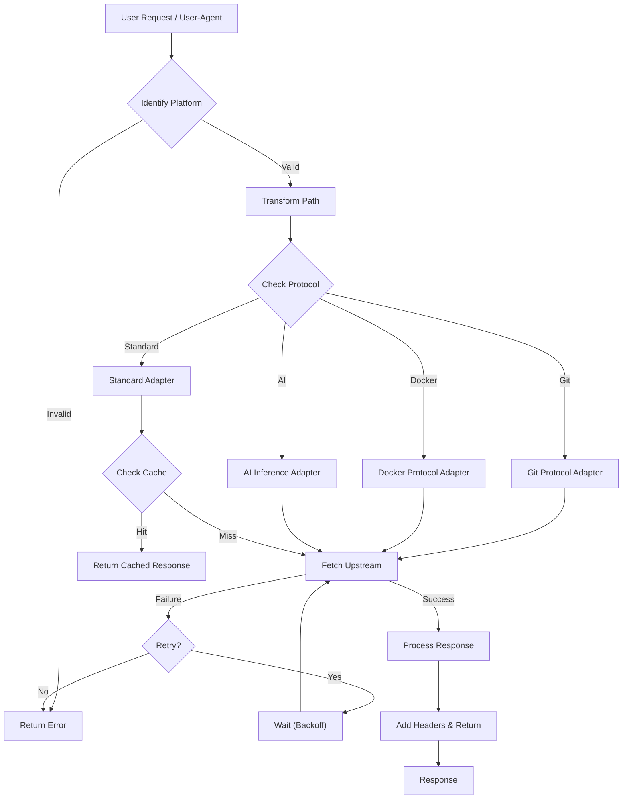
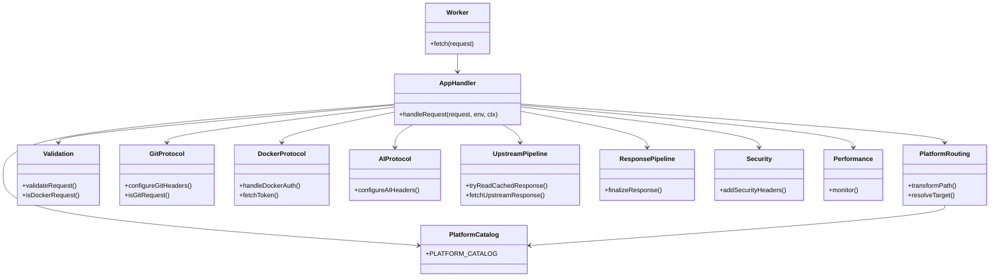

<!-- renoise-banner -->
<p align="center">
  <a href="https://renoise.ai/plugin?utm_medium=github&utm_source=xixu">
    
  </a>
</p>

<p align="center">
  <a href="https://renoise.ai/plugin?utm_medium=github&utm_source=xixu">Renoise MCP</a> · <a href="https://github.com/renoise-ai/renoise-plugins-official">Renoise Skills &amp; CLI</a><br><br>
  <strong>Accelerate models, datasets, and packages—then turn those resources into talking-head videos without touching a timeline.</strong>
</p>

<div align="center">

# Xget 🚀

<a href="https://trendshift.io/repositories/14768" target="_blank"></a>

[![Ask Zread](https://img.shields.io/badge/Ask_Zread-_.svg?style=flat&color=00b0aa&labelColor=000000&logo=data%3Aimage%2Fsvg%2Bxml%3Bbase64%2CPHN2ZyB3aWR0aD0iMTYiIGhlaWdodD0iMTYiIHZpZXdCb3g9IjAgMCAxNiAxNiIgZmlsbD0ibm9uZSIgeG1sbnM9Imh0dHA6Ly93d3cudzMub3JnLzIwMDAvc3ZnIj4KPHBhdGggZD0iTTQuOTYxNTYgMS42MDAxSDIuMjQxNTZDMS44ODgxIDEuNjAwMSAxLjYwMTU2IDEuODg2NjQgMS42MDE1NiAyLjI0MDFWNC45NjAxQzEuNjAxNTYgNS4zMTM1NiAxLjg4ODEgNS42MDAxIDIuMjQxNTYgNS42MDAxSDQuOTYxNTZDNS4zMTUwMiA1LjYwMDEgNS42MDE1NiA1LjMxMzU2IDUuNjAxNTYgNC45NjAxVjIuMjQwMUM1LjYwMTU2IDEuODg2NjQgNS4zMTUwMiAxLjYwMDEgNC45NjE1NiAxLjYwMDFaIiBmaWxsPSIjZmZmIi8%2BCjxwYXRoIGQ9Ik00Ljk2MTU2IDEwLjM5OTlIMi4yNDE1NkMxLjg4ODEgMTAuMzk5OSAxLjYwMTU2IDEwLjY4NjQgMS42MDE1NiAxMS4wMzk5VjEzLjc1OTlDMS42MDE1NiAxNC4xMTM0IDEuODg4MSAxNC4zOTk5IDIuMjQxNTYgMTQuMzk5OUg0Ljk2MTU2QzUuMzE1MDIgMTQuMzk5OSA1LjYwMTU2IDE0LjExMzQgNS42MDE1NiAxMy43NTk5VjExLjAzOTlDNS42MDE1NiAxMC42ODY0IDUuMzE1MDIgMTAuMzk5OSA0Ljk2MTU2IDEwLjM5OTlaIiBmaWxsPSIjZmZmIi8%2BCjxwYXRoIGQ9Ik0xMy43NTg0IDEuNjAwMUgxMS4wMzg0QzEwLjY4NSAxLjYwMDEgMTAuMzk4NCAxLjg4NjY0IDEwLjM5ODQgMi4yNDAxVjQuOTYwMUMxMC4zOTg0IDUuMzEzNTYgMTAuNjg1IDUuNjAwMSAxMS4wMzg0IDUuNjAwMUgxMy43NTg0QzE0LjExMTkgNS42MDAxIDE0LjM5ODQgNS4zMTM1NiAxNC4zOTg0IDQuOTYwMVYyLjI0MDFDMTQuMzk4NCAxLjg4NjY0IDE0LjExMTkgMS42MDAxIDEzLjc1ODQgMS42MDAxWiIgZmlsbD0iI2ZmZiIvPgo8cGF0aCBkPSJNNCAxMkwxMiA0TDQgMTJaIiBmaWxsPSIjZmZmIi8%2BCjxwYXRoIGQ9Ik00IDEyTDEyIDQiIHN0cm9rZT0iI2ZmZiIgc3Ryb2tlLXdpZHRoPSIxLjUiIHN0cm9rZS1saW5lY2FwPSJyb3VuZCIvPgo8L3N2Zz4K&logoColor=ffffff)](https://zread.ai/xixu-me/Xget)
[](https://deepwiki.com/xixu-me/xget)
[](https://codecov.io/github/xixu-me/xget)
[](#ecosystem-integration)
[](#ecosystem-integration)

[](#deploy-to-cloudflare-workers)
[](#deploy-to-edgeone-pages)
[](#deploy-to-vercel)
[](#deploy-to-netlify)
[](#deploy-to-deno-deploy)
[](#self-hosted-deployment)
[](#self-hosted-deployment)

**English** | [汉语（简体）](https://raw.githubusercontent.com/xixu-me/xget/main/README.zh-Hans.md) |
[漢語（繁體）](https://github.com/xixu-me/xget/blob/main/README.zh-Hant.md)

</div>

An ultra-high-performance, secure, all-in-one acceleration engine for developer resources. It provides unified, efficient acceleration for code hosting, model
and dataset hubs, package registries, container registries, AI inference
providers, and more, while handling caching, retries, security headers, and
protocol-specific compatibility behavior for you.


Technical deep dive:
**_[Deep Dive into Xget: A High-Performance, Multi-Protocol, and Secure Acceleration Engine for Developer Resources](https://blog.xi-xu.me/en/2025/10/07/Deep-Dive-into-Xget.html)_**.

Xget was invited onto [GitCode](https://gitcode.com/xixu-me/xget) and
recognized as a G-Star graduation project. As "a widely used public project",
it receives support from OpenAI's
[Codex for Open Source](https://developers.openai.com/community/codex-for-oss)
and has also been spontaneously recommended by several tech creators, including
[Ruan Yifeng](https://www.ruanyifeng.com/blog/2025/12/weekly-issue-379.html#:~:text=Xget),
[GitHubDaily](https://x.com/i/status/1956204203937829256),
[FishC](https://www.bilibili.com/video/BV1EeeBzVEop/), and
[Xuanli 199](https://www.bilibili.com/video/BV197hqzsE8Y/?t=8). Thanks to every
individual, team, and community that supports, shares, recommends, or actively
uses Xget.

## Supported Platforms

> [!NOTE]
> The badges below point to the relevant usage or deployment sections in this
> README.

[](#github)
[](#gitlab)
[](#gitea)
[](#codeberg)
[](#sourceforge)
[](#aosp-android-open-source-project)
[](#hugging-face-mirror)
[](#civitai-ai-model-platform)
[](#npm-package-acceleration)
[](#python-package-acceleration)
[](#conda-package-acceleration)
[](#maven-package-acceleration)
[](#apache-software-download-acceleration)
[](#gradle-package-acceleration)
[](#homebrew-package-acceleration)
[](#ruby-package-acceleration)
[](#r-package-acceleration)
[](#perl-package-acceleration)
[](#texlatex-package-acceleration)
[](#go-module-acceleration)
[](#nuget-package-acceleration)
[](#rust-package-acceleration)
[](#php-package-acceleration)
[](#flathub-repository-mirror)
[](#debianubuntu-apt-configuration)
[](#debianubuntu-apt-configuration)
[](#fedora-dnf-configuration)
[](#rocky-linux-dnf-configuration)
[](#opensuse-zypper-configuration)
[](#arch-linux-pacman-configuration)
[](#arxiv-paper-download)
[](#f-droid-repository-mirror)
[](#jenkins-plugin-download)
[](#container-registries)
[](#ai-inference-providers)

## Quick Start

**Pre-deployed Instance: `xget.xi-xu.me`** - For evaluation and trial only,
deploy your own instance for production or availability-sensitive workloads

> [!WARNING]
> If you self-host it, put it behind authentication, IP allowlists,
> or both unless you explicitly intend to run a public mirror.

**URL Converter:** [**`xuc.xi-xu.me`**](https://xuc.xi-xu.me) - Convert any
supported platform URL to Xget's acceleration format with one click

**Agent Skills: `npx skills add xixu-me/skills -s xget`**

## Why Xget

### Performance-Oriented Design

- **Global Edge Runtime**: Built on Cloudflare Workers and designed to run
  close to users and upstream services
- **Protocol-Aware Handling**: Supports HTTP/3, range requests, Git traffic,
  container registry flows, and AI inference APIs
- **Cache and Retry Pipeline**: Includes edge caching for compatible
  responses, retry logic for transient upstream failures, and request
  normalization for supported platforms
- **Connection Reuse**: Uses standard HTTP connection reuse and keep-alive
  behavior where the runtime and upstream allow it
- **Request Timing Visibility**: Can expose timing data through
  `X-Performance-Metrics` headers where protocol compatibility allows

### Deep Multi-Platform Integration

- **All-in-One Multi-Platform Support**: Unified support for mainstream
  platforms in various development scenarios
- **Intelligent Recognition and Conversion**: Automatically recognizes platform
  prefixes and converts to correct URL structures for target platforms
- **Consistent Acceleration Experience**: Enjoy unified and stable ultra-fast
  download experience regardless of file type or source

### Enterprise-Grade Security

- **Multi-Layer Security Headers**:
  - `Strict-Transport-Security`: Enforces HTTPS transmission, prevents
    man-in-the-middle attacks
  - `X-Frame-Options: DENY`: Prevents clickjacking attacks
  - `Content-Security-Policy`: Strict content security policy
  - `Referrer-Policy`: Controls referrer information leakage
  - `Permissions-Policy`: Restricts privacy-sensitive browser features by
    default
  - `X-XSS-Protection`: Legacy compatibility header for older browsers
- **Request Validation Mechanism**:
  - HTTP method whitelist: Regular requests limited to GET/HEAD, while Git/LFS,
    container registry, AI inference, and Hugging Face API traffic allow `POST`,
    `PUT`, `PATCH`, and `DELETE` as needed
  - Path length limit: Prevents excessively long URL attacks (max 2048
    characters)
  - Input sanitization: Prevents path traversal and injection attacks
- **Timeout Protection**: 30-second request timeout, prevents resource
  exhaustion and malicious requests

### Modern Architecture and Reliability

- **Intelligent Retry Mechanism**:
  - Maximum 3 retries with linear delay strategy (1000ms × retry count)
  - Automatic error recovery, improved download success rate
  - Timeout detection and interruption handling
- **Efficient Caching Strategy**:
  - Strategy-based cache durations keep mutable metadata fresh while caching
    immutable artifacts longer
  - Git operations skip caching to ensure real-time data
  - Edge caching based on Cloudflare Cache API and Cloudflare fetch cache
    controls
- **Performance Monitoring System**:
  - Built-in `PerformanceMonitor` class for real-time tracking of request stage
    durations
  - Detailed performance data provided via `X-Performance-Metrics` response
    header
  - Cache hit rate statistics and optimization recommendations

### Full Git Protocol Compatibility

- **Smart Protocol Detection**:
  - Automatically recognizes Git-specific endpoints (`/info/refs`,
    `/git-upload-pack`, `/git-receive-pack`)
  - Detects Git client User-Agent patterns
  - Supports query parameters like `service=git-upload-pack`
- **Complete Operation Support**:
  - `git clone`: Full repository cloning, supports shallow clones and branch
    specification
  - `git push`: Code push and branch management
  - `git pull/fetch`: Incremental updates and remote synchronization
  - `git submodule`: Recursive submodule cloning
- **Protocol Optimization**:
  - Preserves Git-specific request headers and authentication information
  - Smart User-Agent handling (default `git/2.34.1`)
  - Supports Git LFS large file transfer

### Ecosystem Integration

- **Dedicated Browser Extension**:
  [Xget Now](https://github.com/xixu-me/Xget-Now) provides seamless experience
  - Automatic URL redirection, no manual URL modification needed
  - Support for custom Xget instance domains
  - Multi-platform preference settings and blacklist/whitelist management
  - Local processing ensures privacy and security
- **Download Tool Compatibility**: Perfect support for wget, cURL, aria2, IDM,
  and other mainstream download tools
- **CI/CD Integration**: Can be used directly in GitHub Actions, GitLab CI, and
  other environments

## Architecture

### Request Processing Flow



### Component Architecture



## URL Conversion Rules

Using the pre-deployed instance **`xget.xi-xu.me`** or your own deployed
instance, simply replace the domain and add the platform prefix:

### Conversion Format

| Platform               | Platform Prefix | Original URL Format                                                  | Accelerated URL Format                                                            |
| ---------------------- | --------------- | -------------------------------------------------------------------- | --------------------------------------------------------------------------------- |
| GitHub                 | `gh`            | `https://github.com/...`                                             | `https://xget.xi-xu.me/gh/...`                                                    |
| GitHub Gist            | `gist`          | `https://gist.github.com/...`                                        | `https://xget.xi-xu.me/gist/...`                                                  |
| GitLab                 | `gl`            | `https://gitlab.com/...`                                             | `https://xget.xi-xu.me/gl/...`                                                    |
| Gitea                  | `gitea`         | `https://gitea.com/...`                                              | `https://xget.xi-xu.me/gitea/...`                                                 |
| Codeberg               | `codeberg`      | `https://codeberg.org/...`                                           | `https://xget.xi-xu.me/codeberg/...`                                              |
| SourceForge            | `sf`            | `https://sourceforge.net/...`                                        | `https://xget.xi-xu.me/sf/...`                                                    |
| AOSP                   | `aosp`          | `https://android.googlesource.com/...`                               | `https://xget.xi-xu.me/aosp/...`                                                  |
| Hugging Face           | `hf`            | `https://huggingface.co/...`                                         | `https://xget.xi-xu.me/hf/...`                                                    |
| Civitai                | `civitai`       | `https://civitai.com/...`                                            | `https://xget.xi-xu.me/civitai/...`                                               |
| npm                    | `npm`           | `https://registry.npmjs.org/...`                                     | `https://xget.xi-xu.me/npm/...`                                                   |
| PyPI                   | `pypi`          | `https://pypi.org/...`                                               | `https://xget.xi-xu.me/pypi/...`                                                  |
| conda                  | `conda`         | `https://repo.anaconda.com/...` and `https://conda.anaconda.org/...` | `https://xget.xi-xu.me/conda/...` and `https://xget.xi-xu.me/conda/community/...` |
| Maven                  | `maven`         | `https://repo1.maven.org/...`                                        | `https://xget.xi-xu.me/maven/...`                                                 |
| Apache                 | `apache`        | `https://downloads.apache.org/...`                                   | `https://xget.xi-xu.me/apache/...`                                                |
| Gradle                 | `gradle`        | `https://plugins.gradle.org/...`                                     | `https://xget.xi-xu.me/gradle/...`                                                |
| Homebrew               | `homebrew`      | `https://github.com/Homebrew/...`                                    | `https://xget.xi-xu.me/homebrew/...`                                              |
| RubyGems               | `rubygems`      | `https://rubygems.org/...`                                           | `https://xget.xi-xu.me/rubygems/...`                                              |
| CRAN                   | `cran`          | `https://cran.r-project.org/...`                                     | `https://xget.xi-xu.me/cran/...`                                                  |
| CPAN                   | `cpan`          | `https://www.cpan.org/...`                                           | `https://xget.xi-xu.me/cpan/...`                                                  |
| CTAN                   | `ctan`          | `https://tug.ctan.org/...`                                           | `https://xget.xi-xu.me/ctan/...`                                                  |
| Go Modules             | `golang`        | `https://proxy.golang.org/...`                                       | `https://xget.xi-xu.me/golang/...`                                                |
| NuGet                  | `nuget`         | `https://api.nuget.org/...`                                          | `https://xget.xi-xu.me/nuget/...`                                                 |
| Rust Crates            | `crates`        | `https://crates.io/...`                                              | `https://xget.xi-xu.me/crates/...`                                                |
| Packagist              | `packagist`     | `https://repo.packagist.org/...`                                     | `https://xget.xi-xu.me/packagist/...`                                             |
| Flathub                | `flathub`       | `https://dl.flathub.org/...`                                         | `https://xget.xi-xu.me/flathub/...`                                               |
| Debian                 | `debian`        | `https://deb.debian.org/...`                                         | `https://xget.xi-xu.me/debian/...`                                                |
| Ubuntu                 | `ubuntu`        | `https://archive.ubuntu.com/...`                                     | `https://xget.xi-xu.me/ubuntu/...`                                                |
| Fedora                 | `fedora`        | `https://mirrors.kernel.org/fedora/...`                              | `https://xget.xi-xu.me/fedora/...`                                                |
| Rocky Linux            | `rocky`         | `https://download.rockylinux.org/...`                                | `https://xget.xi-xu.me/rocky/...`                                                 |
| openSUSE               | `opensuse`      | `https://download.opensuse.org/...`                                  | `https://xget.xi-xu.me/opensuse/...`                                              |
| Arch Linux             | `arch`          | `https://geo.mirror.pkgbuild.com/...`                                | `https://xget.xi-xu.me/arch/...`                                                  |
| arXiv                  | `arxiv`         | `https://arxiv.org/...`                                              | `https://xget.xi-xu.me/arxiv/...`                                                 |
| F-Droid                | `fdroid`        | `https://f-droid.org/...`                                            | `https://xget.xi-xu.me/fdroid/...`                                                |
| Jenkins Plugins        | `jenkins`       | `https://updates.jenkins.io/...`                                     | `https://xget.xi-xu.me/jenkins/...`                                               |
| Container Registries   | `cr`            | See [Container Registries](#container-registries)                    | See [Container Registries](#container-registries)                                 |
| AI Inference Providers | `ip`            | See [AI Inference Providers](#ai-inference-providers)                | See [AI Inference Providers](#ai-inference-providers)                             |

### Platform Conversion Examples

#### GitHub

```url
# Original URL
https://github.com/microsoft/vscode/archive/refs/heads/main.zip

# Converted (add gh prefix)
https://xget.xi-xu.me/gh/microsoft/vscode/archive/refs/heads/main.zip
```

#### GitHub Gist

```url
# Original URL
https://gist.github.com/xixu-me/e2ea9db6b1f143892495f796fef18631/raw/3b8807172ee492d0da3a7e370b0fb88fc97b53e6/Free-ChatGPT-Paid-Plan.md

# Converted (add gist prefix)
https://xget.xi-xu.me/gist/xixu-me/e2ea9db6b1f143892495f796fef18631/raw/3b8807172ee492d0da3a7e370b0fb88fc97b53e6/Free-ChatGPT-Paid-Plan.md
```

#### GitLab

```url
# Original URL
https://gitlab.com/gitlab-org/gitlab/-/archive/master/gitlab-master.zip

# Converted (add gl prefix)
https://xget.xi-xu.me/gl/gitlab-org/gitlab/-/archive/master/gitlab-master.zip
```

#### Gitea

```url
# Original URL
https://gitea.com/gitea/gitea/archive/master.zip

# Converted (add gitea prefix)
https://xget.xi-xu.me/gitea/gitea/gitea/archive/master.zip
```

#### Codeberg

```url
# Original URL
https://codeberg.org/forgejo/forgejo/archive/forgejo.zip

# Converted (add codeberg prefix)
https://xget.xi-xu.me/codeberg/forgejo/forgejo/archive/forgejo.zip
```

#### SourceForge

```url
# Original URL
https://sourceforge.net/projects/sevenzip/files/7-Zip/23.01/7z2301-x64.exe/download

# Converted (add sf prefix)
https://xget.xi-xu.me/sf/projects/sevenzip/files/7-Zip/23.01/7z2301-x64.exe/download
```

#### AOSP (Android Open Source Project)

```url
# AOSP project original URL
https://android.googlesource.com/platform/frameworks/base

# Converted (add aosp prefix)
https://xget.xi-xu.me/aosp/platform/frameworks/base

# AOSP device tree original URL
https://android.googlesource.com/device/google/pixel

# Converted (add aosp prefix)
https://xget.xi-xu.me/aosp/device/google/pixel
```

#### Hugging Face

```url
# Model file original URL
https://huggingface.co/microsoft/DialoGPT-medium/resolve/main/pytorch_model.bin

# Converted (add hf prefix)
https://xget.xi-xu.me/hf/microsoft/DialoGPT-medium/resolve/main/pytorch_model.bin

# Dataset file original URL
https://huggingface.co/datasets/rajpurkar/squad/resolve/main/plain_text/train-00000-of-00001.parquet

# Converted (add hf prefix)
https://xget.xi-xu.me/hf/datasets/rajpurkar/squad/resolve/main/plain_text/train-00000-of-00001.parquet
```

#### Civitai

```url
# AI model download original URL
https://civitai.com/api/download/models/128713

# Converted (add civitai prefix)
https://xget.xi-xu.me/civitai/api/download/models/128713

# Model API original URL
https://civitai.com/api/v1/models/7240

# Converted (add civitai prefix)
https://xget.xi-xu.me/civitai/api/v1/models/7240

# Model version API original URL
https://civitai.com/api/v1/model-versions/128713

# Converted (add civitai prefix)
https://xget.xi-xu.me/civitai/api/v1/model-versions/128713
```

#### npm

```url
# Package file original URL
https://registry.npmjs.org/react/-/react-18.2.0.tgz

# Converted (add npm prefix)
https://xget.xi-xu.me/npm/react/-/react-18.2.0.tgz

# Package metadata original URL
https://registry.npmjs.org/lodash

# Converted (add npm prefix)
https://xget.xi-xu.me/npm/lodash
```

#### PyPI

```url
# Python package file original URL
https://pypi.org/packages/source/r/requests/requests-2.31.0.tar.gz

# Converted (add pypi prefix)
https://xget.xi-xu.me/pypi/packages/source/r/requests/requests-2.31.0.tar.gz

# Wheel file original URL
https://pypi.org/packages/py3/r/requests/requests-2.31.0-py3-none-any.whl

# Converted (add pypi prefix)
https://xget.xi-xu.me/pypi/packages/py3/r/requests/requests-2.31.0-py3-none-any.whl
```

#### conda

```url
# Default channel package file original URL
https://repo.anaconda.com/pkgs/main/linux-64/numpy-1.24.3-py311h08b1b3b_1.conda

# Converted (add conda prefix)
https://xget.xi-xu.me/conda/pkgs/main/linux-64/numpy-1.24.3-py311h08b1b3b_1.conda

# Community channel metadata original URL
https://conda.anaconda.org/conda-forge/linux-64/repodata.json

# Converted (add conda/community prefix)
https://xget.xi-xu.me/conda/community/conda-forge/linux-64/repodata.json
```

#### Maven

```url
# Maven Central Repository JAR file original URL
https://repo1.maven.org/maven2/org/springframework/spring-core/5.3.21/spring-core-5.3.21.jar

# Converted (add maven prefix)
https://xget.xi-xu.me/maven/maven2/org/springframework/spring-core/5.3.21/spring-core-5.3.21.jar

# Maven metadata original URL
https://repo1.maven.org/maven2/org/apache/commons/commons-lang3/maven-metadata.xml

# Converted (add maven prefix)
https://xget.xi-xu.me/maven/maven2/org/apache/commons/commons-lang3/maven-metadata.xml
```

#### Apache Software Download

```url
# Apache software download original URL
https://downloads.apache.org/kafka/3.6.1/kafka_2.13-3.6.1.tgz

# Converted (add apache prefix)
https://xget.xi-xu.me/apache/kafka/3.6.1/kafka_2.13-3.6.1.tgz

# Apache Maven download original URL
https://downloads.apache.org/maven/maven-3/3.9.5/binaries/apache-maven-3.9.5-bin.tar.gz

# Converted (add apache prefix)
https://xget.xi-xu.me/apache/maven/maven-3/3.9.5/binaries/apache-maven-3.9.5-bin.tar.gz

# Apache Spark download original URL
https://downloads.apache.org/spark/spark-3.5.0/spark-3.5.0-bin-hadoop3.tgz

# Converted (add apache prefix)
https://xget.xi-xu.me/apache/spark/spark-3.5.0/spark-3.5.0-bin-hadoop3.tgz
```

#### Gradle

```url
# Gradle plugin portal JAR file original URL
https://plugins.gradle.org/m2/org/gradle/gradle-hello-world-plugin/0.2/gradle-hello-world-plugin-0.2.jar

# Converted (add gradle prefix)
https://xget.xi-xu.me/gradle/m2/org/gradle/gradle-hello-world-plugin/0.2/gradle-hello-world-plugin-0.2.jar

# Gradle plugin metadata original URL
https://plugins.gradle.org/m2/com/github/ben-manes/gradle-versions-plugin/0.51.0/gradle-versions-plugin-0.51.0.module

# Converted (add gradle prefix)
https://xget.xi-xu.me/gradle/m2/com/github/ben-manes/gradle-versions-plugin/0.51.0/gradle-versions-plugin-0.51.0.module
```

#### Homebrew

```url
# Homebrew formula repository original URL
https://github.com/Homebrew/homebrew-core/raw/HEAD/Formula/g/git.rb

# Converted (add homebrew prefix)
https://xget.xi-xu.me/homebrew/homebrew-core/raw/HEAD/Formula/g/git.rb

# Homebrew API original URL
https://formulae.brew.sh/api/formula/git.json

# Converted (add homebrew/api prefix)
https://xget.xi-xu.me/homebrew/api/formula/git.json

# Homebrew Bottles original URL
https://ghcr.io/v2/homebrew/core/git/manifests/2.39.0

# Converted (add homebrew/bottles prefix)
https://xget.xi-xu.me/homebrew/bottles/v2/homebrew/core/git/manifests/2.39.0
```

#### RubyGems

```url
# RubyGems package file original URL
https://rubygems.org/gems/rails-7.0.4.gem

# Converted (add rubygems prefix)
https://xget.xi-xu.me/rubygems/gems/rails-7.0.4.gem

# RubyGems API original URL
https://rubygems.org/api/v1/gems/nokogiri.json

# Converted (add rubygems prefix)
https://xget.xi-xu.me/rubygems/api/v1/gems/nokogiri.json
```

#### CRAN

```url
# CRAN package file original URL
https://cran.r-project.org/src/contrib/ggplot2_3.5.2.tar.gz

# Converted (add cran prefix)
https://xget.xi-xu.me/cran/src/contrib/ggplot2_3.5.2.tar.gz

# CRAN package metadata original URL
https://cran.r-project.org/web/packages/dplyr/DESCRIPTION

# Converted (add cran prefix)
https://xget.xi-xu.me/cran/web/packages/dplyr/DESCRIPTION
```

#### CPAN (Perl Package Management)

```url
# CPAN module original URL
https://www.cpan.org/modules/by-module/DBI/DBI-1.643.tar.gz

# Converted (add cpan prefix)
https://xget.xi-xu.me/cpan/modules/by-module/DBI/DBI-1.643.tar.gz

# CPAN author package original URL
https://www.cpan.org/authors/id/T/TI/TIMB/DBI-1.643.tar.gz

# Converted (add cpan prefix)
https://xget.xi-xu.me/cpan/authors/id/T/TI/TIMB/DBI-1.643.tar.gz
```

#### CTAN (TeX/LaTeX Package Management)

```url
# CTAN package file original URL
https://tug.ctan.org/tex-archive/macros/latex/contrib/beamer.zip

# Converted (add ctan prefix)
https://xget.xi-xu.me/ctan/tex-archive/macros/latex/contrib/beamer.zip

# CTAN font file original URL
https://tug.ctan.org/tex-archive/fonts/cm/pk/ljfour/public/cm/dpi600/cmr10.pk

# Converted (add ctan prefix)
https://xget.xi-xu.me/ctan/tex-archive/fonts/cm/pk/ljfour/public/cm/dpi600/cmr10.pk
```

#### Go Modules

```url
# Go module proxy original URL
https://proxy.golang.org/github.com/gin-gonic/gin/@v/v1.9.1.zip

# Converted (add golang prefix)
https://xget.xi-xu.me/golang/github.com/gin-gonic/gin/@v/v1.9.1.zip

# Go module info original URL
https://proxy.golang.org/github.com/gorilla/mux/@v/list

# Converted (add golang prefix)
https://xget.xi-xu.me/golang/github.com/gorilla/mux/@v/list
```

#### NuGet

```url
# NuGet package download original URL
https://api.nuget.org/v3-flatcontainer/newtonsoft.json/13.0.3/newtonsoft.json.13.0.3.nupkg

# Converted (add nuget prefix)
https://xget.xi-xu.me/nuget/v3-flatcontainer/newtonsoft.json/13.0.3/newtonsoft.json.13.0.3.nupkg

# NuGet package metadata original URL
https://api.nuget.org/v3/registration5-semver1/microsoft.aspnetcore.app/index.json

# Converted (add nuget prefix)
https://xget.xi-xu.me/nuget/v3/registration5-semver1/microsoft.aspnetcore.app/index.json
```

#### Rust Crates

```url
# Crate download original URL
https://crates.io/api/v1/crates/serde/1.0.0/download

# Converted (add crates prefix)
https://xget.xi-xu.me/crates/serde/1.0.0/download

# Crate metadata original URL
https://crates.io/api/v1/crates/serde

# Converted (add crates prefix)
https://xget.xi-xu.me/crates/serde

# Crate search original URL
https://crates.io/api/v1/crates?q=serde

# Converted (add crates prefix)
https://xget.xi-xu.me/crates/?q=serde
```

#### Packagist

```url
# Packagist package metadata original URL
https://repo.packagist.org/p2/symfony/console.json

# Converted (add packagist prefix)
https://xget.xi-xu.me/packagist/p2/symfony/console.json

# Packagist package list original URL
https://repo.packagist.org/packages/list.json

# Converted (add packagist prefix)
https://xget.xi-xu.me/packagist/packages/list.json
```

#### Flathub

```url
# Flathub repository original URL
https://dl.flathub.org/repo/summary

# Converted (add flathub prefix)
https://xget.xi-xu.me/flathub/repo/summary

# Flathub app reference original URL
https://dl.flathub.org/repo/appstream/org.gnome.gedit.flatpakref

# Converted (add flathub prefix)
https://xget.xi-xu.me/flathub/repo/appstream/org.gnome.gedit.flatpakref
```

#### Linux Distributions

```url
# Debian package original URL
https://deb.debian.org/debian/pool/main/c/curl/curl_7.88.1-10+deb12u4_amd64.deb

# Converted (add debian prefix)
https://xget.xi-xu.me/debian/debian/pool/main/c/curl/curl_7.88.1-10+deb12u4_amd64.deb

# Ubuntu package original URL
https://archive.ubuntu.com/ubuntu/pool/main/g/git/git_2.34.1-1ubuntu1.9_amd64.deb

# Converted (add ubuntu prefix)
https://xget.xi-xu.me/ubuntu/ubuntu/pool/main/g/git/git_2.34.1-1ubuntu1.9_amd64.deb

# Fedora package original URL
https://mirrors.kernel.org/fedora/releases/39/Everything/x86_64/os/Packages/n/nginx-1.24.0-1.fc39.x86_64.rpm

# Converted (add fedora prefix)
https://xget.xi-xu.me/fedora/releases/39/Everything/x86_64/os/Packages/n/nginx-1.24.0-1.fc39.x86_64.rpm

# Rocky Linux package original URL
https://download.rockylinux.org/pub/rocky/9/BaseOS/x86_64/os/Packages/b/bash-5.1.8-6.el9.x86_64.rpm

# Converted (add rocky prefix)
https://xget.xi-xu.me/rocky/pub/rocky/9/BaseOS/x86_64/os/Packages/b/bash-5.1.8-6.el9.x86_64.rpm

# openSUSE package original URL
https://download.opensuse.org/distribution/leap/15.5/repo/oss/x86_64/vim-9.0.1572-150500.20.8.1.x86_64.rpm

# Converted (add opensuse prefix)
https://xget.xi-xu.me/opensuse/distribution/leap/15.5/repo/oss/x86_64/vim-9.0.1572-150500.20.8.1.x86_64.rpm

# Arch Linux package original URL
https://geo.mirror.pkgbuild.com/core/os/x86_64/linux-6.6.10.arch1-1-x86_64.pkg.tar.zst

# Converted (add arch prefix)
https://xget.xi-xu.me/arch/core/os/x86_64/linux-6.6.10.arch1-1-x86_64.pkg.tar.zst
```

#### arXiv

```url
# arXiv paper PDF original URL
https://arxiv.org/pdf/2301.07041.pdf

# Converted (add arxiv prefix)
https://xget.xi-xu.me/arxiv/pdf/2301.07041.pdf

# arXiv paper source original URL
https://arxiv.org/e-print/2301.07041

# Converted (add arxiv prefix)
https://xget.xi-xu.me/arxiv/e-print/2301.07041
```

#### F-Droid

```url
# F-Droid app APK original URL
https://f-droid.org/repo/org.fdroid.fdroid_1016050.apk

# Converted (add fdroid prefix)
https://xget.xi-xu.me/fdroid/repo/org.fdroid.fdroid_1016050.apk

# F-Droid app metadata original URL
https://f-droid.org/api/v1/packages/org.fdroid.fdroid

# Converted (add fdroid prefix)
https://xget.xi-xu.me/fdroid/api/v1/packages/org.fdroid.fdroid
```

#### Jenkins Plugins

```url
# Jenkins update center original URL
https://updates.jenkins.io/update-center.json

# Converted (add jenkins prefix)
https://xget.xi-xu.me/jenkins/update-center.json

# Jenkins plugin download original URL
https://updates.jenkins.io/download/plugins/maven-plugin/3.27/maven-plugin.hpi

# Converted (add jenkins prefix)
https://xget.xi-xu.me/jenkins/download/plugins/maven-plugin/3.27/maven-plugin.hpi
```

#### Container Registries

Xget supports multiple container registries, using the `cr/[Registry Prefix]`
format:

| Container Registry           | Registry Prefix | Original URL Format                         | Accelerated URL Format                      |
| ---------------------------- | --------------- | ------------------------------------------- | ------------------------------------------- |
| Docker Hub                   | `docker`        | `https://registry-1.docker.io/...`          | `https://xget.xi-xu.me/cr/docker/...`       |
| Quay.io                      | `quay`          | `https://quay.io/...`                       | `https://xget.xi-xu.me/cr/quay/...`         |
| Google Container Registry    | `gcr`           | `https://gcr.io/...`                        | `https://xget.xi-xu.me/cr/gcr/...`          |
| Microsoft Container Registry | `mcr`           | `https://mcr.microsoft.com/...`             | `https://xget.xi-xu.me/cr/mcr/...`          |
| Amazon Public ECR            | `ecr`           | `https://public.ecr.aws/...`                | `https://xget.xi-xu.me/cr/ecr/...`          |
| GitHub Container Registry    | `ghcr`          | `https://ghcr.io/...`                       | `https://xget.xi-xu.me/cr/ghcr/...`         |
| GitLab Container Registry    | `gitlab`        | `https://registry.gitlab.com/...`           | `https://xget.xi-xu.me/cr/gitlab/...`       |
| Red Hat Registry             | `redhat`        | `https://registry.redhat.io/...`            | `https://xget.xi-xu.me/cr/redhat/...`       |
| Oracle Container Registry    | `oracle`        | `https://container-registry.oracle.com/...` | `https://xget.xi-xu.me/cr/oracle/...`       |
| Cloudsmith                   | `cloudsmith`    | `https://docker.cloudsmith.io/...`          | `https://xget.xi-xu.me/cr/cloudsmith/...`   |
| DigitalOcean Registry        | `digitalocean`  | `https://registry.digitalocean.com/...`     | `https://xget.xi-xu.me/cr/digitalocean/...` |
| VMware Registry              | `vmware`        | `https://projects.registry.vmware.com/...`  | `https://xget.xi-xu.me/cr/vmware/...`       |
| Kubernetes Registry          | `k8s`           | `https://registry.k8s.io/...`               | `https://xget.xi-xu.me/cr/k8s/...`          |
| Heroku Registry              | `heroku`        | `https://registry.heroku.com/...`           | `https://xget.xi-xu.me/cr/heroku/...`       |
| SUSE Registry                | `suse`          | `https://registry.suse.com/...`             | `https://xget.xi-xu.me/cr/suse/...`         |
| openSUSE Registry            | `opensuse`      | `https://registry.opensuse.org/...`         | `https://xget.xi-xu.me/cr/opensuse/...`     |
| Gitpod Registry              | `gitpod`        | `https://registry.gitpod.io/...`            | `https://xget.xi-xu.me/cr/gitpod/...`       |

```url
# Docker Hub original URL (official images)
https://registry-1.docker.io/v2/library/nginx/manifests/latest

# Converted (add cr/docker prefix)
https://xget.xi-xu.me/cr/docker/v2/nginx/manifests/latest

# Docker Hub original URL (user images)
https://registry-1.docker.io/v2/nginxinc/nginx-unprivileged/manifests/latest

# Converted (add cr/docker prefix)
https://xget.xi-xu.me/cr/docker/v2/nginxinc/nginx-unprivileged/manifests/latest

# GitHub Container Registry original URL
https://ghcr.io/v2/nginxinc/nginx-unprivileged/manifests/latest

# Converted (add cr/ghcr prefix)
https://xget.xi-xu.me/cr/ghcr/v2/nginxinc/nginx-unprivileged/manifests/latest

# Google Container Registry original URL
https://gcr.io/v2/distroless/base/manifests/latest

# Converted (add cr/gcr prefix)
https://xget.xi-xu.me/cr/gcr/v2/distroless/base/manifests/latest
```

For use cases, see
[Container Image Acceleration](#container-image-acceleration).

#### AI Inference Providers

Xget supports API acceleration for many mainstream AI inference providers, using
the `ip/[AI Provider Prefix]` format:

| AI Inference Provider | Provider Prefix | Original URL Format                             | Accelerated URL Format                       |
| --------------------- | --------------- | ----------------------------------------------- | -------------------------------------------- |
| OpenAI                | `openai`        | `https://api.openai.com/...`                    | `https://xget.xi-xu.me/ip/openai/...`        |
| Anthropic             | `anthropic`     | `https://api.anthropic.com/...`                 | `https://xget.xi-xu.me/ip/anthropic/...`     |
| Gemini                | `gemini`        | `https://generativelanguage.googleapis.com/...` | `https://xget.xi-xu.me/ip/gemini/...`        |
| Vertex AI             | `vertexai`      | `https://aiplatform.googleapis.com/...`         | `https://xget.xi-xu.me/ip/vertexai/...`      |
| Cohere                | `cohere`        | `https://api.cohere.ai/...`                     | `https://xget.xi-xu.me/ip/cohere/...`        |
| Mistral AI            | `mistralai`     | `https://api.mistral.ai/...`                    | `https://xget.xi-xu.me/ip/mistralai/...`     |
| xAI                   | `xai`           | `https://api.x.ai/...`                          | `https://xget.xi-xu.me/ip/xai/...`           |
| GitHub Models         | `githubmodels`  | `https://models.github.ai/...`                  | `https://xget.xi-xu.me/ip/githubmodels/...`  |
| NVIDIA API            | `nvidiaapi`     | `https://integrate.api.nvidia.com/...`          | `https://xget.xi-xu.me/ip/nvidiaapi/...`     |
| Perplexity            | `perplexity`    | `https://api.perplexity.ai/...`                 | `https://xget.xi-xu.me/ip/perplexity/...`    |
| Groq                  | `groq`          | `https://api.groq.com/...`                      | `https://xget.xi-xu.me/ip/groq/...`          |
| Cerebras              | `cerebras`      | `https://api.cerebras.ai/...`                   | `https://xget.xi-xu.me/ip/cerebras/...`      |
| SambaNova             | `sambanova`     | `https://api.sambanova.ai/...`                  | `https://xget.xi-xu.me/ip/sambanova/...`     |
| Siray                 | `siray`         | `https://api.siray.ai/...`                      | `https://xget.xi-xu.me/ip/siray/...`         |
| HF Inference          | `huggingface`   | `https://router.huggingface.co/...`             | `https://xget.xi-xu.me/ip/huggingface/...`   |
| Together              | `together`      | `https://api.together.xyz/...`                  | `https://xget.xi-xu.me/ip/together/...`      |
| Replicate             | `replicate`     | `https://api.replicate.com/...`                 | `https://xget.xi-xu.me/ip/replicate/...`     |
| Fireworks             | `fireworks`     | `https://api.fireworks.ai/...`                  | `https://xget.xi-xu.me/ip/fireworks/...`     |
| Nebius                | `nebius`        | `https://api.studio.nebius.ai/...`              | `https://xget.xi-xu.me/ip/nebius/...`        |
| Jina                  | `jina`          | `https://api.jina.ai/...`                       | `https://xget.xi-xu.me/ip/jina/...`          |
| Voyage AI             | `voyageai`      | `https://api.voyageai.com/...`                  | `https://xget.xi-xu.me/ip/voyageai/...`      |
| Fal AI                | `falai`         | `https://fal.run/...`                           | `https://xget.xi-xu.me/ip/falai/...`         |
| Novita                | `novita`        | `https://api.novita.ai/...`                     | `https://xget.xi-xu.me/ip/novita/...`        |
| Burncloud             | `burncloud`     | `https://ai.burncloud.com/...`                  | `https://xget.xi-xu.me/ip/burncloud/...`     |
| OpenRouter            | `openrouter`    | `https://openrouter.ai/...`                     | `https://xget.xi-xu.me/ip/openrouter/...`    |
| Poe                   | `poe`           | `https://api.poe.com/...`                       | `https://xget.xi-xu.me/ip/poe/...`           |
| Featherless AI        | `featherlessai` | `https://api.featherless.ai/...`                | `https://xget.xi-xu.me/ip/featherlessai/...` |
| Hyperbolic            | `hyperbolic`    | `https://api.hyperbolic.xyz/...`                | `https://xget.xi-xu.me/ip/hyperbolic/...`    |

```url
# OpenAI API original URL
https://api.openai.com/v1/chat/completions

# Converted (add ip/openai prefix)
https://xget.xi-xu.me/ip/openai/v1/chat/completions

# Claude API original URL
https://api.anthropic.com/v1/messages

# Converted (add ip/anthropic prefix)
https://xget.xi-xu.me/ip/anthropic/v1/messages

# Gemini API original URL
https://generativelanguage.googleapis.com/v1beta/models/gemini-2.5-flash:generateContent

# Converted (add ip/gemini prefix)
https://xget.xi-xu.me/ip/gemini/v1beta/models/gemini-2.5-flash:generateContent

# HF Inference API original URL
https://router.huggingface.co/hf-inference/models/openai/whisper-large-v3

# Converted (add ip/huggingface prefix)
https://xget.xi-xu.me/ip/huggingface/hf-inference/models/openai/whisper-large-v3
```

For use cases, see
[AI Inference API Acceleration](#ai-inference-api-acceleration).

## Use Cases

### Git Operations and Configuration

#### Git Operations

```bash
# Clone repository
git clone https://xget.xi-xu.me/gh/microsoft/vscode.git

# Clone specific branch
git clone -b main https://xget.xi-xu.me/gh/facebook/react.git

# Shallow clone (latest commit only)
git clone --depth 1 https://xget.xi-xu.me/gh/torvalds/linux.git

# Clone GitLab repository
git clone https://xget.xi-xu.me/gl/gitlab-org/gitlab.git

# Clone Gitea repository
git clone https://xget.xi-xu.me/gitea/gitea/gitea.git

# Clone Codeberg repository
git clone https://xget.xi-xu.me/codeberg/forgejo/forgejo.git

# Clone SourceForge repository
git clone https://xget.xi-xu.me/sf/projects/mingw-w64/code.git

# Clone AOSP repository
git clone https://xget.xi-xu.me/aosp/platform/frameworks/base.git

# Add remote repository
git remote add upstream https://xget.xi-xu.me/gh/[owner]/[repository].git

# Pull updates
git pull https://xget.xi-xu.me/gh/microsoft/vscode.git main

# Recursive submodule clone
git clone --recursive https://xget.xi-xu.me/gh/[username]/[repository-with-submodules].git
```

#### Git Global Acceleration Configuration

```bash
# Configure Git to use Xget for specific domains
git config --global url."https://xget.xi-xu.me/gh/".insteadOf "https://github.com/"
git config --global url."https://xget.xi-xu.me/gl/".insteadOf "https://gitlab.com/"
git config --global url."https://xget.xi-xu.me/gitea/".insteadOf "https://gitea.com/"
git config --global url."https://xget.xi-xu.me/codeberg/".insteadOf "https://codeberg.org/"
git config --global url."https://xget.xi-xu.me/sf/".insteadOf "https://sourceforge.net/"
git config --global url."https://xget.xi-xu.me/aosp/".insteadOf "https://android.googlesource.com/"

# Verify configuration
git config --global --get-regexp url

# Now all git clone operations for relevant platforms will automatically use Xget
git clone https://github.com/microsoft/vscode.git  # Automatically converted to Xget URL
git clone https://gitlab.com/gitlab-org/gitlab.git  # Automatically converted to Xget URL
git clone https://codeberg.org/forgejo/forgejo.git  # Automatically converted to Xget URL
git clone https://android.googlesource.com/platform/frameworks/base.git  # Automatically converted to Xget URL
```

### Mainstream Download Tool Integration

#### wget Download

```bash
# Download single file
wget https://xget.xi-xu.me/gh/microsoft/vscode/archive/refs/heads/main.zip

# Resume download
wget -c https://xget.xi-xu.me/hf/microsoft/DialoGPT-large/resolve/main/pytorch_model.bin

# Batch download
wget -i urls.txt  # urls.txt contains multiple Xget URLs
```

#### cURL Download

```bash
# Basic download
curl -L -O https://xget.xi-xu.me/gh/golang/go/archive/refs/tags/go1.22.0.tar.gz

# Show progress bar
curl -L --progress-bar -o model.bin https://xget.xi-xu.me/hf/openai/whisper-large-v3/resolve/main/pytorch_model.bin

# Set user agent
curl -L -H "User-Agent: MyApp/1.0" https://xget.xi-xu.me/gl/gitlab-org/gitlab-runner/-/archive/main/gitlab-runner-main.zip
```

#### aria2 Multi-threaded Download

```bash
# Multi-threaded download of large files
aria2c -x 16 -s 16 https://xget.xi-xu.me/hf/microsoft/DialoGPT-large/resolve/main/pytorch_model.bin

# Resume download
aria2c -c https://xget.xi-xu.me/gh/microsoft/vscode/archive/refs/heads/main.zip

# Batch download configuration file
aria2c -i download-list.txt  # File containing multiple Xget URLs
```

### Hugging Face Mirror

```python
import os
from transformers import AutoTokenizer, AutoModelForCausalLM

# Set environment variable to make transformers library automatically use Xget mirror
os.environ['HF_ENDPOINT'] = 'https://xget.xi-xu.me/hf'

# Define model name
model_name = 'microsoft/DialoGPT-medium'

print(f"Downloading model from mirror: {model_name}")

# Use AutoModelForCausalLM to load dialogue generation model
# Since we set the environment variable above, no additional parameters are needed here
tokenizer = AutoTokenizer.from_pretrained(model_name)
model = AutoModelForCausalLM.from_pretrained(model_name)

print("Model and tokenizer loaded successfully!")

# You can now use the tokenizer and model
# For example:
# new_user_input_ids = tokenizer.encode("Hello, how are you?", return_tensors='pt')
# chat_history_ids = model.generate(new_user_input_ids, max_length=1000, pad_token_id=tokenizer.eos_token_id)
# print(tokenizer.decode(chat_history_ids[:, new_user_input_ids.shape[-1]:][0], skip_special_tokens=True))
```

### Civitai AI Model Platform

```python
import requests

# Set API base URL to use Xget
base_url = "https://xget.xi-xu.me/civitai"

# Get model information
def get_model_info(model_id):
    """Get Civitai model information"""
    url = f"{base_url}/api/v1/models/{model_id}"
    response = requests.get(url)
    return response.json()

# Download model
def download_model(model_version_id, output_path):
    """Download Civitai model file"""
    download_url = f"{base_url}/api/download/models/{model_version_id}"

    print(f"Downloading model version {model_version_id}...")

    response = requests.get(download_url, stream=True)
    response.raise_for_status()

    with open(output_path, 'wb') as f:
        for chunk in response.iter_content(chunk_size=8192):
            f.write(chunk)

    print(f"Model downloaded to: {output_path}")

# Usage example
model_id = 7240  # Example model ID
model_info = get_model_info(model_id)
print(f"Model name: {model_info['name']}")

# Download first model version
if model_info['modelVersions']:
    version_id = model_info['modelVersions'][0]['id']
    download_model(version_id, f"model_{version_id}.safetensors")
```

### npm Package Acceleration

#### Configure npm to Use Xget Mirror

```bash
# Temporarily use Xget mirror
npm install --registry https://xget.xi-xu.me/npm/

# Globally configure npm mirror
npm config set registry https://xget.xi-xu.me/npm/

# Verify configuration
npm config get registry
```

#### Configure Bun to Use Xget Mirror

```toml
# bunfig.toml (project-level) or ~/.bunfig.toml (global)
[install]
registry = "https://xget.xi-xu.me/npm/"
```

```bash
# Install dependencies with Bun
bun install

# Bun also supports .npmrc, so you can reuse existing npm registry settings
echo "registry=https://xget.xi-xu.me/npm/" > .npmrc
bun install
```

#### Use in Project (npm / Bun)

```bash
# Configure project-level mirror in .npmrc (.npmrc can be reused by npm / Bun)
echo "registry=https://xget.xi-xu.me/npm/" > .npmrc

# Install dependencies with npm
npm install

# Install dependencies with Bun
bun install
```

### Python Package Acceleration

#### Configure pip to Use Xget Mirror

```bash
# Temporarily use Xget mirror
pip install requests -i https://xget.xi-xu.me/pypi/simple/

# Globally configure pip mirror
pip config set global.index-url https://xget.xi-xu.me/pypi/simple/
pip config set global.trusted-host xget.xi-xu.me

# Verify configuration
pip config list
```

#### Use in Project

```bash
# Create pip.conf file (Linux/macOS)
mkdir -p ~/.pip
cat > ~/.pip/pip.conf << EOF
[global]
index-url = https://xget.xi-xu.me/pypi/simple/
trusted-host = xget.xi-xu.me
EOF

# Or create pip.conf in project root directory
cat > pip.conf << EOF
[global]
index-url = https://xget.xi-xu.me/pypi/simple/
trusted-host = xget.xi-xu.me
EOF

# Install using configuration file
pip install -r requirements.txt --config-file pip.conf
```

#### Specify Mirror in requirements.txt

```txt
# requirements.txt
--index-url https://xget.xi-xu.me/pypi/simple/
--trusted-host xget.xi-xu.me

requests>=2.25.0
numpy>=1.21.0
pandas>=1.3.0
matplotlib>=3.4.0
```

### conda Package Acceleration

#### Configure conda to Use Xget Mirror

```bash
# Configure default channel mirrors
conda config --add default_channels https://xget.xi-xu.me/conda/pkgs/msys2
conda config --add default_channels https://xget.xi-xu.me/conda/pkgs/r
conda config --add default_channels https://xget.xi-xu.me/conda/pkgs/main

# Configure all community channel mirrors (recommended)
conda config --set channel_alias https://xget.xi-xu.me/conda/community

# Or configure specific community channels
conda config --add channels https://xget.xi-xu.me/conda/community/conda-forge
conda config --add channels https://xget.xi-xu.me/conda/community/bioconda

# Set channel priority
conda config --set channel_priority strict

# Verify configuration
conda config --show
```

#### Configure in .condarc

The .condarc file can be placed in the user home directory (`~/.condarc`) or
project root directory:

```yaml
default_channels:
  - https://xget.xi-xu.me/conda/pkgs/main
  - https://xget.xi-xu.me/conda/pkgs/r
  - https://xget.xi-xu.me/conda/pkgs/msys2
channel_alias: https://xget.xi-xu.me/conda/community
channel_priority: strict
show_channel_urls: true
```

#### Use Environment File

The environment file can directly specify complete mirror URLs:

```yaml
# environment.yml
name: myproject
channels:
  - https://xget.xi-xu.me/conda/pkgs/main
  - https://xget.xi-xu.me/conda/pkgs/r
  - https://xget.xi-xu.me/conda/community/bioconda
  - https://xget.xi-xu.me/conda/community/conda-forge
dependencies:
  - python=3.11
  - numpy>=1.24.0
  - pandas>=2.0.0
  - matplotlib>=3.7.0
  - scipy>=1.10.0
  - pip
  - pip:
      - requests>=2.28.0
```

```bash
# Create environment using environment file
conda env create -f environment.yml

# Update environment
conda env update -f environment.yml
```

### Maven Package Acceleration

#### Configure Maven to Use Xget Mirror

```xml
<!-- Configure Maven mirror in ~/.m2/settings.xml -->
<settings>
  <mirrors>
    <mirror>
      <id>xget-maven-central</id>
      <mirrorOf>central</mirrorOf>
      <name>Xget Maven Central Mirror</name>
      <url>https://xget.xi-xu.me/maven/maven2</url>
    </mirror>
  </mirrors>
</settings>
```

#### Use in Project

```xml
<!-- Configure project-level mirror in pom.xml -->
<project>
  <repositories>
    <repository>
      <id>xget-maven-central</id>
      <name>Xget Maven Central</name>
      <url>https://xget.xi-xu.me/maven/maven2</url>
    </repository>
  </repositories>

  <pluginRepositories>
    <pluginRepository>
      <id>xget-maven-central</id>
      <name>Xget Maven Central</name>
      <url>https://xget.xi-xu.me/maven/maven2</url>
    </pluginRepository>
  </pluginRepositories>
</project>
```

```bash
# Specify mirror using command line
mvn clean install -Dmaven.repo.remote=https://xget.xi-xu.me/maven/maven2

# Download specific dependency
mvn dependency:get -Dartifact=org.springframework:spring-core:5.3.21 \
  -DremoteRepositories=https://xget.xi-xu.me/maven/maven2
```

### Apache Software Download Acceleration

#### Download Apache Software Using Xget

```bash
# Download Apache Kafka
wget https://xget.xi-xu.me/apache/kafka/3.6.1/kafka_2.13-3.6.1.tgz

# Download Apache Maven
curl -L -O https://xget.xi-xu.me/apache/maven/maven-3/3.9.5/binaries/apache-maven-3.9.5-bin.tar.gz

# Download Apache Spark
aria2c https://xget.xi-xu.me/apache/spark/spark-3.5.0/spark-3.5.0-bin-hadoop3.tgz

# Download Apache Hadoop
wget https://xget.xi-xu.me/apache/hadoop/common/hadoop-3.3.6/hadoop-3.3.6.tar.gz

# Download Apache Flink
curl -L -O https://xget.xi-xu.me/apache/flink/flink-1.18.1/flink-1.18.1-bin-scala_2.12.tgz
```

#### Common Apache Software Downloads

```bash
# Big data related
wget https://xget.xi-xu.me/apache/hive/hive-3.1.3/apache-hive-3.1.3-bin.tar.gz
wget https://xget.xi-xu.me/apache/hbase/2.5.7/hbase-2.5.7-bin.tar.gz
wget https://xget.xi-xu.me/apache/zookeeper/zookeeper-3.8.4/apache-zookeeper-3.8.4-bin.tar.gz

# Web servers
wget https://xget.xi-xu.me/apache/httpd/httpd-2.4.59.tar.gz
wget https://xget.xi-xu.me/apache/tomcat/tomcat-10/v10.1.19/bin/apache-tomcat-10.1.19.tar.gz

# Development tools
wget https://xget.xi-xu.me/apache/ant/1.10.14/apache-ant-1.10.14-bin.tar.gz
wget https://xget.xi-xu.me/apache/netbeans/netbeans/20/netbeans-20-bin.zip
```

### Gradle Package Acceleration

#### Configure Gradle to Use Xget Mirror

```gradle
// Configure Gradle mirror in build.gradle
repositories {
    maven {
        url 'https://xget.xi-xu.me/maven/maven2'
    }
    gradlePluginPortal {
        url 'https://xget.xi-xu.me/gradle/m2'
    }
}

// Configure plugin repositories
pluginManagement {
    repositories {
        maven {
            url 'https://xget.xi-xu.me/gradle/m2'
        }
        gradlePluginPortal()
    }
}
```

#### Global Configuration

```gradle
// Configure global mirror in ~/.gradle/init.gradle
allprojects {
    repositories {
        maven {
            url 'https://xget.xi-xu.me/maven/maven2'
        }
    }
}

settingsEvaluated { settings ->
    settings.pluginManagement {
        repositories {
            maven {
                url 'https://xget.xi-xu.me/gradle/m2'
            }
            gradlePluginPortal()
        }
    }
}
```

```bash
# Specify mirror using command line
gradle build -Dmaven.repo.remote=https://xget.xi-xu.me/maven/maven2

*(README truncated for display. [Read the full README on GitHub](https://github.com/xixu-me/xget)).*
