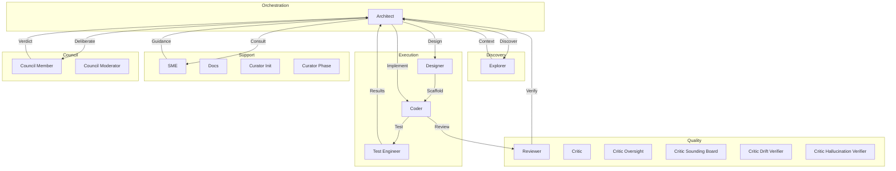

# OpenCode Swarm
<div align="center">

# Your AI writes the code. Swarm proves it works.

**Closing the trust gap between "the model said it's done" and "this actually works in production."**

[](https://www.npmjs.com/package/opencode-swarm)
[](https://raw.githubusercontent.com/ZaxbyHub/opencode-swarm/main/LICENSE)
[](https://github.com/zaxbysauce/opencode-swarm)

[Website](https://swarmai.site/) · [Getting Started](https://github.com/ZaxbyHub/opencode-swarm/blob/main/docs/getting-started.md) · [Configuration](https://github.com/ZaxbyHub/opencode-swarm/blob/main/docs/configuration.md) · [Architecture](https://github.com/ZaxbyHub/opencode-swarm/blob/main/docs/architecture.md)

</div>

---

OpenCode Swarm is a plugin for [OpenCode](https://opencode.ai) that turns a single AI coding session into an **architect-led team of specialized core, optional, and conditional agents**. Run `/swarm agents` for the live roster; it is generated from the current plugin configuration. One agent writes the code. A different agent reviews it. Another writes and runs tests. Another checks security. **Nothing ships until every required gate passes.**

```bash
bunx opencode-swarm install
```

> This single command installs the package, registers it as an OpenCode plugin, disables conflicting default agents, and creates a ready-to-edit config at `~/.config/opencode/opencode-swarm.json`. Requires [Bun](https://bun.sh) >= 1.3.13 (`bun --version` to check), or Node.js >= 22.13 for npm installs (the Node-hosted sidecar uses the built-in `node:sqlite`). If you must use npm: `npm install -g opencode-swarm && opencode-swarm install`.

> **First-run note:** the installer registers the plugin, writes the global plugin config, creates a project override when missing, and disables the native `explore` and `general` agents in `opencode.json`. If you are not using a Swarm architect, the Swarm gates, reviewers, and test agents are bypassed. Open the OpenCode agent or mode picker and choose the Swarm architect when needed.

### Why Swarm?

Most AI coding tools let one model write code and ask that same model whether the code is good. That misses too much. Swarm separates planning, implementation, review, testing, and documentation into specialized internal roles — and enforces gated execution so agents never mutate the codebase in parallel unless their scopes are proven disjoint (v8 parallel lanes, Epic waves), and then each in its own isolated worktree.

### Key Features

| Surface | Entry point |
|---|---|
| `swarm-implement.yml` gated GitHub Action | `swarm:implement` issue label or workflow_dispatch — runs the implementation pipeline and opens an evidence PR |


- 🏗️ **Specialized core, optional, and conditional agents** — architect, coder, reviewer, test_engineer, critic, critic_finding_validator, explorer, sme, docs, designer, critic_oversight, critic_sounding_board, critic_drift_verifier, critic_hallucination_verifier, curator_init, curator_phase, council_generalist, council_skeptic, council_domain_expert. Run `/swarm agents` for the live roster — that is the source of truth, not this list.
- 🔒 **Gated pipeline** — code never ships without reviewer + test engineer approval
- 🔎 **Independent auto-review engine** — bounded whole-diff review in a fresh read-only model session, structured diff-anchored findings, optional independent validation, advisory-by-default phase review, and an evidence-backed opt-in completion gate. v7 remains opt-in; v8's default is pinned to a committed 30-diff cost burn-in.
- 🔍 **DEEP_DIVE Protocol** — High-rigor, on-demand read-only codebase audit via specialized skills
- 🔬 **External Skill Curation Pipeline** — Opt-in discovery, quarantine, evaluation, and promotion of external skill candidates from configured sources (disabled by default; enable via `external_skills.curation_enabled: true` in config). Includes 7 tools: `external_skill_discover`, `external_skill_list`, `external_skill_inspect`, `external_skill_promote`, `external_skill_reject`, `external_skill_delete`, `external_skill_revoke`. Candidates pass through a 3-gate validation pipeline before evaluation: **prompt injection scan** (12 regex patterns), **unsafe instruction scan** (25 patterns), and **provenance integrity check** (SHA-256, timestamp, URL, publisher, and hash verification).
- 🎯 **Governed Skill Optimizer** — Manually-activated, single-skill optimizer (`/swarm skill-opt plan|run|status|diff|approve|reject|rollback|history`) that drives one allowlisted `SKILL.md` candidate at a time through deterministic draft → smoke → evaluation-substrate validation → manual approval → atomic activation/rollback. Bounded, restartable, reversible, and unable to mutate source/harness/security surfaces. Disabled by default (`skill_opt.enabled: false`); see [docs/skill-optimizer.md](https://github.com/ZaxbyHub/opencode-swarm/blob/main/docs/skill-optimizer.md).
- 🌊 **Epic Mode (opt-in preview)** — one plan = one epic, run phase by phase as parallel waves of tasks whose declared scopes don't conflict. The delegation gate enforces the active wave; in git projects each coder works in an isolated worktree on an epic branch that `/swarm epic close` squash-lands as staged changes. Per-task QA always runs, and a phase reviewer + critic gate (`epic_phase_review`) runs before `phase_complete`. Epic learns per-file write risk across epics, suggests plan restructurings with a predicted speedup, and reports a scorecard (`/swarm epic report`). Enable with `epic.mode.enabled: true`; see [docs/modes.md](https://github.com/ZaxbyHub/opencode-swarm/blob/main/docs/modes.md#epic-mode-preview).
- 🔄 **Phase completion gates** — completion-verify and drift verifier gates enforced before phase completion
- 🔁 **Resumable sessions** — all state saved to `.swarm/`; pick up any project any day
- 🔀 **GitLab as a first-class forge** (#2733) — MR and issue URLs (`https://<gitlab-host>/owner/repo/-/merge_requests/N`, `/-/issues/N`) are accepted by `/swarm pr-review`, `pr-feedback`, `pr subscribe/unsubscribe`, `ci-monitor`, publication recording, and issue ingestion, with self-hosted instance hosts derived from the remote or `forge.base_url` (config `forge: { provider, base_url }`, default `auto`; ambiguous remotes fail closed). Every URL-security control (HTTPS-only, private/localhost rejection, IDN protection, credential stripping) applies identically to GitLab. The `glab` binary resolves through the same hardened resolver contract as `gh` (`OPENCODE_SWARM_GLAB_BINARY` env override). Honest capability reporting: GitLab does not synthesize GitHub's `statusCheckRollup`/`reviewDecision`/`mergeStateStatus` — those surface an explicit unavailable result instead of a fabricated value, and glab-backed live MR polling is tracked as follow-up issue [#2882](https://github.com/ZaxbyHub/opencode-swarm/issues/2882).
- 🖥️ **PR Monitor** — GitHub PR subscription and background polling via `gh` CLI; delivers real-time CI, review, and merge status updates via the AutomationEventBus (FR-001, opt-in via `pr_monitor.enabled: true`). Subscribe with `/swarm pr subscribe <pr-url|owner/repo#N|N>`; unsubscribe with `/swarm pr unsubscribe <pr-url|owner/repo#N|N>`; check status with `/swarm pr status`. With `auto_pr_feedback: true`, CI failures and merge conflicts mechanically activate PR_FEEDBACK only when no other workflow owns the session; otherwise they are durably queued for a later round.
- 🌐 **13 full language profiles** (TypeScript, JavaScript, Python, Go, Rust, Java, Kotlin, C/C++, C#, Ruby, Swift, Dart, PHP) with **tree-sitter parse validation across 20 grammars** (adds CSS, Bash, PowerShell, INI, Regex — and `.tsx` / `.c` aliases) — extending: see [docs/adding-a-language.md](https://github.com/ZaxbyHub/opencode-swarm/blob/main/docs/adding-a-language.md)
- 🛡️ **Built-in security** — SAST, secrets scanning, dependency audit per task
- 🔒 **Scope enforcement** — Validates write targets against declared scope with cross-process persistence, TTL expiry, and scope-aware destructive command blocking. **Handles both single-string and array-based path arguments** (`files[]`, `paths[]`, `targetFiles[]`) to prevent scope bypass via multi-file tool calls.
- 📝 **Shell write detection** — Static analysis of POSIX/PowerShell/cmd commands to detect file writes (redirects, builtins, in-place editors, network downloads, archive extraction, git destructive ops) before execution
- 🆓 **Free tier** — works with OpenCode Zen's free model roster
- ⚙️ **Fully configurable** — override any agent's model, disable agents, tune guardrails

> **The Swarm architect coordinates all internal agents automatically.** You never manually switch between internal roles. If the active OpenCode agent is not a Swarm architect, the plugin workflow is bypassed.

---

## Shell Write Detection

Swarm includes comprehensive static analysis for shell commands to detect and intercept file write operations before execution.

### Shell Write Detection Features

- **POSIX shell detection** — Parses commands with `bash-parser` AST for accurate detection of:
  - Redirect operators (`>`, `>>`, `>|`, `<<`, `<<-`)
  - Here-documents and here-strings
  - Write-effect builtins (`cp`, `mv`, `install`, `ln`, `truncate`, `dd`)
  - In-place editors (`sed -i`, `perl -i`, `awk -i`)
  - Interpreter eval (`python -c`, `node -e`, `bun -e`, `ruby -e`, `php -r`)
  - Network downloaders (`curl -o`, `wget -O`, `scp`)
  - Archive extraction (`tar -x`, `unzip`, `gunzip`)
  - Git destructive operations (`git clean -fd`, `git reset --hard`)

- **Windows shell detection** — Uses regex heuristics for PowerShell and cmd.exe:
  - PowerShell cmdlets: `Out-File`, `Set-Content`, `Add-Content`, `Copy-Item`, `Move-Item`
  - cmd.exe builtins: `copy`, `move`, `ren`, `del`, `rd`, `md`
  - Redirect operators (`>`, `>>`)

- **Interactive session denial** — Blocks commands that create persistent or open-ended sessions:
  - POSIX: `watch`, `screen`, `tmux new-session`
  - PowerShell: `Start-Process`

- **Cross-process scope enforcement** — Declared scope is persisted to `.swarm/scopes/scope-{taskId}.json` with:
  - TTL expiry (default 24 hours)
  - Symlink guards (O_NOFOLLOW + realpath containment)
  - Schema versioning and fail-closed validation
  - **Scope-aware destructive command blocking** — Recursive delete patterns (`rm -rf`, `rmdir /s`, `del /s`, `Remove-Item -Recurse`, `rsync --delete`) are blocked unless ALL target paths are within the declared scope (coder agents only)

### Security Patterns

The guardrails system blocks destructive shell commands targeting:
- System paths (`/root`, `/etc`, `C:\Windows`, etc.)
- Symlink/junction creation with external targets
- File operations under `.swarm/` directory
- Fork bombs and infinite loops
- Disk wiping and ransomware-grade operations

---

## What Actually Happens

You say:

```text
Build me a JWT auth system.
```

Swarm then:

1. Clarifies only what it cannot infer.
2. Scans the codebase to understand what already exists.
3. Consults domain experts when needed and caches the guidance.
4. Writes a phased implementation plan.
5. Sends that plan through a critic gate before coding starts.
6. Executes tasks through the QA pipeline — one at a time, or concurrently in isolated worktrees for plans with provably file-disjoint task groups (v8 default for new plans, #1674; serial is the automatic fallback when scopes overlap or are unknown):

* coder writes code
* automated checks run
* reviewer checks correctness
* test engineer writes and runs tests
* architect runs regression sweep
* failures loop back with structured feedback

   With Epic Mode on, `epic_next_wave` issues each phase as waves of conflict-free tasks (the same per-task pipeline runs inside every wave), and `epic_phase_review` runs a reviewer + critic over the whole phase before `phase_complete`.

7. After each phase, docs and retrospectives are updated.

All project state lives in `.swarm/` — plans, evidence, context, knowledge, and telemetry. Resumable by design. If `.swarm/` already exists, the architect goes straight into **RESUME** → **EXECUTE** instead of repeating discovery.

---

## Execution Modes

Swarm has two independent mode systems:

**Session modes** — toggle per session with a slash command:

| Mode | Safety | Speed | When to Use |
|------|--------|-------|------------|
| **Balanced** (default) | High | Medium | Everyday development |
| **Turbo** | Medium | Fast | Rapid iteration; skips phase_complete Gates 1–5 (Stage A and Stage B still run for every task) |
| **Lean Turbo** | High | Fast | Parallel lanes for non-conflicting tasks (up to `max_parallel_coders` coders) |
| **Full-Auto** | Deterministic policy + critic oversight | Fast | Unattended multi-interaction runs |
| **Epic** (opt-in) | High — per-task QA always runs; Turbo stays off | Fast on plans with many independent tasks | Large plans: one plan = one epic, run phase by phase as parallel waves of tasks with disjoint scopes |

**Auto-proceed** — a session toggle (`/swarm auto-proceed [on|off]`) that skips the "Ready for Phase N+1?" prompt at phase boundaries. Defaults to `false`; set as a plan default via `execution_profile.auto_proceed` during QA GATE SELECTION. Session override always wins. Independent of Full-Auto.

Full-Auto reduces approval friction by deterministically allowing safe operations (read-only tools, in-scope writes, safe shell) and routing every ambiguous or high-risk action (writes to plugin/build/guardrail paths, network, dependency changes, plan/phase mutations, subagent delegation) through the read-only `critic_oversight` agent before it executes. Denials are returned to the agent as structured signals so it can choose a safer path; repeated denials pause the run; phase completion requires an APPROVED oversight record. See [docs/modes.md](https://github.com/ZaxbyHub/opencode-swarm/blob/main/docs/modes.md#full-auto) for `mode`, `permission_policy`, `denials`, and `oversight` config keys, fail-closed semantics, and recovery from a paused run.

Epic binds to the current plan and runs fully on OpenCode 1.x and OpenCode 2 (7.x plugin). On OpenCode 2 the v2 adapter ships a session-capable client, places coder worktree sessions with an eager parentless create (#3169 Phase 3), and — since #3169 Phase 4 — dispatches human-typed `/swarm` commands natively, so the full flow (`/swarm epic start` → waves → phase review → close) is available there; the remaining live-host verification legs are tracked on #3169, and the dual-host CI lane has landed (merge-queue v2 smoke cell, weekly host-contract v2 digest, and a vendored-pin freshness notice). The epic itself is always opened by the user (`human-only` policy — the agent cannot start one on any host). `/swarm epic start` also refuses plans too small to benefit and suggests Balanced. The `epic_next_wave` tool then dispatches each phase as waves of tasks whose declared scopes don't conflict; in a git project each coder works in an isolated worktree on an epic branch, and `/swarm epic close` squash-lands the work as staged changes for you to review. Every task in a wave still runs the full per-task QA pipeline (Stage A and Stage B). Epic learns which files tasks tend to write together and uses it to plan later waves and epics. See [docs/modes.md](https://github.com/ZaxbyHub/opencode-swarm/blob/main/docs/modes.md#epic-mode-preview); maintainers start with [src/epic/README.md](https://github.com/ZaxbyHub/opencode-swarm/blob/main/src/epic/README.md).

**Project mode** — persistent via `execution_mode` config key:

| Value | Effect |
|-------|--------|
| `strict` | Maximum safety — adds slop-detector and incremental-verify hooks |
| `balanced` (default) | Standard hooks |
| `fast` | Skips compaction service — for short sessions under context pressure |

Switch session modes with `/swarm turbo [on|off]`, `/swarm full-auto [on|off]`, or `/swarm epic start|close` (Epic needs `"epic": {"mode": {"enabled": true}}` in config). Control phase-boundary auto-proceed with `/swarm auto-proceed [on|off]`. Set project mode in config. Lean Turbo is configured in `turbo.lean.*` in config and composes with all session modes. See [docs/modes.md](https://github.com/ZaxbyHub/opencode-swarm/blob/main/docs/modes.md).

---

## Quick Start

**→ For a complete first-run walkthrough, see [Getting Started](https://github.com/ZaxbyHub/opencode-swarm/blob/main/docs/getting-started.md).**

The 15-minute guide covers:
- Installation (`bunx opencode-swarm install`)
- First-run auto-configuration (architect selected automatically)
- Running your first task
- Troubleshooting common issues

The installer automatically:
- Adds `opencode-swarm` to the OpenCode plugin list
- Disables the native `explore` and `general` agents to reduce routing conflicts

It does **not** create a project config. `.opencode/opencode-swarm.json` is opt-in — create it yourself only if you want project-level overrides of the global config.

---

## 30-Second Demo

No animated GIF is shipped in the repo — instead, here is the exact terminal session you can record yourself with `asciinema rec demo.cast` (or any screen recorder). Every command below is real and runs against this repo as published.

**Recording script (copy/paste-able, ~30 seconds):**

```bash
# 1. Install the plugin (5s)
bunx opencode-swarm install

# 2. Open opencode and select a Swarm architect if it is not already active
opencode

# 3. Inside the OpenCode session, verify Swarm is live (5s)
/swarm help
/swarm agents

# 4. Kick off a task — the architect plans, then gates fire automatically (15s)
Build me a JWT auth helper with tests.

# 5. Watch the gates land in real time (5s)
/swarm status
/swarm evidence
```

**ASCII storyboard** of what a viewer should see:

```
┌──────────────────────────────────────────────────────────────┐
│ $ bunx opencode-swarm install                                │
│ ✓ installed opencode-swarm                                   │
│                                                              │
│ $ opencode                                                   │
│ [Swarm] Welcome! Architect auto-selected. Type /swarm help  │
│                                                              │
│ > /swarm help                                                │
│ Available commands: status, plan, agents, help, diagnose... │
│                                                              │
│ > Build me a JWT auth helper with tests.                     │
│ [architect]  PLAN → critic gate → APPROVED                   │
│ [coder]      task 1.1 implementing…                          │
│ [reviewer]   correctness OK                                  │
│ [test_eng.]  3 tests written, 3 pass                         │
│ [architect]  regression sweep clean → phase_complete         │
│                                                              │
│ > /swarm evidence                                            │
│ task 1.1: review ✓  tests ✓  sast ✓  secrets ✓  drift ✓      │
└──────────────────────────────────────────────────────────────┘
```

Each row corresponds to a real gate documented further down this README — none are simulated.

---

## Upgrading

**OpenCode caches plugins indefinitely.** A normal OpenCode restart does **not**
pull newer versions from npm — once a plugin is cached, OpenCode keeps using
that exact copy on every subsequent launch (issue #675). The cache lives in
several places depending on your platform and OpenCode version:

- Current OpenCode cache layout:
  `~/.cache/opencode/node_modules/opencode-swarm/`
- Legacy Linux / devcontainers / GitHub Codespaces:
  `~/.config/opencode/node_modules/opencode-swarm/`
- Package cache layout:
  `~/.cache/opencode/packages/opencode-swarm@latest/`
- Older bare package cache layout:
  `~/.cache/opencode/packages/opencode-swarm/`
- Platform-specific macOS / Windows cache roots:
  `~/Library/Caches/opencode/...`, `%LOCALAPPDATA%\opencode\...`, or `%APPDATA%\opencode\...`

The updater also clears known OpenCode lock files (`bun.lock`, `bun.lockb`, and `package-lock.json`) so the next start resolves the latest package.

To upgrade to the latest published version (clears all known layouts automatically):

```bash
bunx opencode-swarm update     # cache-only refresh, then restart opencode
# or
bunx opencode-swarm install    # full reinstall (re-asserts config), then restart opencode
```

`/swarm diagnose` shows the running version and, when available, the latest
version on npm so you can tell at a glance whether your cache is stale.

To disable the background staleness check entirely, set `version_check: false`
in your `opencode-swarm.json`.

---

## Commands

Common subcommands at a glance:

```bash
/swarm help [command]      # List all commands or get detailed help for a specific command
/swarm status              # Current phase and task
/swarm show-plan [N]       # Full plan or filtered by phase
/swarm agents              # Registered agents and models
/swarm diagnose            # Health check
/swarm evidence [task]     # Test and review results
/swarm epic status         # Open epic, current wave, landing state (Epic Mode)
/swarm reset --confirm     # Clear swarm state
```

Use `/swarm help` to see all available commands categorized by function. Use `/swarm help <command>` for detailed usage information on a specific command.

Nine commands display a ⚠️ warning in help output because they share names with Claude Code built-in slash commands (e.g., `/plan`, `/reset`, `/status`). The warning reminds you to always use `/swarm <command>` — the bare CC command does something different and sometimes destructive. See [docs/commands.md#claude-code-command-conflicts](https://github.com/ZaxbyHub/opencode-swarm/blob/main/docs/commands.md#claude-code-command-conflicts) for the full conflict registry.

See [docs/commands.md](https://github.com/ZaxbyHub/opencode-swarm/blob/main/docs/commands.md) for the full reference. The live source of truth is `src/commands/registry.ts`, which includes canonical commands, compound commands, and deprecated aliases.

## Command Aliases

Some commands are available under deprecated names for backwards compatibility. Using the canonical name is recommended:

| Alias (deprecated) | Canonical command |
|--------------------|-------------------|
| `/swarm config-doctor` | `/swarm config doctor` |
| `/swarm diagnosis` | `/swarm diagnose` |
| `/swarm evidence-summary` | `/swarm evidence summary` |
| `/swarm doctor` | `/swarm config doctor` |
| `/swarm info` | `/swarm status` |
| `/swarm list-agents` | `/swarm agents` |
| `/swarm health` | `/swarm diagnose` |
| `/swarm plan` | `/swarm show-plan` |
| `/swarm close` | `/swarm finalize` |
| `/swarm check` | `/swarm preflight` |
| `/swarm clear` | `/swarm reset-session` |

Aliases are hidden from help output but still function. The canonical command should be used in scripts and documentation.

---

## The Agents

Swarm registers a roster of specialized core, optional, and conditional agents. The exact count shifts as agents are added or feature-flagged, so treat `/swarm agents` as the live source of truth — that command lists what is actually registered in your session. You don't manually switch between them — the architect coordinates automatically.

| Agent | Role | Badge |
|---|---|---|
| **architect** | Orchestrates workflow, writes plans, enforces gates | Core |
| **explorer** | Scans codebase, gathers context, maps facts | Core |
| **coder** | Implements one task at a time (or concurrently in isolated worktrees for provably file-disjoint task groups — v8, #1674) | Core |
| **reviewer** | Checks correctness and security (also reviews a whole phase under Epic Mode via `epic_phase_review`) | Core |
| **test_engineer** | Writes and runs tests, adversarial testing | Core |
| **critic** | Reviews plans before implementation begins (also challenges a whole phase under Epic Mode via `epic_phase_review`) | Core |
| **critic_finding_validator** | Independently confirms, disproves, or leaves reviewer findings unverified | Core |
| **critic_oversight** | Sole quality gate in full-auto autonomous mode | Core |
| **sme** | Provides domain expertise guidance | Core |
| **docs** | Updates documentation to match implementation | Core |
| **designer** | Generates UI scaffolds and design tokens | Conditional |
| **critic_sounding_board** | Pre-escalation pushback to the architect | Optional |
| **critic_drift_verifier** | Verifies implementation matches spec | Optional |
| **critic_hallucination_verifier** | Verifies APIs and citations against real sources | Optional |
| **curator_init** | Consolidates prior knowledge at session start | Optional |
| **curator_phase** | Consolidates phase outcomes, detects workflow drift | Optional |
| **council_generalist** | Broad analytical voice in the General Council (uses reviewer model) | Conditional |
| **council_skeptic** | Adversarial stress-tester voice in the General Council (uses critic model) | Conditional |
| **council_domain_expert** | Technical-depth voice in the General Council (uses SME model) | Conditional |

Legend: Core = always available, Optional = available by default (can be disabled), Conditional = requires specific feature config (ui_review or council)

Run `/swarm status` and `/swarm agents` to see what's active.



---

## How It Compares

Both projects compared here have since been renamed: oh-my-opencode is now [OmO](https://github.com/code-yeongyu/oh-my-openagent) and get-shit-done is now [GSD Core](https://github.com/open-gsd/gsd-core). The table reflects them as they were when it was written (April 2026, v6.81.0) and has not been re-checked against their current releases.

| Feature | Swarm | oh-my-opencode (now OmO) | get-shit-done (now GSD Core) |
|---|:-:|:-:|:-:|
| Multiple specialized agents | ✅ Core + optional + conditional roster (`/swarm agents`) | ❌ | ❌ |
| Plan reviewed before coding | ✅ | ❌ | ❌ |
| Every task reviewed + tested | ✅ | ❌ | ❌ |
| Different model for review vs. code | ✅ | ❌ | ❌ |
| Shell write detection (POSIX/PowerShell/cmd) | ✅ | ❌ | ❌ |
| Scope enforcement with cross-process persistence | ✅ | ❌ | ❌ |
| Interactive session detection and blocking | ✅ | ❌ | ❌ |
| Resumable sessions | ✅ | ❌ | ❌ |
| Built-in security scanning | ✅ | ❌ | ❌ |
| Learns from mistakes | ✅ | ❌ | ❌ |
| Parallel tasks refused at dispatch unless their scopes are conflict-free (Epic Mode) | ✅ | ❌ | ⚠️ overlap check only falls back to sequential |
| Conflict prediction from git co-change history (Epic Mode) | ✅ | ❌ | ❌ |
| Learns per-file risk of undeclared writes across runs (Epic Mode) | ✅ | ❌ | ❌ |
| Plan-restructuring suggestions with predicted speedup (Epic Mode) | ✅ | ❌ | ❌ |
| Per-epic scorecard: conflicts, rework, gate first-pass rates (Epic Mode) | ✅ | ❌ | ❌ |

---

## LLM Provider Guide

Swarm works with any provider supported by OpenCode.

### Free Tier (OpenCode Zen)

No API key required. Excellent starting point:

```json
{
  "agents": {
    "coder": { "model": "opencode/nemotron-3-ultra-free" },
    "reviewer": { "model": "opencode/big-pickle" },
    "explorer": { "model": "opencode/big-pickle" }
  }
}
```

### Paid Providers

For production, mix providers by role:

| Agent | Recommended | Why |
|---|---|---|
| architect | OpenCode UI selection | Needs strongest reasoning |
| coder | minimax-coding-plan/MiniMax-M2.5 | Fast, accurate code generation |
| reviewer | zai-coding-plan/glm-5 | Different training from coder |
| test_engineer | minimax-coding-plan/MiniMax-M2.5 | Same strengths as coder |
| explorer | google/gemini-2.5-flash | Fast read-heavy analysis |
| sme | kimi-for-coding/k2p5 | Strong domain expertise |

### Provider Formats

| Provider | Format | Example |
|---|---|---|
| OpenCode Zen | `opencode/<model>` | `opencode/big-pickle` |
| Anthropic | `anthropic/<model>` | `anthropic/claude-sonnet-4-20250514` |
| Google | `google/<model>` | `google/gemini-2.5-flash` |
| Z.ai | `zai-coding-plan/<model>` | `zai-coding-plan/glm-5` |
| MiniMax | `minimax-coding-plan/<model>` | `minimax-coding-plan/MiniMax-M2.5` |
| Kimi | `kimi-for-coding/<model>` | `kimi-for-coding/k2p5` |

### Model Fallback

Automatic fallback to a secondary model on transient errors (including provider quota exhaustion — e.g. GitHub Copilot's `429 quota exceeded` monthly limit):

```json
{
  "agents": {
    "coder": {
      "model": "anthropic/claude-sonnet-4-20250514",
      "fallback_models": ["opencode/mimo-v2.6-flash-free"]
    }
  }
}
```

Fallback applies to dispatched subagents and to primary (interactive) sessions
alike. For a primary session, a fallback-eligible provider failure on one turn
switches the session's next message to the configured fallback (sticky for the
session; announced by a `MODEL FALLBACK:` advisory and a `model_fallback`
telemetry event). Recovery boundaries: session end (or a new session), 30
minutes without any message on the session, or a change to the configured
model chain (the stale selection then reads as absent and the primary is
retried). Switching the session's agent away from the fallback-scoped role
suppresses the override while the other agent is active, but the prior role's
selection persists until the idle window expires — switching back re-applies
it. There is deliberately no in-session code escape (the host's
model-selection surface cannot distinguish a user re-pick from the session
selection). A one-shot `opencode run` turn that already failed cannot be
re-driven mid-turn — the OpenCode host owns the request loop — so interactive
(TUI/GUI) sessions pick up the fallback on their next message, while a failed
one-shot invocation simply ends; re-run it after resolving the quota.

See [docs/configuration.md](https://github.com/ZaxbyHub/opencode-swarm/blob/main/docs/configuration.md) for full configuration reference.

---

<details>
<summary><strong>Advanced Topics (Technical Detail)</strong></summary>

### Process Remediation Model (PRM)

Swarm monitors agent trajectories and injects course-correction guidance before loops form. Detects five failure patterns:

1. **Repetition Loop** — Same agent performs the same action repeatedly
2. **Ping-Pong** — Agents hand off back and forth without progress
3. **Expansion Drift** — Plan scope grows beyond original task
4. **Stuck-on-Test** — Coder and tests fail in a loop
5. **Context Thrashing** — Agent requests increasingly large file sets

When detected, escalation levels trigger:
- Level 1: Advisory guidance injected
- Level 2: Architect alert sent
- Level 3: Hard stop directive

Configure via:

```json
{
  "prm": {
    "enabled": true,
    "pattern_thresholds": {
      "repetition_loop": 2,
      "ping_pong": 2,
      "expansion_drift": 3,
      "stuck_on_test": 3,
      "context_thrash": 10
    }
  }
}
```

> **Note:** Both `max_trajectory_lines` and `escalation_enabled` are enforced at runtime. `max_trajectory_lines` is the one knob bounding the session trajectory store — the cold-session read, the append-path compaction, and denied-call recording all use it; `escalation_enabled` gates the escalation ladder (advisory → hard stop). Terminal/cooldown semantics live in `docs/configuration.md` (Hard-stop episode state machine).

### Persistent Memory

**`.swarm/plan-ledger.jsonl`** — authoritative source of truth (v6.44 durability model)

**`.swarm/context.md`** — technical decisions and cached SME guidance

**`.swarm/evidence/`** — review/test results per task

**`.swarm/telemetry.jsonl`** — session observability events (fire-and-forget, never blocks execution)

**`.swarm/curator-summary.json`** — phase-level intelligence and drift reports

**`.swarm/epic/`** — Epic Mode: the open epic, its waves, and close reports with scorecards

**`.swarm/epic-prior/`** — Epic Mode: the learned project prior and past epic reports (survives `/swarm close`)

### Guardrails & Circuit Breakers

Every agent runs inside a circuit breaker that prevents runaway behavior:

| Signal | Default Limit |
|--------|:---:|
| Tool calls | 200 |
| Duration | 30 min |
| Same tool repeated | 10x |
| Consecutive errors | 5 |

Limits reset per task. Per-agent overrides available in config.

> **Note:** Built-in per-agent profiles override the global `max_consecutive_errors` to **8** for `architect`, `coder`, `test_engineer`, `explorer`, and `reviewer` (`src/config/schema.ts` `DEFAULT_AGENT_PROFILES`). The `5` shown above is the `GuardrailsConfigSchema` global default that applies only when no per-agent profile sets the value. See [docs/installation.md § Guardrails Configuration](https://github.com/ZaxbyHub/opencode-swarm/blob/main/docs/installation.md#guardrails-configuration) for the full schema and [docs/configuration.md § Per-agent override fields](https://github.com/ZaxbyHub/opencode-swarm/blob/main/docs/configuration.md#per-agent-override-fields) for how to override.

### File Authority (Per-Agent Write Permissions)

Each agent can only write to specific paths:

- **architect** — Everything (except `.swarm/plan.md`, `.swarm/plan.json`)
- **coder** — `src/`, `tests/`, `docs/`, `scripts/`
- **reviewer** — `.swarm/evidence/`
- **test_engineer** — `tests/`, `.swarm/evidence/`
- **explorer, sme** — Read-only

Override via `authority.rules` in config.

### Quality Gates

Built-in tools verify every task before it ships:

- **syntax_check** — Tree-sitter validation across the configured language grammar map
- **placeholder_scan** — Catches TODOs, stubs, incomplete code
- **sast_scan** — 68 security rules across 8 languages (offline)
- **sbom_generate** — Dependency tracking (CycloneDX)
- **quality_budget** — Complexity, duplication, test ratio limits
- **epic_phase_review** — Epic Mode only: an APPROVED phase reviewer, then an APPROVED phase critic, before `phase_complete`

These quality gates run locally. No Docker is required. Config-gated features such as General Council web search can make external API calls only when you enable them and provide a Tavily or Brave Search key.

### Context Budget Guard

The Context Budget Guard monitors how full the model's context window is getting across the whole conversation. It helps prevent context overflow before it becomes a problem.

### Default Behavior

- **Enabled automatically** — No setup required. Swarm starts tracking context usage right away.
- **What it measures** — The total tokens across **all** messages in the conversation (every text part of every message — your prompts, the model's responses, and injected content alike), divided by the model's context window. It does **not** measure only swarm-injected content, and it does **not** read `max_injection_tokens`. Token counts come from one canonical estimator, `estimateTokens` in `src/hooks/utils.ts` (flat ~0.33 tokens/char), unless provider-reported usage is available for the turn, which stays authoritative.
- **Where the window comes from** — Your **live model**, not a constant. Resolution order: an explicit `context_budget.model_limits` entry (`"<provider>/<model>"`, then `"<model>"`, then `"default"`) → the context window the OpenCode host reports for the model you are running (`model.limit.context`, already provider-specific, so a Copilot entry and a first-party entry for the same model resolve differently) → a static fallback table → `128000` as a last resort when nothing else is known. Set a `model_limits` entry only if you want a **smaller working budget** than your model's real window.
- **Warning threshold (0.7 ratio)** — When total conversation tokens reach 70% of the model context window (e.g. ~89,600 on a 128k model, ~700,000 on a 1M model), the architect receives an advisory warning recommending a summary offload to `.swarm/context.md`. This is informational by itself — execution continues normally.
- **Critical threshold (0.9 ratio)** — When total conversation tokens reach 90% of the model context window (e.g. ~115,200 on a 128k model, ~900,000 on a 1M model), the architect receives a critical alert recommending `/swarm handoff` — and, when `enforce` is `true` (the default), the guard also prunes the outgoing request (see the next bullet).
- **Hard enforcement (default on)** — With `enforce: true` (default), crossing the critical threshold masks eligible completed tool outputs (those older than `recent_window` turns OR longer than `tool_output_mask_threshold` characters, in turns not protected by `preserve_last_n_turns`) and prunes lower-priority messages toward `prune_target` of the window (best-effort: pruning stops at the target or when no eligible removable message remains, whichever comes first). All of this happens **in the outgoing request only** — the current turn's message array as sent to the provider. Your **persisted history** is never rewritten: stored conversation, `.swarm/` artifacts, and tool results on disk are untouched. External data — provider-reported usage and the live model limit — is read, never written.
- **Warnings repeat while above threshold** — The warning text is prepended to the current user message on every turn above the threshold; there is no once-per-session suppression. Pruning and masking likewise re-apply each turn while usage stays above the critical threshold.
- **Who sees warnings** — Only the architect receives these warnings. Other agents are unaware of the budget.

To disable entirely, set `context_budget.enabled: false` in your swarm config.

**On-demand status check:** architects can invoke the `context_status` tool at any time to read current context-window headroom (tokens used, model limit, usage percent, threshold state, model ID, provider) without triggering advisory warnings or mutating state. Works even when `context_budget.enabled` is false.

---

### Skill Propagation

Swarm includes an intelligent skill propagation system that tracks, validates, and scores skill usage across agent delegations. When the architect delegates to subagents (coder, reviewer, test_engineer, etc.), the system:

- **Logs skill usage** to `.swarm/skill-usage.jsonl` with session-scoped entries (agent, task ID, skill paths, timestamp)
- **Scores skill relevance** based on frequency, compliance, recency, task ID diversity, and context matching
- **Provides recommendations** — when delegating without a `SKILLS:` field, the system suggests relevant skills with relevance scores
- **Enforces compliance** — optional enforcement mode can block delegations missing the `SKILLS:` field
- **Auto-populates skill index** — maintains a `## Available Skills` section in `.swarm/context.md` with usage counts and compliance rates
- **Supports explicit routing** — `.opencode/skill-routing.yaml` maps agent types to specific skill paths with optional keyword descriptions

**Guardrails:**
- Relevance scoring threshold: 0.5 (skills below this are not recommended)
- Maximum recommendations per delegation: 5
- Scoring budget safeguard: Skipped when session exceeds 500 skill-usage entries to prevent unbounded file reads
- Graceful degradation: Zero installed skills = zero friction — no warnings, no blocks, no auto-population

**Configuration:**

```json
{
  "skillPropagation": {
    "enabled": true,
    "enforce": false,
    "audiences": []
  }
}
```

- **`enabled`** (boolean, default `true`) — turns skill-propagation scoring, recommendations, and warnings on or off. The mandatory explicit-skill-reference integrity check still runs even when this is `false`.
- **`enforce`** (boolean, default `false`) — when `true`, blocks delegations that omit the `SKILLS:` field instead of only warning.
- **`audiences`** (string array, default `[]`, max 16 entries, de-duplicated) — extra audience tokens to broaden which skills are considered in scope for this project, in addition to the active runner's own audience. Each entry must be a lowercase domain token matching `^[a-z0-9]+(?:[._-][a-z0-9]+)*$`; the reserved value `swarm-plugin` and any `runner:*` prefix are rejected.

**Skill routing file format** (`.opencode/skill-routing.yaml`):

```yaml
version: 1
routing:
  coder:
    - path: .claude/skills/writing-tests/SKILL.md
      keywords: ["test", "testing", "writing tests"]
    - path: .claude/skills/engineering-conventions/SKILL.md
      keywords: ["engineering", "conventions", "invariants"]
  reviewer:
    - path: .claude/skills/swarm-pr-review/SKILL.md
      keywords: ["review", "security", "audit"]
```

Routing skills are merged with scored recommendations, with explicitly routed skills receiving a boosted score (0.9) to prioritize them.

### Skill Lifecycle Management

Seven skill-management tools (`skill_generate`, `skill_list`, `skill_apply`, `skill_inspect`, `skill_regenerate`, `skill_retire`, `skill_improve`) are **opt-in** via the `skills.enabled` config flag (default `false`). With the flag off, the tools are host-denied for every agent except the `skill_improver` specialist (issue #2528): the model never receives their schema, so they are genuinely unreachable — not merely unlisted. With the flag on, the architect regains all seven. Tools remain exported and registered.

 Swarm provides tools for managing generated skill lifecycles:

- **`skill_retire`** — Retires an active generated skill by creating a `retired.marker` file in its directory. Retired skills are excluded from discovery, scoring, and injection. The SKILL.md file is preserved for auditability. Use `skill_retire(slug, reason?)` to retire a skill, or pass a reason for tracking purposes.

- **`skill_regenerate`** — Re-clusters the source knowledge entries for an active skill and updates the SKILL.md in place. Reads the existing SKILL.md frontmatter to identify source knowledge IDs, resolves current entries from knowledge stores, and re-renders the skill content. Falls back to fuzzy slug-based re-clustering if source IDs yield no matches. Skills whose source knowledge is entirely archived are automatically retired during regeneration.

- **Auto-retire health check** — During each curator phase run, skills are automatically evaluated for retirement when:
  - The skill's violation rate exceeds 30% (based on skill-usage.jsonl compliance verdicts)
  - All of the skill's source knowledge entries have been archived

  Auto-retired skills are noted in the phase digest summary. The check is non-blocking — errors are caught and logged without failing the curator.

- **Proposal cleanup** — When a draft skill proposal is activated via `skill_apply`, the source proposal file is deleted as part of the activation process (best-effort; permission errors are logged but do not block activation).

### Governed Skill Optimizer

`/swarm skill-opt` (issue #1822 — SkillOpt 3/7) is a **manually-activated, governed** optimizer that drives ONE allowlisted `SKILL.md` candidate at a time through deterministic draft → static smoke → evaluation-substrate validation (`split:'test'`) → manual approval → atomic activation (or rollback). The loop is bounded, restartable, reversible, and unable to mutate harness/source/security surfaces.

Commands: `/swarm skill-opt plan|run|status|diff|approve|reject|rollback|history`.

- **Disabled by default.** `/swarm skill-opt run` requires `skill_opt.enabled: true` AND `--confirm`. `plan`/`status`/`diff`/`history` are always available (read-only / proposal-only).
- **No autonomous mutation.** `approve`/`activate`/`reject`/`rollback` are human-only and require `--expected-content-hash` to refuse a stale base.
- **Validation reuse.** Uses the existing evaluation substrate (`evaluateCandidateV1`) — no duplicate runner/scorer. Held-out test sets are single-use (`claimHeldOutTest`), so a single `run` performs at most one validation.
- **Durable lifecycle.** Append-only state machine under `.swarm/evolution/skills/<slug>/<candidateId>/` with hash-chain integrity and corrupt-tail quarantine.

See `docs/skill-optimizer.md` for the full architecture and the `skill_opt` config block.

### Governed Harness Optimizer

`/swarm harness-opt` (issue #2503 — the HarnessOpt capstone) is the **executing, governed** optimizer over the declarative `harness_evolution` surface: it drives ONE governed round at a time through the evaluation substrate in a disposable worktree (the substrate fingerprints the active checkout before and after every execution), freezes the comparative task set before any round, and records durable lineage with task-cost accounting (missing host data stays `unknown`, never zero).

Commands: `/swarm harness-opt plan|run|compare|status|stop|history`.

- **Disabled by default.** `run` requires `harness_opt.enabled: true` AND `--confirm`; `run`/`stop` are human-only.
- **Isolation.** Rounds execute in disposable worktrees; the substrate fingerprints the active checkout around every execution, so the running checkout is never mutated. A `test` split consumes the held-out set exactly once (substrate-enforced).
- **Comparative protocol.** Baseline, ablation, and simple-agent control arms run on the same frozen task population with per-arm denominators, retained negative results, and a stream-snapshot duplicate guard.
- **Independent oracle.** Acceptance backstop that rejects a token-improving candidate whose artifact quality or verification evidence falls.
- **No self-modification.** Activation/rollback stay on `/swarm approve-write` + the harness store, which additionally re-validates recorded approved paths against the CURRENT allowlist.

See `docs/harness-optimizer.md` for the full architecture and the `harness_opt` config block.

### External Skill Curation

Swarm provides an opt-in, quarantine-first pipeline for discovering, validating, and promoting external skills. Disabled by default — no network calls are made until explicitly enabled.

#### Enabling

```yaml
external_skills:
  curation_enabled: true
  sources:
    - type: url
      location: https://example.com/skills/
      trust_level: medium
```

#### Validation Pipeline

Every candidate passes a 3-gate pipeline before entering quarantine:

| Gate | Name | Description |
|------|------|-------------|
| 1 | Prompt Injection Scan | 12 regex patterns plus oversized field, invisible character, and suspicious formatting checks detect system instruction injection, role hijacking, and instruction override attempts |
| 2 | Unsafe Instruction Scan | 25 patterns detect shell commands, file system attacks, network exfiltration, and privilege escalation |
| 3 | Provenance Integrity | SHA-256 content hash, timestamp validation, URL format checks, and publisher presence validation |

**Trust level modulation**: `low` trust promotes warning-severity findings to errors (stricter); `medium` and `high` trust levels keep warnings advisory. Error-severity findings always block regardless of trust level.

#### Tool Reference

| Tool | Description |
|------|-------------|
| `external_skill_discover` | Fetch and validate a skill from a configured source |
| `external_skill_list` | List candidates with status filters |
| `external_skill_inspect` | View full candidate details |
| `external_skill_promote` | Promote validated candidate to active skill (user approval required) |
| `external_skill_reject` | Reject candidate with reason |
| `external_skill_delete` | Remove candidate from quarantine store |
| `external_skill_revoke` | Retire a previously promoted skill |

#### Security Guarantees

- Disabled by default — no network calls until explicitly enabled
- All candidates quarantined until human review and promotion
- TOCTOU re-validation at promotion time
- Content hash verification prevents tampering
- Bounded concurrent fetches (5 simultaneous) and discovery limits (50 candidates per invocation)
- Max candidate size and count bounds
- Source origin validation (URLs must match configured sources)

#### Limitations

- Static regex patterns only (no LLM-based detection)
- No cryptographic signing (deferred)
- No batch import (deferred)
- No auto-promotion (human approval always required)

### Configuration Reference

| Key | Type | Default | Description |
|-----|------|---------|-------------|
| `context_budget.enabled` | boolean | `true` | Enable or disable the context budget guard entirely |
| `context_budget.max_injection_tokens` | number | `4000` | Separate per-turn cap on system-enhancer injection. It is NOT the guard's budget — the guard measures total conversation tokens against `model_limits`, not this value |
| `context_budget.warn_threshold` | number | `0.7` | Ratio (0.0-1.0) of the model context window at which total conversation tokens trigger a warning advisory |
| `context_budget.critical_threshold` | number | `0.9` | Ratio (0.0-1.0) of the model context window at which total conversation tokens trigger a critical alert with handoff recommendation |
| `context_budget.enforce` | boolean | `true` | When true (default), crossing the critical threshold masks large completed tool outputs and prunes lower-priority messages in the **outgoing request** toward `prune_target`. Execution is never blocked or aborted |
| `context_budget.prune_target` | number | `0.7` | Ratio (0.0-1.0) of the context window the outgoing request is pruned toward when enforcement runs |
| `context_budget.preserve_last_n_turns` | number | `4` | Number of recent turns protected from pruning |
| `context_budget.recent_window` | number | `10` | Age (in turns) beyond which a completed tool output becomes eligible for masking during enforcement; the latest `preserve_last_n_turns` turns are always protected |
| `context_budget.tracked_agents` | string[] | `['architect']` | Agents to track for context budget warnings |
| `context_budget.enforce_on_agent_switch` | boolean | `true` | Enforce budget limits when switching agents |
| `context_budget.model_limits` | record | `{}` | Per-model token limit **overrides**, keyed by `"<provider>/<model>"`, `"<model>"`, or `"default"`. Empty by default so the live model's own context window is used; set an entry only to impose a smaller working budget |
| `context_budget.unified_injection_tokens` | number | `undefined` | Opt-in unified ceiling (tokens) for combined system-enhancer + knowledge-injector injection per turn. When set, both hooks share this budget with proportional split |
| `context_budget.tool_output_mask_threshold` | number | `2000` | Character threshold (chars, not tokens): during enforcement, a completed tool output in a non-protected turn is masked when it is **older than `recent_window` turns OR longer than this many characters** (either condition) |
| `skills.enabled` | boolean | `false` | Gates the 7 skill-management tools (`skill_generate`, `skill_list`, `skill_apply`, `skill_inspect`, `skill_regenerate`, `skill_retire`, `skill_improve`) behind an opt-in flag. When `false` (default), these tools are host-denied for every agent except `skill_improver` — genuinely unreachable at request time (issue #2528). |
| `skill_opt.enabled` | boolean | `false` | Master opt-in for the governed skill optimizer (`/swarm skill-opt`). `run` also requires `--confirm`; `plan`/`status`/`diff`/`history` are always available. See `docs/skill-optimizer.md`. |
| `skill_opt.deadband` | number | `0` | Promotion policy deadband forwarded to the evaluation substrate. |
| `skill_opt.max_rounds` | number | `5` | Hard cap on draft/smoke retries before a validation (held-out test set is single-use). |
| `skill_opt.max_transient_retries` | number | `5` | Max transient-infra retries before an infra failure becomes inconclusive. |
| `epic.mode.enabled` | boolean | `false` | Master opt-in for Epic Mode (`/swarm epic`, `epic_next_wave`, `epic_phase_review`). The legacy `turbo.epic.*` path is still accepted and migrated with a warning. See [docs/modes.md](https://github.com/ZaxbyHub/opencode-swarm/blob/main/docs/modes.md#epic-mode-preview) |
| `epic.mode.activation_threshold` | number | `0.3` | Intra-component density above which a conflict component runs one task per wave |
| `epic.cochange.enabled` | boolean | `false` | Adds the git co-change conflict signal to Epic planning and `/swarm coupling` (otherwise declared-path conflicts only) |
| `epic.cochange.threshold` / `min_co_changes` | number | `0.6` / `5` | NPMI floor and minimum co-change count for a file pair to count as coupled |
| `epic.sizing.*` | object | `min_tasks: 6`, `min_scope_coverage: 0.8`, `min_effective_speedup: 1.25`, `coder_fraction: 0.6` | `/swarm epic start` refuses plans below these (`--force` overrides and is recorded) |
| `epic.learning.*` | object | `enabled: true`, `decay_per_epic: 0.7`, `half_life_days: 60`, `hot_excess: 0.25` | Per-file risk and co-write learning across waves and epics |
| `epic.commit_policy` | string | `epic-branch` | `epic-branch` (work on `swarm/epic/<key>`, landed at close) or `current-branch` |
| `epic.retain_refs` | boolean | `false` | Keep `refs/swarm/epics/<key>/*` after close |
| `context_budget.scoring.enabled` | boolean | `false` | Enable context scoring/ranking |
| `context_budget.scoring.max_candidates` | number | `100` | Maximum items to score (10-500) |
| `context_budget.scoring.weights` | object | `{ phase: 1.0, current_task: 2.0, blocked_task: 1.5, recent_failure: 2.5, recent_success: 0.5, evidence_presence: 1.0, decision_recency: 1.5, dependency_proximity: 1.0 }` | Per-signal priority weights (each 0-5). Only these eight keys are read |
| `context_budget.scoring.decision_decay` | object | `{ mode: 'exponential', half_life_hours: 24 }` | Decision relevance decay (`mode`: linear or exponential; `half_life_hours` 1-168) |
| `context_budget.scoring.token_ratios` | object | `{ prose: 0.25, code: 0.4, markdown: 0.3, json: 0.35 }` | Accepted for backward compatibility only; deprecated and inert at runtime — never read. Token costs always use the canonical flat estimator (`estimateTokens`, ~0.33 tokens/char), never per-content ratios |

### Example Configurations

**Minimal (disable):**
```json
{
  "context_budget": {
    "enabled": false
  }
}
```

**Default (reference):**
```json
{
  "context_budget": {
    "enabled": true,
    "max_injection_tokens": 4000,
    "warn_threshold": 0.7,
    "critical_threshold": 0.9,
    "enforce": true,
    "prune_target": 0.7,
    "preserve_last_n_turns": 4,
    "recent_window": 10,
    "tracked_agents": ["architect"],
    "enforce_on_agent_switch": true,
    "model_limits": { "default": 128000 },
    "tool_output_mask_threshold": 2000,
    "scoring": {
      "enabled": false,
      "max_candidates": 100,
      "decision_decay": { "mode": "exponential", "half_life_hours": 24 }
    }
  }
}
```

(Omitted keys — `weights` above — take the schema defaults listed in the table; only the eight documented weight keys are read.)

**Aggressive (for long-running sessions):**
```json
{
  "context_budget": {
    "enabled": true,
    "max_injection_tokens": 2000,
    "warn_threshold": 0.5,
    "critical_threshold": 0.75,
    "enforce": true,
    "prune_target": 0.6,
    "preserve_last_n_turns": 2,
    "recent_window": 5,
    "tracked_agents": ["architect"],
    "enforce_on_agent_switch": true,
    "model_limits": { "default": 128000 },
    "tool_output_mask_threshold": 1500,
    "scoring": {
      "enabled": true,
      "max_candidates": 50,
      "weights": { "phase": 1.5, "current_task": 3.0, "recent_failure": 3.0, "recent_success": 0.3, "decision_recency": 2.0 },
      "decision_decay": { "mode": "linear", "half_life_hours": 12 }
    }
  }
}
```

> **Note on `scoring.token_ratios`:** the key is still accepted by the config schema for backward compatibility, but it is deprecated and inert — no runtime code reads it, and per-content token ratios are deliberately not used. Token costs for both normal and scoring accounting always come from the one canonical estimator (`estimateTokens` in `src/hooks/utils.ts`, flat ~0.33 tokens/char); when the provider reports token usage, that figure stays authoritative.

### What This Does NOT Do

- **Does NOT block execution** — The guard never aborts or stops the pipeline. Enforcement trims the request, not the run.
- **Does NOT modify persisted history** — Masking and pruning mutate only the **outgoing request** for the current turn (the message array sent to the provider). Stored conversation, `.swarm/` artifacts, and tool results on disk are untouched.
- **Does NOT rewrite tool results** — A masked tool output is a placeholder in the current request; the tool's stored result is unchanged.
- **Does NOT interact with compaction.auto** — Separate feature with separate configuration.
- **Does NOT measure only swarm-injected context** — It measures the whole conversation against the model's context window, using provider-reported usage when available and the canonical flat estimator (`estimateTokens`, ~0.33 tokens/char) otherwise.

</details>

<details>
<summary><strong>Quality Gates (Technical Detail)</strong></summary>

### Built-in Tools and Hooks

*(README truncated for display. [Read the full README on GitHub](https://github.com/ZaxbyHub/opencode-swarm)).*
