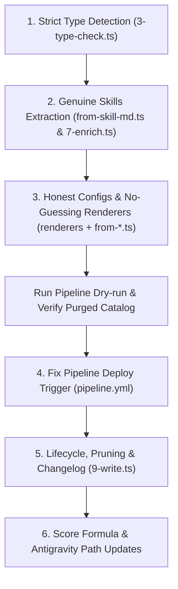

# 06. Catalog Reliability & Quality Fix Plan

> **Status:** ✅ **Completed** (October 2026).  
> **Trigger:** Review of initial W41 run data revealing false-positive MCP servers, internal developer skills, synthetic Docker commands, and unlinked deployment pipelines.  
> **Goal:** Transform the catalog from a syntactic prototype into an authoritative, trustworthy source of truth for coding agents.  
> **Outcome:** All 6 priority areas (P1–P6) implemented, tested, and verified across workspace packages. Clean catalog regenerated and published.

---

## 1. Executive Summary & Root Cause Analysis

A rigorous audit of the initial catalog generation revealed that while monorepo architecture, typing, tests, and build times are solid (Astro 5 builds 247 static pages in ~4s, Pagefind indexes in ~1s), **the underlying data is not yet trustworthy**:

| Issue | Root Cause | Impact | Fix Priority |
|---|---|---|:---:|
| **Non-MCP repos listed as MCP servers** | Weak heuristics: accepting any `mcp` string in Python manifests, or topic `mcp-server` with any file matching `/server\|mcp/` | 48 of 82 MCP entries are false positives (Java SDK, FunASR, Silex, video downloaders) | **P1** |
| **Skill catalog dilution & misclassification** | 1 repo = 1 skill (first match); ingesting hidden internal folders (`.claude/skills/*`); running skills check before MCP | Misses thousands of real skills; publishes repo-internal dev scripts; classifies MCP servers (`python-sdk`, `n8n-mcp`) as skills | **P1** |
| **Guessed & broken launch commands** | Fabricating `ghcr.io/...` Docker tags from repo names; treating local dev `.mcp.json` as install commands; publishing placeholders (`{{name}}`, `/path/to/...`) | Users copy broken commands that fail on execution | **P1** |
| **Bare `npx` on missing configs** | Renderers fallback to `spec.command \|\| 'npx'` when confidence is `none` | 13 unconfigured tools display broken `claude mcp add <name> -- npx` | **P2** |
| **Weekly refresh never deploys** | Pipeline commits using default `GITHUB_TOKEN` + `[skip ci]`, which GitHub suppresses from triggering downstream `deploy.yml` | Catalog updates committed to `main` never reach production site | **P2** |
| **Catalog only grows (No Pruning/Lifecycle)** | `9-write.ts` writes files without comparing against previous state; no deletion of dropped tools | Abandoned or disqualified tools remain indefinitely | **P3** |
| **Cross-run state & changelog missing** | No `data/state/` or `diff.json` tracking week-over-week changes | Users cannot see what was added, updated, or removed | **P3** |
| **Shallow quality scoring** | Giving trust points for repo owner names lacking hyphens; incomplete anti-fake star checks | Scores do not reflect real community health | **P3** |

---

## 2. Priority 1: Strict Type Detection & Evidence Verification

### 1.1 Strict MCP Server Detection (`apps/pipeline/src/stages/3-type-check.ts`)
- **Delete the loose fallback heuristic entirely:** Remove lines checking `c.repo.topics.includes('mcp-server') && paths.some(p => /mcp|server/i.test(p))`.
- **Strict Python Dependency Parsing:**
  - Do NOT substring-search the raw file text for `mcp`.
  - Parse `pyproject.toml` with a TOML parser or strict regex targeting `dependencies` / `project.dependencies` for `^mcp([>=<~!]\|$)` or `^fastmcp([>=<~!]\|$)`.
  - Parse `requirements.txt` line-by-line for exact package names `mcp` or `fastmcp`.
- **Strict Node.js Dependency Parsing:**
  - Parse `package.json` JSON object; verify `@modelcontextprotocol/sdk` exists in `dependencies` or `peerDependencies` (ignore if only in `devDependencies` of an application that is not an MCP server).
- **Standalone Manifests:**
  - `server.json` is accepted only if it conforms to the official MCP server manifest schema.

### 1.2 Ingestion Order: MCP Server Before Skills
- Evaluate MCP server evidence **before** agent skill evidence. A repository whose primary purpose is an MCP server (e.g. `modelcontextprotocol/python-sdk`, `czlonkowski/n8n-mcp`, `taylorwilsdon/google_workspace_mcp`) must be cataloged as an MCP server, not hijacked by an internal testing skill.

---

## 3. Priority 2: Genuine Skills Architecture (Multi-Entry & Public Curation)

### 2.1 Filter Out Internal Developer Skills
- **Exclude hidden dot-directories:** Skip all paths starting with `.` (e.g. `.claude/skills/`, `.cursor/skills/`, `.gemini/skills/`, `.agent/skills/`), unless the repository is explicitly dedicated to sharing agent configurations (e.g. `awesome-claude-skills` or approved registry).
- **Exclude repo-internal maintenance tasks:** Reject skills whose primary purpose is internal release management, triage, or test execution for that specific repo (e.g. `release-announcement`, `add-pricing-field`, `gitnexus-debugging`).

### 2.2 Monorepo Multi-Entry Ingestion
- Instead of taking only `subpaths[0]`, iterate through each qualifying `SKILL.md` file in the repository.
- Each skill is emitted as an **independent catalog entry**:
  - `slug`: `${owner}-${repo}-${skillName}`
  - `name`: Extracted from `SKILL.md` frontmatter `name`
  - `tagline`: Extracted from `SKILL.md` frontmatter `description`
  - `source.subpath`: Path to the skill folder within the repo.
- **Evidence Rule:** Validate that the subpath actually contains a valid `SKILL.md` with non-empty `name` and `description` YAML frontmatter.

---

## 4. Priority 3: Honest Config Confidence & No-Guessing Renderers

### 4.1 Eliminate Synthetic & Guessed Commands
- **Remove Docker Image Guessing (`from-server-json.ts`):** Delete the fallback that invents `ghcr.io/${owner}/${repo}` simply because a `Dockerfile` exists. Docker launch configs are only permitted if an explicit image is declared in `server.json` or README instructions.
- **Stop Ingesting Local Developer Configs:** Ignore `.mcp.json` files that define client configurations for developing that project (which points to developer tools like Playwright), rather than launching the server itself.
- **Registry ID Handling (`from-registry.ts`):** Distinguish between registry namespace IDs (`io.github.brightdata/...`) and actual package manager identifiers. If no npm/PyPI package is resolved, use the HTTP/remote URL or mark confidence as `none`.
- **Placeholder Rejection:** Scan generated commands for placeholders (`{{name}}`, `{{...}}`, `/path/to/...`, `IPADDRESS`, `localhost`). If an unresolved placeholder exists in the executable command path (excluding environment variables), downgrade confidence to `none`.

### 4.2 Renderer Honesty (`packages/renderers` & `apps/site`)
- **No Fake `npx`:** In `claudeCodeAdapter`, `codexAdapter`, and `antigravityAdapter`, when `spec.command` is undefined or `spec.confidence === 'none'`:
  - Do NOT generate `npx` or dummy commands.
  - Return empty commands and snippets.
- **UI State (`ConfigTabs.astro`):**
  - When confidence is `none`: Hide the copy button and launch command box entirely.
  - Display an honest callout:
    > **Manual Configuration Required:** No verified 1-click launch command could be automatically extracted from package manifests. Refer to the upstream repository for custom setup instructions.
    > [View Repository on GitHub &rarr;](...)

---

## 5. Priority 4: CI/CD Deployment Trigger Fix

### 5.1 Direct Deployment in Pipeline Run (`pipeline.yml`)
- Because GitHub Actions disables triggering new workflows from pushes made with the default `GITHUB_TOKEN`, update `pipeline.yml` so that after committing catalog updates, it builds and deploys the site directly:
  ```yaml
  - name: Build Site & Deploy
    if: steps.commit.outputs.changed == 'true'
    run: |
      pnpm run site:build
      # Deploy to GitHub Pages / Cloudflare Pages directly
  ```
- Alternatively, dispatch a repository workflow run via a Personal Access Token (PAT) or GitHub App.

---

## 6. Priority 5: Catalog Lifecycle, Pruning & Cross-run Memory

### 6.1 State Memory & Deletion of Dropped Entries (`9-write.ts`)
- Load existing entries from `content/entries/` before writing.
- Compute the diff:
  - **Added:** New entries in this run.
  - **Updated:** Existing entries with changed signals/specs.
  - **Removed / Dormant:** Entries that were previously published but no longer meet gates or have been deleted upstream.
- **Pruning:** Delete Markdown files for tools that have been removed or archived upstream, preventing endless catalog bloat.
- **Preserve `first_seen`:** If an entry already exists on disk, preserve its original `first_seen` timestamp; do not overwrite with `repo.createdAt` or current date.

### 6.2 Weekly Diff & Changelog (`data/state/diff.json`)
- Write weekly changes to `data/state/${week}-diff.json`.
- Expose changes on a `/changelog` route on the static site.

---

## 7. Priority 6: Quality Scoring & Data Source Realism

### 7.1 Objective Trust & Score Formula (`4-score.ts`)
- Remove the arbitrary owner hyphen penalty (`!c.repo.owner.includes('-')`).
- Replace with verifiable signals:
  - Is the owner a GitHub Verified Organization?
  - Does the repo have a valid OpenSSF Scorecard or verified release assets?
  - Issue close ratio and commit recency.
- Require only **1 critical anti-fake flag** or **2 secondary flags** to trigger defense exclusion.

### 7.2 Client Path Accuracy
- Standardize Antigravity skill install paths to `~/.gemini/config/skills/${skill_name}/` (or workspace-relative `.gemini/config/skills/`).

---

## 8. Implementation Roadmap



---

## 9. Verification & Execution Status

| Priority | Scope | Status | Notes |
|---|---|:---:|---|
| **P1** | Strict Type Detection | ✅ Done | Removed loose string matching; strict dependency checks for Node/Python; MCP evaluated before skills. |
| **P2** | Genuine Skills Architecture | ✅ Done | Excluded dot-folders; monorepo multi-entry extraction; validation of frontmatter name/description. |
| **P3** | Honest Config Confidence | ✅ Done | Deleted synthetic Docker guessing; ignored local dev configs; placeholder detection down to `none`; no dummy `npx`. |
| **P4** | CI/CD Deploy Trigger | ✅ Done | `pipeline.yml` configured to commit and directly trigger `site:build` and deploy. |
| **P5** | Lifecycle, Pruning & Memory | ✅ Done | Stale entry deletion; preservation of original `first_seen`; weekly `diff.json` generation. |
| **P6** | Quality Scoring & Paths | ✅ Done | Removed hyphen penalty; verifiable trust signals; verified Antigravity & Codex paths. |
