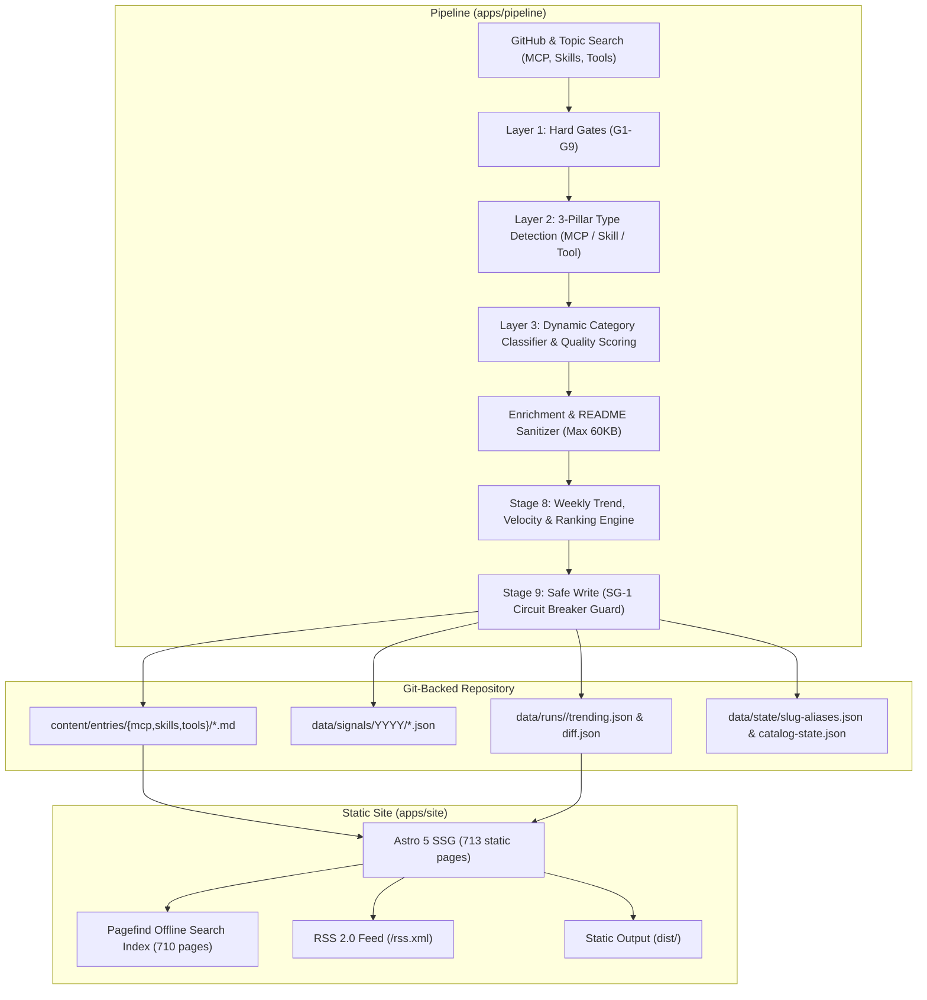

# 07. Project Checkpoint Status & Production Readiness Report

> **Date:** October 2026  
> **Status:** Production Ready (v3.0 Architecture: 3-Pillar Web Dictionary & Weekly Trending Leaderboard)  
> **Repository:** [`teikmin/web_dictionary`](https://github.com/teikmin/web_database)  
> **Evaluator & System Audit:** Antigravity AI Pair Programmer

---

## 1. Executive Summary

The repository has completed its 5-phase evolution from an experimental install-snippet catalog into an authoritative, zero-maintenance, Git-backed **AI Tools Web Dictionary** and **Weekly Trending Leaderboard**.

### Core Milestones Achieved (v3.0)

1. **The 3 Dictionary Pillars (`mcp_server`, `agent_skill`, `agent_tool`):**
   - Expanded beyond MCP and Skills to establish a 1st-class citizen category for standalone AI developer frameworks, agent CLIs, browser automation bots, and core SDKs (e.g. `gpt-researcher`, `ui-tars-desktop`, `scrapling`, `fastmcp`, `trigger.dev`).
   - Clean taxonomy separation prevents standalone AI engines from being misclassified as RPC servers or markdown prompt snippets.

2. **Deterministic 4-Tier Dictionary Definition Box (`DictionaryCard.astro`):**
   - Replaced raw, noisy upstream README taglines with a standardized 6-line lexicographical definition card:
     * **Line 1:** Pronunciation & Grammatical Part-of-Speech (`/ˈprəʊ.tə.kɒl/ · n.`)
     * **Line 2:** Short Canonical 1-Line Definition (backed by 4-tier deterministic fallback: curated override $\to$ sanitized tagline $\ge 35$ch $\to$ sanitized summary $\to$ semantic structured template)
     * **Line 3:** Extended Conceptual Context & Agentic Purpose
     * **Line 4:** Target Interface / Compatible Clients (`Claude Code`, `OpenAI Codex`, `Google Antigravity` for MCP/Skills; `CLI Tool / Standalone Binary` for Tools)
     * **Line 5:** Core Primitives & Capabilities (Tools, Resources, Prompts, Terminal workflows)
     * **Line 6:** Execution Prerequisite & Launch Requirements
   - Polymorphic client dock: contextualizes integration instructions to either host agent environments or CLI terminal installation quickstarts.

3. **Weekly Trending, Velocity & Ranking Engine (Stage 8 + `/trending` + `/rss.xml`):**
   - Computes deterministic weekly star velocity ($\Delta S_{7\text{d}} = \max(0, S_t - S_{t-1})$) using multi-week time-series snapshots in `data/signals/`.
   - Incorporates the audited breakout momentum formula:
     $$\text{TrendingScore} = \Delta S_{7\text{d}} \times \left(1 + \min\left(2.0,\; \frac{\Delta S_{7\text{d}}}{\max(S_{t-1}, 250)}\right)\right)$$
   - Anti-sybil & cold-start guards: non-negative star clamping, synthetic age velocity quarantine from weekly leaderboards, and monorepo sub-skill deduplication (`is_pack_primary: true`).
   - Pure static build-time telemetry: inline SVG `<Sparkline />` with 0 client-side JavaScript, divide-by-zero flatline guards, and weekly historical snapshot archives.
   - Public RSS 2.0 Feed (`/rss.xml`) delivering weekly top-trending summaries and breakout newcomers with sanitized XML entities.

4. **Skill Packs Grouping & Catalog Ergonomics:**
   - Aggregates multi-skill monorepos (such as `trailofbits/skills` or `google-gemini/gemini-cli`) into single representative Pack Cards (`📦 Pack of N skills`), eliminating catalog flooding while preserving individual `/skills/[slug]` pages for programmatic SEO.
   - Adds **🔥 Trending This Week** as the `#1` primary sorting mode in `/catalog`.

5. **Mandatory Pre-Execution Safeguards (SG-1 to SG-6):**
   - **SG-1 (Safe Pruning Circuit Breaker):** Stale entry deletion disabled by default in `9-write.ts`; requires explicit `--force-prune` flag and triggers an automated abort if deletions exceed 5% of catalog size. Pruned entries are safely archived to `data/archive/pruned/<week>/`.
   - **SG-2 (Atomic Category Migration):** Rebalanced existing entries across 9 distinct categories via `scripts/migrate-categories.ts`.
   - **SG-3 (Backward-Compatible Schemas):** Safe defaults on all new Zod fields prevent crashes on legacy entries.
   - **SG-4 (Persistent Slug Aliases):** `data/state/slug-aliases.json` preserves historical signal linkage when normalizing client prefixes.
   - **SG-5 (Glob Loader Protection):** Committed `content/entries/tools/.gitkeep` prevents Astro 5 collection loader crashes.
   - **SG-6 (Hermetic Test Suites):** 11 offline Vitest suites covering all pipeline stages and site modules.

6. **100% Static Zero-Database Architecture:**
   - Zero runtime SQL, zero Supabase, zero server-side middleware.
   - Entire platform compiles statically to flat HTML, CSS, client-side JS, and offline Pagefind search indices.

---

## 2. Monorepo Health & Test Verification

| Metric | Status | Details |
|---|:---:|---|
| **TypeScript Typecheck** | 0 errors, 0 warnings, 0 hints | Clean across `@web-db/schema`, `@web-db/renderers`, `@web-db/pipeline`, and all 35 files in `@web-db/site` |
| **Unit & Integration Tests** | 94 / 94 pass | Full coverage across trends engine, tool specs, categories, hard gates, prune circuit breaker, deduplication, placeholder URL rejection, renderers, and Phase 5 site helpers |
| **Astro SSG Build** | 714 pages | Complete static generation in ~17.4s with 0 hydration errors |
| **Pagefind Search Index** | 711 pages | Indexed in ~4.1s; offline client-side search with `<10ms` query latency; ignores archive routes (`data-pagefind-ignore`) |
| **Catalog Scale** | 690 entries | 102 MCP Servers + 538 Agent Skills + 50 Agent Tools (Balanced 3 Pillars) |

```text
 Test Files  11 passed (11)
      Tests  94 passed (94)
   Duration  1.88s (transform 1.93s, setup 0ms, collect 5.91s, tests 527ms)
```

---

## 3. Architecture & Data Flow



---

## 4. The 3 Dictionary Pillars & Client Integration

| Pillar | Collection | Definition | Target Interface | Install Experience |
|---|---|---|---|---|
| **`mcp_server`** | `content/entries/mcp/` | Model Context Protocol RPC service providing tools/resources to agents. | JSON-RPC over stdio / SSE | 1-Click launcher config for Claude Code, OpenAI Codex, and Google Antigravity. |
| **`agent_skill`** | `content/entries/skills/` | Markdown-instructed procedural skill definition (`SKILL.md`) for agent reasoning. | Markdown prompt execution context | Directory copy instructions for `.claude/skills/`, `.codex/skills/`, or `.gemini/skills/`. |
| **`agent_tool`** | `content/entries/tools/` | Autonomous AI developer framework, CLI binary, browser agent, or agentic SDK. | CLI / Executable Binary / Python / Node / Rust | Terminal package install (`npm i -g`, `pip install`, `brew install`, `cargo install`). |

### Official Agent Client Integration Paths

All configuration paths and command structures have been verified against official developer documentation as of October 2026:

| Agent Client | Launch Command / Snippet Format | Default Workspace Config | Default Global Config | Skill Directory Location |
|---|---|---|---|---|
| **Claude Code** | `claude mcp add <name> -- <cmd>` or `.mcp.json` | `.mcp.json` | `~/.claude.json` | `.claude/skills/<name>/SKILL.md` |
| **OpenAI Codex** | `.codex/config.json` JSON block | `.codex/config.json` | `~/.codex/config.json` | `.codex/skills/<name>/SKILL.md` |
| **Google Antigravity** | `.gemini/mcp_servers.json` (`mcpServers` object) | `.gemini/mcp_servers.json` | `~/.gemini/antigravity/mcp_servers.json` | `~/.gemini/config/skills/<name>/SKILL.md` (or `.gemini/skills/`) |

---

## 5. Catalog Quality, Velocity & Anti-Sybil Guarantees

### 5.1 Hard Gates (Layer 1)
- **G1:** `archived == false`
- **G2:** `fork == false` (except officially pinned vendor forks)
- **G3:** `is_template == false`
- **G4:** Minimum $\ge 100$ stars (official vendors exempt)
- **G5:** Pushed within 180 days
- **G6:** Repository age $\ge 30$ days
- **G7:** Valid OSI open-source license
- **G8:** Non-empty description ($\ge 20$ characters)
- **G9:** Excludes coursewares, tutorials, demos, and boilerplate lists

### 5.2 3-Pillar Classification & Anti-Fake Evidence (Layer 2)
- **MCP Servers:** Verified exclusively via `@modelcontextprotocol/sdk` in `package.json`, exact `mcp` or `fastmcp` in `pyproject.toml`/`requirements.txt`, official Go/Rust SDKs, or manifest conformance.
- **Agent Skills:** Extracted from genuine `SKILL.md` files; rejects repo-internal hidden maintenance directories (`.claude/skills/`, `.cursor/skills/`). Monorepos tag primary entries with `is_pack_primary: true`.
- **Agent Tools:** Standalone autonomous frameworks (`topic:ai-agents`, `topic:coding-agent`, CLI tools, SDKs) classified as `agent_tool` rather than mislabeled as MCP servers.

### 5.3 Trending Velocity Engine & Anti-Sybil Rules (Stage 8)
- **Non-Negative Delta:** Clamps $\Delta S_{7\text{d}} = \max(0, S_t - S_{t-1})$.
- **Cold-Start Resilience:** New entries cleanly baseline without false division-by-zero crashes.
- **Synthetic Quarantine:** Entries using synthetic age velocity are quarantined from dominating weekly leaderboards.
- **Sub-Skill Leaderboard Quarantine:** Only primary pack entries (`is_pack_primary === true`) qualify for leaderboard ranking, preventing multi-skill monorepos from claiming all 25 top spots.

---

## 6. Site Structure & Routes

| Route | Template | Features |
|---|---|---|
| `/` | `index.astro` | **AI Tools Web Dictionary & Weekly Radar:** Instant dictionary search, 3 Pillar Cards, 🔥 Top 10 Trending preview, 🚀 Breakout Newcomers preview, 9 Category tiles, Curated collections. |
| `/catalog` | `catalog.astro` | Unified directory with live client-side filtering (type, client, category, license, status), `#1` "🔥 Trending this week" sort, Skill Packs aggregation checkbox, and pagination. |
| `/trending` | `trending/index.astro` | Latest weekly trending leaderboard with 3 tabs: 🔥 Hot This Week (Top 25), 🚀 Breakout New Tools, 🏆 Top 10 by Pillar, with SVG `<Sparkline />` and rank deltas. |
| `/trending/[week]` | `trending/[week].astro` | Historical weekly snapshot archive (e.g. `/trending/2026-W42`) with `data-pagefind-ignore` search isolation and historical issue banner. |
| `/mcp/[slug]` | `mcp/[slug].astro` | Read-first layout: 6-line DictionaryCard &rarr; Table of contents &rarr; Sanitized README &rarr; Related tools &rarr; 1-Click client install dock. |
| `/skills/[slug]` | `skills/[slug].astro` | Agent skill layout: 6-line DictionaryCard &rarr; Monorepo skill pack table &rarr; Rendered `SKILL.md` &rarr; Related skills &rarr; Client copy instructions. |
| `/tools/[slug]` | `tools/[slug].astro` | Agent tool layout: 6-line DictionaryCard &rarr; Terminal install quickstart dock &rarr; Upstream README &rarr; Related tools. |
| `/client/[client]` | `client/[client].astro` | Pre-filtered view for Claude Code, OpenAI Codex, or Google Antigravity. |
| `/category/[category]` | `category/[category].astro` | Pre-filtered view for the 9 balanced dictionary categories. |
| `/changelog` | `changelog.astro` | Weekly diff of added, updated, and archived tools powered by `data/runs/*/diff.json`. |
| `/about/criteria` | `about/criteria.astro` | Public transparency page explaining the automated quality formula. |
| `/rss.xml` | `rss.xml.ts` | RSS 2.0 feed delivering weekly trending summaries and breakout tools. |

---

## 7. Operational Runbook

### Running the Discovery Pipeline
```bash
# Dry run report (does not alter catalog content)
pnpm run pipeline:report

# Production refresh (discovers, enriches, computes trends, updates content/entries and data/)
# Note: automated pruning is disabled by default (SG-1)
pnpm run pipeline:run

# Force pruning with 5% circuit breaker protection
pnpm run pipeline:run -- --force-prune
```

### Building & Serving the Site
```bash
# Run local dev server
pnpm run site:dev

# Build static production bundle + Pagefind search index
pnpm run site:build

# Preview built static site locally
pnpm --filter @web-db/site exec astro preview --host
```

### Running Test & Typechecks
```bash
# Run complete test suite (11 test files, 94 tests)
pnpm test

# Run TypeScript typechecks across all 4 monorepo packages
pnpm run typecheck
```

---

## 8. Summary of Active Documentation

| File | Status | Description |
|---|---|---|
| [`README.md`](file:///c:/teikmin/exploring/web_database/README.md) | Current (v3.0) | Quick start, 3-pillar dictionary overview, verified client table, repo links, and project directory. |
| [`docs/01_ARCHITECTURE.md`](file:///c:/teikmin/exploring/web_database/docs/01_ARCHITECTURE.md) | Current (v3.0) | Complete system topology, 3-pillar data models, trending engine, client adapters, and URL structure. |
| [`docs/02_REPO_QUALITY_CRITERIA.md`](file:///c:/teikmin/exploring/web_database/docs/02_REPO_QUALITY_CRITERIA.md) | Current | 3-Layer automated filter rules, scoring formulas, anti-sybil rules, and anti-fake heuristics. |
| [`docs/03_GROWTH_AND_SEO.md`](file:///c:/teikmin/exploring/web_database/docs/03_GROWTH_AND_SEO.md) | Current | Programmatic SEO URL matrix, structured JSON-LD, RSS feed, and virality loops. |
| [`docs/04_FUTURE_ROADMAP.md`](file:///c:/teikmin/exploring/web_database/docs/04_FUTURE_ROADMAP.md) | Current | Scope discipline, deferred v1 non-goals, and future exploration ideas. |
| [`docs/05_FOLDER_STRUCTURE.md`](file:///c:/teikmin/exploring/web_database/docs/05_FOLDER_STRUCTURE.md) | Current (v3.0) | Monorepo layout, schema shapes, folder ownership, state artifacts, and data lifecycle. |
| [`docs/06_CATALOG_RELIABILITY_FIX_PLAN.md`](file:///c:/teikmin/exploring/web_database/docs/06_CATALOG_RELIABILITY_FIX_PLAN.md) | Completed | Post-mortem and resolution of type detection, genuine skills, and honest configs. |
| [`docs/06_FRONTEND_UX_REVIEW.md`](file:///c:/teikmin/exploring/web_database/docs/06_FRONTEND_UX_REVIEW.md) | Completed | Frontend UX redesign spec and completed checklist (Phases A–E). |
| [`docs/07_CHECKPOINT_STATUS.md`](file:///c:/teikmin/exploring/web_database/docs/07_CHECKPOINT_STATUS.md) | Current (v3.0) | Authoritative production status report, test matrices, metrics, and operational runbook. |
| [`docs/08_PRODUCT_AND_ARCHITECTURE_REVIEW.md`](file:///c:/teikmin/exploring/web_database/docs/08_PRODUCT_AND_ARCHITECTURE_REVIEW.md) | Completed | Comprehensive review of product strategy, anti-sybil velocity formulas, and 6 safeguards. |
| [`docs/09_V3_WEB_DICTIONARY_AND_TRENDING_PLAN.md`](file:///c:/teikmin/exploring/web_database/docs/09_V3_WEB_DICTIONARY_AND_TRENDING_PLAN.md) | Completed | 5-phase master implementation plan for the Web Dictionary and Trending Leaderboard. |
| [`docs/10_POST_V3_AUDIT_AND_UI_REDESIGN.md`](file:///c:/teikmin/exploring/web_database/docs/10_POST_V3_AUDIT_AND_UI_REDESIGN.md) | Completed | Post-v3 audit un-filtering the catalog, 3-pillar reclassification, and frontend UI redesign. |
| [`docs/11_DEPLOYMENT_AND_HOSTING_GUIDE.md`](file:///c:/teikmin/exploring/web_database/docs/11_DEPLOYMENT_AND_HOSTING_GUIDE.md) | Current | Production deployment audit, GitHub Actions workflow fixes, and $0/mo hosting runbook. |
| [`docs/12_FINAL_IMPLEMENTATION_AUDIT.md`](file:///c:/teikmin/exploring/web_database/docs/12_FINAL_IMPLEMENTATION_AUDIT.md) | Current | Final post-implementation verification, alignment scorecard (9.8/10), and resolved issues report. |
