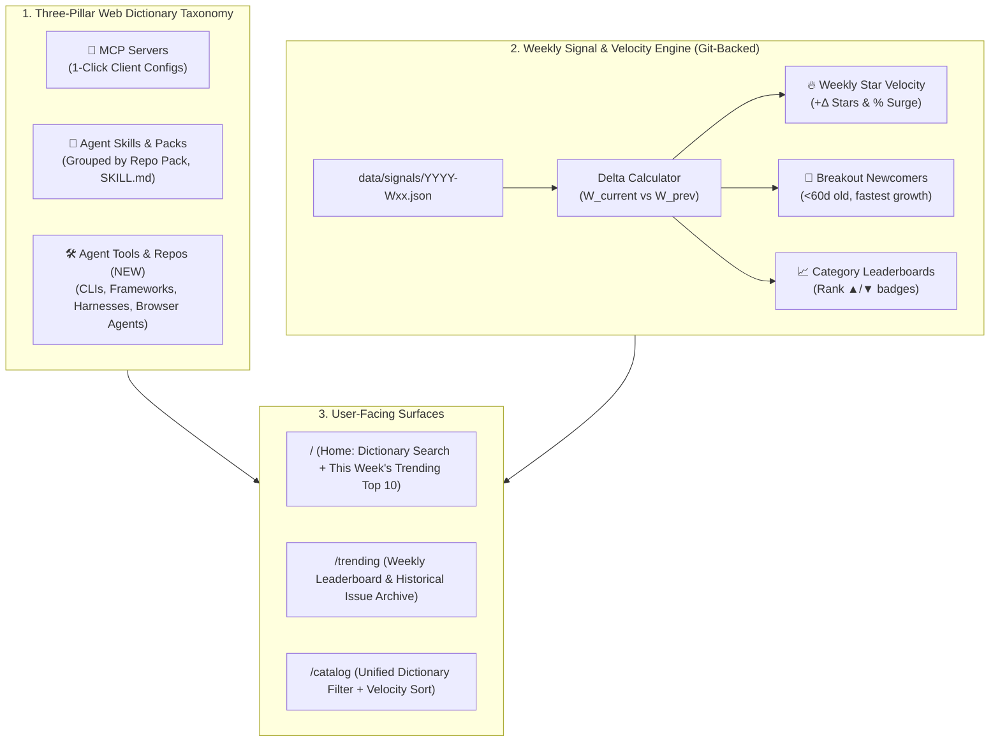

# 08. Product, UX & Architecture Review: The "AI Web Dictionary & Trend Radar"

> **Date:** 16 October 2026  
> **Reviewer:** Antigravity (Product Manager, Lead Architect & UX Critic View)  
> **Scope:** Full review of project documentation ([`00`](file:///c:/teikmin/exploring/web_database/docs/00_PROJECT_EVALUATION.md)–[`07`](file:///c:/teikmin/exploring/web_database/docs/07_CHECKPOINT_STATUS.md)), pipeline configuration, run reports ([`2026-W42/report.md`](file:///c:/teikmin/exploring/web_database/data/runs/2026-W42/report.md)), and repository structure against the founder's core product vision.

---

## 1. Executive Summary & Overall Rating

You set out to build two tightly connected experiences:
1. **An AI Tools "Web Dictionary":** A clean, high-signal reference where users can search and understand AI tools — GitHub repos, Agent Skills, MCP servers, and interesting agent tools.
2. **A Weekly Trend & Ranking Board:** A live pulse showing which new agent tools or repos are trending *right now* (weekly rankings, breakout tools, rising velocity) so users can catch up on the ecosystem without drowning in GitHub noise.

### How the Current Repo Measures Up

**Overall Score: 7.6 / 10** — *World-class static engineering & pipeline architecture (8.8/10), paired with a product/discovery layer (6.2/10) that currently acts like a static install-snippet catalog rather than a true "Web Dictionary + Weekly Trend Radar."*

| Perspective | Rating | Verdict |
|---|:---:|---|
| **🧑‍💻 Developer / Architecture View** | **8.8 / 10** | Deleting Supabase in favor of a Git-backed `pnpm` monorepo, shared Zod schemas ([`packages/schema`](file:///c:/teikmin/exploring/web_database/packages/schema/package.json)), Astro 5 SSG, and Pagefind search is a 10/10 architectural move for a solo builder. Near-zero cost, fast builds, high maintainability. |
| **📋 Project Manager (PM) View** | **7.2 / 10** | Great scope discipline (cutting auth, paid APIs, and LLM fluff early). However, there is **doc-to-code drift** (several features marked "✅ Completed" in [`06_FRONTEND_UX_REVIEW.md`](file:///c:/teikmin/exploring/web_database/docs/06_FRONTEND_UX_REVIEW.md) and [`07_CHECKPOINT_STATUS.md`](file:///c:/teikmin/exploring/web_database/docs/07_CHECKPOINT_STATUS.md) are missing or bypassed in reality), and the product lacks a **weekly retention loop**. |
| **🧭 End-User Perspective** | **6.2 / 10** | Great light reading theme and 1-click configs, **but fails two core promises**: (1) there is no real **Weekly Trending / Ranking** view (only all-time star sorting), and (2) the catalog is flooded by **538 sub-folder skills from monorepos** while missing general AI agent tools/repos. |

---

## 2. Deep-Dive Audit: Three Perspectives

### 2.1 End-User Perspective (The "Web Dictionary & Trend Hunter") — 6.2 / 10

When a user visits your site, they have two modes: **Lookup Mode** (*"What is this tool / what's the best tool for X?"*) and **Trend-Catching Mode** (*"What blew up in AI agents this week?"*). Here is where the current experience breaks down:

#### ❌ Gap 1: No "Weekly Ranking" or "Trending Right Now" Experience
- **The Problem:** Sorting by "Popular" in [`/catalog`](file:///c:/teikmin/exploring/web_database/apps/site/src/pages/catalog.astro) sorts by **total lifetime GitHub stars** or static composite score. A repo with `196,000` stars (`morluto/rea`) or `101,000` stars (`paperclipai/paperclip`) sits permanently at the top every single week.
- **User Impact:** If a user visits every Monday to see *what is trending right now*, the top of the board looks frozen. They cannot see **Star Velocity** (e.g., `+1,850 ★ this week`), **Breakout Newcomers** (repos created in the last 30–60 days surging in adoption), or **Rank Movers** (`▲ +12 spots this week`).
- **Missing Route:** [`07_CHECKPOINT_STATUS.md`](file:///c:/teikmin/exploring/web_database/docs/07_CHECKPOINT_STATUS.md) §6 lists `/changelog` (`changelog.astro`) and `/rss.xml` (`rss.xml.ts`), **neither file actually exists** in [`apps/site/src/pages/`](file:///c:/teikmin/exploring/web_database/apps/site/src/pages/index.astro). Even if `/changelog` existed as a raw list of added/removed files, a technical diff is not an engaging **Weekly Leaderboard**.

#### ❌ Gap 2: The Catalog Only Knows "MCP" and "Skills" — Missing "Agent Tools & Repos"
- **The Problem:** You wanted a dictionary for *"AI tools like GitHub repos, agent skills, MCP, interesting agent tools, etc."* Currently, Layer 2 ([`02_REPO_QUALITY_CRITERIA.md`](file:///c:/teikmin/exploring/web_database/docs/02_REPO_QUALITY_CRITERIA.md) §4) strictly forces every repository into either `mcp_server` or `agent_skill`.
- **Two Bad Side Effects Observed in [`2026-W42/report.md`](file:///c:/teikmin/exploring/web_database/data/runs/2026-W42/report.md):**
  1. **Forced Misclassification:** Major standalone AI agent repos/tools like `assafelovic/gpt-researcher` (30k stars), `bytedance/UI-TARS-desktop` (39k stars), `D4Vinci/Scrapling` (87k stars), `triggerdotdev/trigger.dev` (16k stars), and `open-metadata/OpenMetadata` (15k stars) are listed as **MCP Servers** simply because they have an MCP integration somewhere in their tree. Worse, the pipeline generates bizarre MCP launch commands for them (e.g., `claude mcp add gpt-researcher -- uvx gpt-researcher` or an unreplaced placeholder `https://{openmetadata_host}/mcp`).
  2. **Blind Spot for Pure Agent Tools:** Amazing agent CLIs, coding harnesses, browser agents, memory layers, and multi-agent frameworks that do *not* ship a `SKILL.md` or `@modelcontextprotocol/sdk` dependency are completely invisible to your dictionary.

#### ❌ Gap 3: Monorepo "Skill Flood" Destroys Browsing & Ranking
- **The Problem:** Look at [`data/state/catalog-state.json`](file:///c:/teikmin/exploring/web_database/data/state/catalog-state.json) and [`2026-W42/report.md`](file:///c:/teikmin/exploring/web_database/data/runs/2026-W42/report.md):
  - Out of **690 total entries**, **538 are skills** (`78%` of the entire site!) and only **152 are MCP servers**.
  - Why? Because when a single high-star repository (like `anthropics/claude-plugins-official` with 37k stars, `paperclipai/paperclip` with 101k stars, `wshobson/agents`, or `zenstory-ai/drama-skills`) passes the repo-level gates, the pipeline extracts **every single `SKILL.md` subfolder as a top-ranked entry that inherits the parent repo's 37k–101k star count**.
- **User Impact:** Look at the Top 30 Agent Skills in [`2026-W42/report.md`](file:///c:/teikmin/exploring/web_database/data/runs/2026-W42/report.md#L71-L100):
  - Ranks #1–#5 are all `nitrostack-*` skills from the exact same repo.
  - Ranks #6–#10 are all `anthropics/claude-plugins-official` (`access`, `configure`, `imessage-access`, `imessage-configure`).
  - Ranks #18–#22 are 5 variations of `skillopt-sleep` (`codex-skillopt-sleep`, `cursor-skillopt-sleep`, etc.) from `microsoft/SkillOpt`.
  - Ranks #23–#27 are 5 internal skills from `paperclipai/paperclip` (`delegate-work`, `paperclip-delegate-work`, etc.).
  - When a user browses Skills, instead of discovering diverse tools, they scroll through dozens of repetitive sub-files from the same 10 monorepos.

#### ❌ Gap 4: "README Dump" vs. True "Web Dictionary" Format
- Putting the sanitized README on the tool page ([`06_FRONTEND_UX_REVIEW.md`](file:///c:/teikmin/exploring/web_database/docs/06_FRONTEND_UX_REVIEW.md) §5.5) was a big improvement over a 1-line stub.
- However, GitHub READMEs are written as marketing pitches or developer docs — not dictionary entries. A visitor looking up a tool in a **Web Dictionary** wants a standardized **Quick Definition Box** at the very top (What it is, Primary Use Case, How it runs: Local vs. Cloud, API Keys Needed, Compatible Clients) before scrolling through a 60KB README.

---

### 2.2 Developer & Architecture Perspective — 8.8 / 10

#### ✅ What Is Architecturally Brilliant
1. **Git-as-Database (`content/entries/` + `data/signals/`):** Zero runtime database maintenance, free hosting on Cloudflare Pages / Vercel / GitHub Pages, deterministic builds, and full version history via Git commits.
2. **Workspace Separation (`apps/*` + `packages/*`):** Sharing `@web-db/schema` and `@web-db/renderers` between the weekly ingestion pipeline and the Astro static site guarantees compile-time safety.
3. **Cost-Ordered 3-Layer Funnel:** Filtering via free GitHub Search metadata (Layer 1) before fetching Git trees (Layer 2) and enrichment manifests (Layer 3) respects GitHub API rate limits and completes a full run in **~28 seconds** ([`2026-W42/report.md`](file:///c:/teikmin/exploring/web_database/data/runs/2026-W42/report.md)).
4. **Weekly Signal Snapshots Already Exist:** You already store `data/signals/2026/2026-W41.json` and `2026-W42.json`. You have the exact time-series raw material needed to build a real Trending & Velocity engine without changing your storage model!

#### ⚠️ Architectural & Engineering Bugs Found in the Audit
1. **Documentation vs. Implementation Drift:**
   Several files documented as existing or completed in [`05_FOLDER_STRUCTURE.md`](file:///c:/teikmin/exploring/web_database/docs/05_FOLDER_STRUCTURE.md), [`06_FRONTEND_UX_REVIEW.md`](file:///c:/teikmin/exploring/web_database/docs/06_FRONTEND_UX_REVIEW.md), and [`07_CHECKPOINT_STATUS.md`](file:///c:/teikmin/exploring/web_database/docs/07_CHECKPOINT_STATUS.md) do not match the actual repository state:

| Claimed in Docs | Actual State in Repo | Severity |
|---|---|---|
| `apps/site/src/pages/changelog.astro` & `rss.xml.ts` exist ([`07_CHECKPOINT_STATUS.md`](file:///c:/teikmin/exploring/web_database/docs/07_CHECKPOINT_STATUS.md#L118-L120)) | **Missing.** Neither file exists in `apps/site/src/pages/`. | 🔴 High |
| `data/runs/<week>/diff.json` generated ([`07_CHECKPOINT_STATUS.md`](file:///c:/teikmin/exploring/web_database/docs/07_CHECKPOINT_STATUS.md#L60)) | **Missing.** `data/runs/2026-W41/` and `W42/` only contain `decisions.json`, `enriched.json`, and `report.md`. | 🔴 High |
| Category keyword `"agent"` removed so `ai-frameworks` doesn't catch 68% of entries ([`06_FRONTEND_UX_REVIEW.md`](file:///c:/teikmin/exploring/web_database/docs/06_FRONTEND_UX_REVIEW.md#L339) Task A4 "✅ Completed") | **Not fixed.** [`content/categories/ai-frameworks.yaml`](file:///c:/teikmin/exploring/web_database/content/categories/ai-frameworks.yaml#L7) still lists `- agent` as its very first keyword! | 🔴 High |
| Placeholder URLs like `{host}` downgraded to `none` confidence ([`06_CATALOG_RELIABILITY_FIX_PLAN.md`](file:///c:/teikmin/exploring/web_database/docs/06_CATALOG_RELIABILITY_FIX_PLAN.md#L68) "✅ Done") | **Bypassed for single-brace `{...}`.** `OpenMetadata` in [`2026-W42/report.md`](file:///c:/teikmin/exploring/web_database/data/runs/2026-W42/report.md#L45) outputs `https://{openmetadata_host}/mcp` with `manifest` confidence. | 🟡 Medium |
| Catalog capped at `500` (`350` MCP / `150` Skills) in [`thresholds.yaml`](file:///c:/teikmin/exploring/web_database/apps/pipeline/config/thresholds.yaml#L10-L12) | **Bypassed by monorepo split.** `6-select.ts` selects 150 skill *repos*, which then expand into **538 skill entries** (`690` total entries). | 🟡 Medium |
| Stages `5-anti-fake.ts` and `8-lifecycle.ts` listed in [`05_FOLDER_STRUCTURE.md`](file:///c:/teikmin/exploring/web_database/docs/05_FOLDER_STRUCTURE.md#L214-L217) | **Folded or missing.** Actual stages jump `4-score.ts` $\to$ `6-select.ts` $\to$ `7-enrich.ts` $\to$ `9-write.ts`. | 🟢 Low (Doc sync) |

2. **Sub-Entry Evidence Rule Not Enforced:**
   [`02_REPO_QUALITY_CRITERIA.md`](file:///c:/teikmin/exploring/web_database/docs/02_REPO_QUALITY_CRITERIA.md#L81) warns: *"To prevent a popular monorepo from flooding the catalog with trivial or unmaintained utilities, each sub-entry must carry its own verifiable evidence."* Currently, sub-skills do not have independent scoring or per-repo caps, causing the 538-skill flood.

---

### 2.3 Project Manager (PM) Perspective — 7.2 / 10

- **Product Positioning Conflict:** Right now, the product is torn between two identities:
  - *Identity A (Config Generator):* "Copy `.mcp.json` for Claude Code, Codex, and Antigravity."
  - *Identity B (AI Web Dictionary & Trend Radar):* "Search AI repos, skills, MCPs, and agent tools, and track weekly trending tools."
  - Identity A is a great utility hook, but Identity B is what makes the site a **destination** people visit every week.
- **Retention & Habit Loop:** Developer directories die when users only visit once every 3 months via Google search. Adding a **Weekly Trending & Ranking Board** (`2026-W42 Leaderboard`) creates a weekly habit loop and gives you a natural artifact to share on X/Twitter, Reddit, and newsletters every Monday morning (*"Here are the Top 10 fastest-growing AI Agent Tools & Skills of Week 42"*).

---

## 3. Recommended Redesign: Features to Add, Change & Remove

To align the project with your **Web Dictionary + Weekly Trend Board** vision (without adding backend servers or databases), here is the recommended redesign blueprint.



---

### 3.1 ADD: Feature #1 — The "Weekly Trending & Leaderboard" Engine (`/trending`)

You already collect weekly snapshots in `data/signals/2026/2026-W41.json` and `2026-W42.json`. Turn that passive JSON archive into your site's signature feature:

1. **Compute Week-over-Week Signals in the Pipeline:**
   Compare current week ($W_t$) against previous week ($W_{t-1}$) and write these fields directly into each entry's frontmatter and `data/runs/<week>/trending.json`:
   - `stars_delta_7d`: Raw stars gained this week (e.g., `+1,420 ★`).
   - `trending_score`: Velocity score that balances raw star gain with relative growth rate so smaller breakout tools can compete with 100k-star giants:
     $$\text{TrendingScore} = \Delta \text{Stars}_{7\text{d}} \times \left(1 + \frac{\Delta \text{Stars}_{7\text{d}}}{\max(\text{Stars}_{t-1}, 100)}\right)^{0.5}$$
   - `rank_delta`: Change in category or overall rank (`▲ 5`, `▼ 2`, `NEW`).
2. **Create a Dedicated `/trending` Leaderboard Page (and Home Page Tab):**
   Organize `/trending` into three scannable tabs:
   - **🔥 Hot This Week (Top 25 Overall):** Ranked by `trending_score`, showing `+X,XXX ★ this week`, `% growth`, and a 4-week mini sparkline (SVG built at static build time from the last 4 signal files!).
   - **🚀 Breakout New Tools:** Filtering for repositories created in the last **60 days** (or `first_seen` in the last 2 weeks) with the highest weekly star gain. This directly answers *"which new agent tools are trending right now"*.
   - **📂 Top Movers by Type:** Separate weekly top 10 lists for **MCP Servers**, **Agent Skills**, and **Agent Tools/Repos**.
3. **Archiveable Weekly Issues (`/trending/2026-W42`):**
   Every weekly pipeline run statically generates a permanent snapshot page for that week (replacing the missing `/changelog` with something 10x more valuable). Users can browse past weeks (`W41`, `W42`, `W43`), and you get a ready-made link to post every week.

---

### 3.2 ADD: Feature #2 — Expand to a 3-Pillar "Web Dictionary" (`MCP` + `Skills` + `Agent Tools`)

Stop forcing every interesting AI repository into `mcp_server` or `agent_skill`. Introduce a 3rd first-class dictionary type: **`agent_tool`** (or **`agent_repo`**).

| Dictionary Pillar | Route | What Belongs Here | Primary User Action |
|---|---|---|---|
| **1. MCP Servers** | `/mcp/[slug]` | True, dedicated MCP servers whose primary purpose is exposing MCP tools/resources (`github-mcp-server`, `postgres-mcp`, `firecrawl-mcp-server`). | Read overview + **1-Click Copy MCP Config** |
| **2. Agent Skills** | `/skills/[slug]` | Reusable `SKILL.md` prompt/workflow packages and agent plugins for Claude Code, Codex, and Antigravity. | Read `SKILL.md` + **Copy Skill Install Command** |
| **3. Agent Tools & Repos** *(NEW)* | `/tools/[slug]` | Standalone AI coding agents, autonomous harnesses, browser automation agents, memory engines, multi-agent frameworks, and eval tools (`gpt-researcher`, `UI-TARS-desktop`, `Scrapling`, `Aider`, `Browser-Use`, etc.). | Read structured **Dictionary Card** + README + `git clone` / `npx` / `uvx` quickstart |

**Why this fixes two problems at once:**
- Your MCP catalog becomes 100% pure (no more general frameworks pretending to be MCP servers).
- Your site becomes a true **AI Web Dictionary** where users can look up *any* trending AI agent repo on GitHub.

---

### 3.3 CHANGE: Feature #3 — Group Monorepo Skills into "Skill Packs" (Fix the 538-Skill Flood)

Right now, a single repository with 30 `SKILL.md` files creates 30 top-ranked cards that drown out everything else.
- **How to Redesign It:**
  1. **Parent "Skill Pack" Grouping in Browse Views:** On `/catalog` and `/trending`, if a repository contains $>1$ skill, display **1 parent "Skill Pack" card** (or cap at max 2 individual skills per repo in the main feed) with a badge: `📦 Pack of 18 Skills`.
  2. **Pack Detail View or Expandable Drawer:** Clicking the Skill Pack shows all 18 skills inside that repository cleanly organized in a table, while still keeping individual `/skills/[slug]` pages alive for direct search & SEO!
  3. **Discount Inherited Stars for Sub-Skills:** A sub-skill inside a 100k-star monorepo should not automatically get credit for 100k stars unless the repo itself is a dedicated skills repo.

---

### 3.4 CHANGE: Feature #4 — Standardized "Dictionary Definition Card" on Every Entry

To make the site feel like a **Web Dictionary** rather than just a GitHub README mirror, add a structured **Dictionary Definition Box** above the README on every detail page:

```text
┌─────────────────────────────────────────────────────────────────────────┐
│ 📖 DICTIONARY DEFINITION                                                │
│                                                                         │
│ • What it is:     Headless browser automation MCP server powered by     │
│                   Playwright for LLM web scraping and interaction.      │
│ • Type:           🔌 MCP Server (Stdio / Node.js)                       │
│ • Category:       Browser Automation  ·  Tags: #playwright #scraping    │
│ • Execution:      Runs locally via `npx` (Zero external API key req.)   │
│ • Works With:     Claude Code · OpenAI Codex · Google Antigravity       │
│ • Trend Status:   🔥 #4 Trending This Week (+640 ★ in 2026-W42)         │
└─────────────────────────────────────────────────────────────────────────┘
```

All 6 lines can be generated deterministically from your existing frontmatter (`type`, `launch.transport`, `launch.command`, `launch.env_vars`, `categories`, and `signals` delta) with **zero LLM API cost**.

---

### 3.5 REMOVE / FIX: Immediate Cleanup List

1. **Remove `- agent` from [`content/categories/ai-frameworks.yaml`](file:///c:/teikmin/exploring/web_database/content/categories/ai-frameworks.yaml):**
   - Right now, `- agent` is still the #1 keyword in `ai-frameworks.yaml`, causing almost every AI agent repo to get lumped into `AI Frameworks & Memory`. Replace it with specific keywords (`langgraph`, `autogen`, `crewai`, `mastra`, `pydantic-ai`, `mem0`, `zep`, `orchestrator`).
   - Add 2–3 clearer dictionary categories: **`coding-agents`** (CLI & IDE agents), **`web-search-rag`** (search, scraping, crawlers), and **`media-creative`** (image, video, audio, document skills).
2. **Fix Single-Brace `{placeholder}` Detection in Enrichment:**
   - Update placeholder regex in `apps/pipeline/src/enrich/` to catch single curly braces like `https://{openmetadata_host}/mcp` or `<your-domain>` so broken URLs are never rendered as 1-click commands.
3. **Remove Duplicate/Internal Variants in Skills (`microsoft/SkillOpt`, `paperclipai/paperclip`):**
   - When a repo ships identical skills duplicated across client folders (`codex-skillopt-sleep`, `cursor-skillopt-sleep`, `plugins-skillopt-sleep`), deduplicate them by normalized skill name or folder hash so the user doesn't see 5 identical cards.
4. **Reconcile Documentation with Reality:**
   - Either implement the missing `/changelog` (ideally upgraded to `/trending`) and `/rss.xml` routes, or update [`07_CHECKPOINT_STATUS.md`](file:///c:/teikmin/exploring/web_database/docs/07_CHECKPOINT_STATUS.md) so the docs never claim non-existent files are live.

---

## 4. Prioritized Action Roadmap (What to Change Next)

If you decide to execute these improvements, here is the highest-ROI order:

| Priority | Phase | Scope | Impact on Vision |
|:---:|---|---|---|
| **P0** | **Data Hygiene & Category Fix** | Remove `- agent` from `ai-frameworks.yaml`; fix `{placeholder}` URL check; deduplicate client-prefixed skill clones (`codex-*`, `cursor-*`). | 🟢 Immediately cleans up catalog browse quality |
| **P1** | **Weekly Velocity & `/trending` Board** | Compute `stars_delta_7d` & `trending_score` from `data/signals/`; build `/trending` leaderboard + "Hot This Week" & "Breakout New Tools" sections on `/`. | 🔥 Delivers your core "catch up on the weekly trend" goal |
| **P2** | **Monorepo "Skill Pack" Grouping** | Group multi-skill repos into collapsible Skill Packs on `/catalog` and `/trending` (or limit max 2 skills per repo in browse grids). | 🟢 Eliminates the 538-skill flood; makes `/catalog` enjoyable to browse |
| **P3** | **3rd Pillar: `Agent Tools & Repos`** | Add `agent_tool` type in `@web-db/schema`; move general AI agent repos (`gpt-researcher`, `UI-TARS`, `Scrapling`, etc.) out of MCP and into `/tools/[slug]`. | 📖 Transforms the site into a true AI Tools Web Dictionary |
| **P4** | **Dictionary Definition Card + Sparklines** | Add the structured 6-line Dictionary Definition Box to detail pages and 4-week SVG star sparklines on trending cards. | ✨ High visual polish & instant user comprehension |
