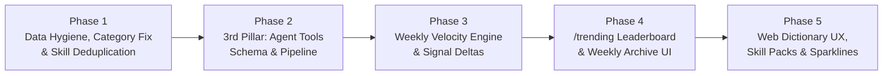

# 09. v3 Master Implementation Plan: AI Web Dictionary & Weekly Trend Board

> **Date:** 16 October 2026  
> **Status:** Active Implementation (Phases 1, 2, and 3 Completed & Verified)  
> **Companion Review:** [`08_PRODUCT_AND_ARCHITECTURE_REVIEW.md`](file:///c:/teikmin/exploring/web_database/docs/08_PRODUCT_AND_ARCHITECTURE_REVIEW.md)  
> **Goal:** Evolve the repository from a 2-type install-snippet catalog into a **3-Pillar AI Tools Web Dictionary (`MCP Servers` + `Agent Skills` + `Agent Tools & Repos`)** with a **Weekly Trending & Velocity Leaderboard (`/trending`)**.

---

## 1. Complete Inventory of What to Fix, Change & Add

### 1.1 Bugs & Data Hygiene Fixes (Existing System)

| ID | Area | Exact Root Cause Found | What to Fix | Target Files |
|:---:|---|---|---|---|
| **FIX-1** | **Duplicate Skills Across Client Folders** | In [`7-enrich.ts`](file:///c:/teikmin/exploring/web_database/apps/pipeline/src/stages/7-enrich.ts#L203-L215), when a repo contains the same skill in multiple client folders (e.g. `codex/.../skillopt-sleep` and `cursor/.../skillopt-sleep`), lines 203–209 rename `skillName` to `codex-skillopt-sleep` *before* line 213 checks `seenSkills.has(skillName)`, bypassing deduplication. | Deduplicate by **base `skill_name` + normalized body hash** before disambiguating folder names. Only disambiguate when two skills have the same generic name (like `access` or `configure`) **and** genuinely different `SKILL.md` content. | [`apps/pipeline/src/stages/7-enrich.ts`](file:///c:/teikmin/exploring/web_database/apps/pipeline/src/stages/7-enrich.ts) |
| **FIX-2** | **Category Assignment Ignores YAML & Catches `agent`/`llm`** | [`9-write.ts`](file:///c:/teikmin/exploring/web_database/apps/pipeline/src/stages/9-write.ts#L10-L44) hardcodes `assignCategory()` instead of reading [`content/categories/*.yaml`](file:///c:/teikmin/exploring/web_database/content/categories/ai-frameworks.yaml), and line 39 includes `\b(...\|prompt\|agent\|llm)\b` in `ai-frameworks`, dumping ~60% of entries into `ai-frameworks`. | 1. Remove `agent`, `llm`, `prompt`, `research`, `experiment` from the `ai-frameworks` matcher.<br>2. Load category matching rules dynamically from `content/categories/*.yaml` (or centralize in `apps/pipeline/src/classify/categories.ts`). | [`apps/pipeline/src/stages/9-write.ts`](file:///c:/teikmin/exploring/web_database/apps/pipeline/src/stages/9-write.ts), [`content/categories/ai-frameworks.yaml`](file:///c:/teikmin/exploring/web_database/content/categories/ai-frameworks.yaml) |
| **FIX-3** | **Single-Brace `{placeholder}` URLs in MCP Configs** | Placeholder check misses single curly braces `{...}` and angle brackets `<...>` in HTTP URLs, letting broken commands like `https://{openmetadata_host}/mcp` pass with `manifest` confidence ([`2026-W42/report.md`](file:///c:/teikmin/exploring/web_database/data/runs/2026-W42/report.md#L45)). | Reject or downgrade confidence to `none` whenever `command`, `args`, or `remote_url` matches `/\{[a-zA-Z0-9_-]+\}\|<[a-zA-Z0-9_-]+>\|YOUR_.*_HERE\|example\.com\|localhost/i`. | [`apps/pipeline/src/enrich/mcp/from-package-json.ts`](file:///c:/teikmin/exploring/web_database/apps/pipeline/src/enrich/mcp/from-package-json.ts), [`from-server-json.ts`](file:///c:/teikmin/exploring/web_database/apps/pipeline/src/enrich/mcp/from-server-json.ts), [`from-readme.ts`](file:///c:/teikmin/exploring/web_database/apps/pipeline/src/enrich/mcp/from-readme.ts) |
| **FIX-4** | **Monorepo Skill Flood (`538` Skills vs `152` MCPs)** | [`6-select.ts`](file:///c:/teikmin/exploring/web_database/apps/pipeline/src/stages/6-select.ts) caps at 150 skill *repos*, and [`7-enrich.ts`](file:///c:/teikmin/exploring/web_database/apps/pipeline/src/stages/7-enrich.ts#L197) expands each repo up to 5 skills (`150 × 5 = 538` skills), all inheriting the parent repo's 30k–100k star score. | 1. Introduce **Parent Repo Grouping (`pack_slug` / `repo_skill_count`)** so browse & trending views show **1 card per repo pack** by default (or max 2 skills per repo in flat lists).<br>2. Enforce the global entry cap *after* sub-entry expansion or cap skills at `250` total entries. | [`apps/pipeline/src/stages/6-select.ts`](file:///c:/teikmin/exploring/web_database/apps/pipeline/src/stages/6-select.ts), [`7-enrich.ts`](file:///c:/teikmin/exploring/web_database/apps/pipeline/src/stages/7-enrich.ts), [`apps/site/src/components/CatalogView.astro`](file:///c:/teikmin/exploring/web_database/apps/site/src/components/CatalogView.astro) |
| **FIX-5** | **SDKs & Full Apps Misclassified as MCP Servers** | [`3-type-check.ts`](file:///c:/teikmin/exploring/web_database/apps/pipeline/src/stages/3-type-check.ts#L26-L72) classifies any repo with `@modelcontextprotocol/sdk`, `mcp`, or `fastmcp` as `mcp_server`. Thus, SDKs (`modelcontextprotocol/python-sdk`, `PrefectHQ/fastmcp`) and huge standalone apps (`gpt-researcher`, `UI-TARS-desktop`, `Scrapling`, `trigger.dev`) are mislabeled as MCP servers. | Distinguish **Dedicated MCP Servers** (repo name/topics/manifest clearly indicate an MCP server or gateway) from **General Agent Tools / SDKs** (which belong in the new 3rd pillar `agent_tool`). | [`apps/pipeline/src/stages/3-type-check.ts`](file:///c:/teikmin/exploring/web_database/apps/pipeline/src/stages/3-type-check.ts) |
| **FIX-6** | **Missing `diff.json`, `/changelog`, and `/rss.xml`** | Documented as live in [`07_CHECKPOINT_STATUS.md`](file:///c:/teikmin/exploring/web_database/docs/07_CHECKPOINT_STATUS.md#L118-L120), but never written by [`9-write.ts`](file:///c:/teikmin/exploring/web_database/apps/pipeline/src/stages/9-write.ts) and missing from `apps/site/src/pages/`. | Replace `/changelog` with the much stronger **`/trending`** & **`/trending/[week]`** routes, and add `/rss.xml` (`rss.xml.ts`) fed by weekly trending & new entries. | [`apps/pipeline/src/stages/9-write.ts`](file:///c:/teikmin/exploring/web_database/apps/pipeline/src/stages/9-write.ts), `apps/site/src/pages/trending/`, `apps/site/src/pages/rss.xml.ts` |

---

### 1.2 New Features to Add (Web Dictionary + Weekly Trend Board)

| ID | Feature | User Value | Summary of Design |
|:---:|---|---|---|
| **ADD-1** | **Weekly Trend & Velocity Engine** | Let users see **what is hot right now** instead of static all-time star giants. | Compare weekly signal snapshots (`data/signals/YYYY/YYYY-Wxx.json`) to compute `stars_delta_7d`, `stars_growth_pct`, `trending_score`, `rank_delta`, and `is_new_this_week`. |
| **ADD-2** | **`/trending` Leaderboard & Weekly Archive (`/trending/[week]`)** | Gives users a Monday-morning destination ("AI Agent Weekly Top 25") and gives you shareable weekly URLs. | 3-tab leaderboard on `/trending`:<br>1. **🔥 Hot This Week** (sorted by velocity `trending_score`)<br>2. **🚀 Breakout New Repos** (created $\le 60$ days ago or newly added)<br>3. **🏆 Top by Pillar** (Top 10 MCP, Top 10 Skills, Top 10 Agent Tools)<br>Plus static weekly archive pages `/trending/2026-W42`. |
| **ADD-3** | **3rd Dictionary Pillar: `Agent Tools & Repos` (`/tools/[slug]`)** | Turns the site into a complete **AI Tools Web Dictionary** covering GitHub agent repos, CLIs, harnesses, browser agents, and frameworks. | Add `agent_tool` to `EntryTypeSchema` (`content/entries/tools/*.md`). Includes `ToolSpecSchema` (install method: `npx`/`uvx`/`pip`/`brew`/`docker`/`git clone`, CLI binary name, runtime, local vs cloud). |
| **ADD-4** | **Expanded Dictionary Taxonomy (10 Categories + Use-Case Tags)** | Users searching a dictionary need clear domain buckets, not 68% in `ai-frameworks`. | Refine `content/categories/*.yaml` into 10 crisp buckets + extract up to 4 normalized `tags` per entry (e.g. `#playwright`, `#postgres`, `#coding-agent`, `#local-llm`). |
| **ADD-5** | **Standardized "Dictionary Definition Card" on Detail Pages** | Gives instant 5-second comprehension before the user reads a 60KB upstream README. | Structured card at the top of `/mcp/[slug]`, `/skills/[slug]`, and `/tools/[slug]` showing: *Plain Definition*, *Pillar & Runtime*, *Category & Tags*, *Auth/Cost (Local Free vs API Key)*, *Compatible Clients*, and *Weekly Trend Badge*. |
| **ADD-6** | **4-Week SVG Star Sparkline & Momentum Badges** | Visual cue on cards showing whether a tool is surging, steady, or stalling. | Build-time inline SVG sparkline from the last 4 `data/signals/` snapshots + `+1,240 ★ this week` badge on cards. |

---

## 2. Detailed Technical Design (By Subsystem)

### 2.1 Schema Changes (`packages/schema`)

#### A. Expand `EntryTypeSchema` in [`packages/schema/src/entry.ts`](file:///c:/teikmin/exploring/web_database/packages/schema/src/entry.ts)
- Change `EntryTypeSchema` from `z.enum(['mcp_server', 'agent_skill'])` to:
  ```ts
  export const EntryTypeSchema = z.enum(['mcp_server', 'agent_skill', 'agent_tool']);
  ```
- Create `packages/schema/src/tool-spec.ts` (`ToolSpecSchema`) for the 3rd pillar (`agent_tool`):
  - `subcategory`: `'coding_agent' | 'agent_framework' | 'browser_agent' | 'memory_rag' | 'eval_observability' | 'sdk_harness' | 'desktop_ui' | 'other'`
  - `install_command`: optional verified quickstart command (`pip install ...`, `npx ...`, `brew install ...`, `git clone ...`)
  - `runtime`: `'node' | 'python' | 'rust' | 'go' | 'docker' | 'multi' | 'unknown'`
  - `execution_mode`: `'local' | 'cloud' | 'hybrid'`

#### B. Expand `LatestSignalsSchema` in [`packages/schema/src/entry.ts`](file:///c:/teikmin/exploring/web_database/packages/schema/src/entry.ts)
Add weekly velocity & ranking fields so every page and card has instant access without loading historical JSON files at runtime:
- `stars`: `number` (current total stars)
- `stars_delta_7d`: `number` (default `0`, difference from prior week's snapshot; if no prior week exists, estimate from recent velocity or `0`)
- `stars_growth_pct`: `number` (default `0`, percentage growth over 7 days)
- `trending_score`: `number` (default `0`, composite velocity score for weekly ranking)
- `rank_current`: `number` (optional, overall weekly rank within its pillar)
- `rank_delta`: `number` (optional, rank movement vs previous week: positive = moved up, negative = moved down, `null` = `NEW`)
- `sparkline_4w`: `number[]` (optional array of last 4 weekly star counts for rendering inline SVG sparklines)

#### C. Add `pack_info` for Monorepo Skills in [`packages/schema/src/skill-spec.ts`](file:///c:/teikmin/exploring/web_database/packages/schema/src/skill-spec.ts)
- `pack_slug`: `string` (`owner-repo`, grouping all skills from the same parent repository)
- `pack_total_skills`: `number` (how many total skills exist in this parent repo)
- `is_pack_primary`: `boolean` (marks the #1 representative skill of that repo so default `/catalog` and `/trending` views can collapse sibling skills under the primary pack card)

---

### 2.2 Weekly Trending & Velocity Formula (`apps/pipeline`)

How the pipeline calculates **Weekly Rankings** in Stage 8/9:

1. **Load Previous Snapshots:**
   Read up to the last 4 weekly files in `data/signals/YYYY/YYYY-Wxx.json` (e.g. `2026-W41.json` vs `2026-W42.json`).
2. **Calculate 7-Day Star Delta ($\Delta S_{7\text{d}}$):**
   - If the entry existed in $W_{t-1}$:
     $$\Delta S_{7\text{d}} = \max\left(0,\; S_t - S_{t-1}\right)$$
   - **Cold-Start Fallback (First Run / Brand New Entry):** If $W_{t-1}$ does not contain the repo (or `S_t == S_{t-1}` because both runs happened on the same day during testing), estimate weekly velocity from repository age:
     $$\text{EstimatedWeeklyVelocity} = \frac{S_t}{\max\left(\text{RepoAgeWeeks},\; 2\right)} \times \text{RecencyBoost}$$
     *(Flagged clearly as `velocity_source: 'snapshot_delta' | 'age_velocity'` so once true weekly deltas accumulate, `snapshot_delta` takes over).*
3. **Calculate `trending_score`:**
   Pure star delta favors 100k-star repos; pure percentage growth favors a 100-star repo that gained 20 stars. Combine them with a damped growth multiplier:
   $$\text{TrendingScore} = \Delta S_{7\text{d}} \times \left(1 + \min\left(2.0,\; \frac{\Delta S_{7\text{d}}}{\max(S_{t-1}, 250)}\right)\right)$$
4. **Emit Weekly Leaderboard Artifact (`data/runs/<week>/trending.json`):**
   Stores the top 25 overall trending tools, top 15 breakout new repos (created $\le 60$ days ago), top 10 per pillar (`mcp_server`, `agent_skill`, `agent_tool`), and summary stats (total new tools, total stars gained across the ecosystem this week).

---

### 2.3 Discovery & Classification for the 3rd Pillar (`Agent Tools & Repos`)

1. **Expand [`apps/pipeline/config/queries.yaml`](file:///c:/teikmin/exploring/web_database/apps/pipeline/config/queries.yaml):**
   Add `tool_queries` targeting high-signal AI agent repositories:
   - `topic:ai-agents archived:false fork:false stars:>=250`
   - `topic:coding-agent archived:false fork:false stars:>=150`
   - `topic:autonomous-agents archived:false fork:false stars:>=250`
   - `topic:agent-framework archived:false fork:false stars:>=250`
   - `topic:browser-agent archived:false fork:false stars:>=150`
   *(Note: Use a slightly higher star floor like `>=250` for general `ai-agents` repos so only genuinely notable agent tools enter the dictionary).*
2. **Refine [`apps/pipeline/src/stages/3-type-check.ts`](file:///c:/teikmin/exploring/web_database/apps/pipeline/src/stages/3-type-check.ts):**
   - **Rule 1 (`mcp_server`):** Must have MCP file evidence (`@modelcontextprotocol/sdk`, `mcp`/`fastmcp`, or `server.json`) **AND** be an actual MCP server/gateway (not the core SDK repo `modelcontextprotocol/python-sdk` itself, and not a 50k-star general platform where MCP is just an optional plugin unless `mcp` is in the repo name, description, or `server.json`).
   - **Rule 2 (`agent_skill`):** Contains public `SKILL.md` files (with frontmatter `name` & `description`). If a repo is primarily an `agent_tool` (e.g. a coding agent CLI) that happens to include internal skills, classify the main repo as `agent_tool` and only extract skills if they live in a dedicated public `skills/` directory.
   - **Rule 3 (`agent_tool`):** Passed Layer 1 gates, has an executable package/CLI/library manifest (`package.json`, `pyproject.toml`, `Cargo.toml`, `go.mod`, or `Dockerfile`), and matches AI agent tool topics/keywords.

---

### 2.4 Dictionary Categories Overhaul (`content/categories/*.yaml`)

Replace the skewed 7-category setup (where `ai-frameworks` captured 68% of the catalog) with **9 balanced Dictionary Categories**:

| Category ID | Display Name | What It Covers | Strict Keywords (No bare `agent` or `llm`) |
|---|---|---|---|
| `coding-agents` *(NEW)* | **Coding & Dev Agents** | CLI coding agents, IDE harnesses, PR review agents, code graph/AST tools | `coding-agent`, `code-review`, `ast`, `code-graph`, `debugger`, `compiler`, `git`, `github`, `terminal`, `shell`, `cli`, `ide` |
| `browser-web` | **Browser & Web Search** | Headless browser control, Playwright/Puppeteer, web scrapers, search APIs | `browser`, `playwright`, `puppeteer`, `cdp`, `scrape`, `scraper`, `crawl`, `firecrawl`, `tavily`, `brave-search`, `serp` |
| `databases-memory` | **Databases & Agent Memory** | SQL/NoSQL MCPs, vector databases, knowledge graphs, long-term agent memory | `postgres`, `mysql`, `sqlite`, `supabase`, `redis`, `mongodb`, `neo4j`, `qdrant`, `milvus`, `chroma`, `mem0`, `zep`, `knowledge-graph`, `vector-db` |
| `agent-frameworks` | **Orchestration & Frameworks** | Multi-agent runtimes, SDKs, workflow graphs, MCP gateways | `langgraph`, `langchain`, `autogen`, `crewai`, `llamaindex`, `fastmcp`, `mcp-gateway`, `swarm`, `multi-agent`, `orchestrator`, `dify` |
| `productivity-ops` | **Productivity & Workspace** | Slack, Notion, Google Workspace, Jira, Linear, email, calendar, CRM | `slack`, `discord`, `telegram`, `notion`, `gmail`, `calendar`, `google-workspace`, `jira`, `linear`, `airtable`, `n8n`, `zapier` |
| `cloud-infra` *(NEW)* | **Cloud, DevOps & Infra** | AWS, Cloudflare, Kubernetes, Docker, serverless, observability, CI/CD | `aws`, `cloudflare`, `kubernetes`, `k8s`, `docker`, `terraform`, `vercel`, `prometheus`, `grafana`, `sentry`, `datadog`, `telemetry` |
| `media-creative` *(NEW)* | **Media, Docs & Creative** | PDF/Office parsing, image/video/audio generation, slides, diagrams | `pdf`, `docx`, `xlsx`, `pptx`, `mermaid`, `diagram`, `image-generation`, `video`, `audio`, `tts`, `ocr`, `markdown` |
| `security-auth` | **Security & Identity** | Vulnerability scanning, pentesting, OAuth/auth providers, sandboxes | `security`, `pentest`, `cve`, `vulnerability`, `oauth`, `auth0`, `clerk`, `vault`, `sandbox`, `audit`, `cryptography` |
| `domain-research` *(NEW)* | **Research, Finance & Domain** | ArXiv/academic research, financial/stock data, legal, medical, specialized data | `arxiv`, `paper`, `research-agent`, `finance`, `stock`, `trading`, `sec-edgar`, `legal`, `law`, `biomedical`, `weather` |

---

## 3. Phased Execution Plan

Each phase is self-contained, testable, and keeps the site buildable at every step.



---

### Pre-Execution Safeguards (Mandatory Gating Criteria SG-1 through SG-6)
Execution of Phase 1 is gated on satisfying six technical safeguards established by the architecture audit:
- **[SG-1] Disable Destructive Catalog Pruning in `9-write.ts`:** Disable automated unlinking by default. Require an explicit `--force-prune` flag to unlink files. Add a circuit breaker throwing an error if `prunedCount > 0.05 * totalExisting`. Archive unlinked files to `data/archive/pruned/`.
- **[SG-2] Offline Atomic Category Migration Script:** Create and run `scripts/migrate-categories.ts` to batch-rewrite all 690 existing markdown files in `content/entries/` before replacing category YAMLs, and update site category navigation.
- **[SG-3] Backward-Compatible Zod Schema Defaults:** Ensure all new schema properties use `.default(...)` or `.optional()` (`tags: z.array(z.string()).default([])`, `is_pack_primary: z.boolean().default(true)`, `pack_total_skills: z.number().default(1)`, `clients: z.array(z.string()).default([])`).
- **[SG-4] Persistent Slug Alias Registry:** When stripping client prefixes in `7-enrich.ts`, emit `data/state/slug-aliases.json` to preserve continuous time-series tracking between historical snapshots in `data/signals/` and new runs.
- **[SG-5] Collection Directory Initialization:** Commit `content/entries/tools/.gitkeep` immediately to prevent Astro 5 glob loader crashes on clean checkouts.
- **[SG-6] Offline Hermetic Unit Test Suites:** Verify skill deduplication, placeholder URL rejection, and category assignment logic via local Vitest fixtures in `apps/pipeline/test/` without consuming GitHub API rate limits.

---

### Phase 1: Data Hygiene, Category Overhaul & Skill Deduplication
**Goal:** Clean up the existing catalog data so categories are balanced, duplicate skills are eliminated, and broken placeholder URLs are removed, guarded by SG-1 through SG-6.

| Step | Task Description | Files to Modify | Verification / Exit Check |
|:---:|---|---|---|
| **1.1** | **Fix Skill Deduplication & Client Aliases (`FIX-1`, `SG-4`):** In `7-enrich.ts`, normalize `skill_name` by stripping client prefixes (`codex-`, `cursor-`, `claude-`, `plugins-`, `dsh-`, etc.) using regex within the same repo. Collapse client variants into a canonical skill recording `clients: [...]` compatibility, and persist alias mappings in `data/state/slug-aliases.json` to maintain telemetry continuity. | [`apps/pipeline/src/stages/7-enrich.ts`](file:///c:/teikmin/exploring/web_database/apps/pipeline/src/stages/7-enrich.ts), `data/state/slug-aliases.json` | Clones like `codex-skillopt-sleep` / `cursor-skillopt-sleep` collapse into 1 canonical skill entry; aliases are saved to `slug-aliases.json`. |
| **1.2** | **Add Skill Pack Metadata (`FIX-4`, `SG-3`):** Add `pack_slug`, `pack_total_skills`, `is_pack_primary`, and `clients` to `SkillSpecSchema` with backward-compatible defaults. In `7-enrich.ts`, compute pack metadata and set `is_pack_primary: true` on the primary entry and `false` on siblings. | [`packages/schema/src/skill-spec.ts`](file:///c:/teikmin/exploring/web_database/packages/schema/src/skill-spec.ts), [`apps/pipeline/src/stages/7-enrich.ts`](file:///c:/teikmin/exploring/web_database/apps/pipeline/src/stages/7-enrich.ts) | Schema typechecks cleanly; every skill knows its parent pack. |
| **1.3** | **Strict Placeholder Check & Renderer Guard (`FIX-3`):** Update URL and command validation across `from-server-json.ts`, `from-package-json.ts`, `from-registry.ts`, and `from-readme.ts` using strict placeholder regex (catching `{...}`, `<...>`, `YOUR_*`, `example.com`, `localhost`, `127.0.0.1`, loopback IPs). Downgrade confidence to `none` and clear launch fields. Update `packages/renderers` to check `spec.confidence === 'none'` before rendering 1-click commands. | `apps/pipeline/src/enrich/mcp/*.ts`, `packages/renderers/src/*.ts` | `OpenMetadata` (`https://{openmetadata_host}/mcp`) is downgraded to `confidence: 'none'`; renderers output empty launch snippets. |
| **1.4** | **Category Overhaul, Classifier & Offline Migration (`FIX-2`, `ADD-4`, `SG-2`, `SG-5`):** Commit `content/entries/tools/.gitkeep`. Create score-weighted `apps/pipeline/src/classify/categories.ts` (with 9 balanced categories and tag extraction). Run offline migration `scripts/migrate-categories.ts` across all 690 markdown files in `content/entries/` and update `BaseLayout.astro`, `CatalogView.astro`, `EntryCard.astro`. Replace `content/categories/*.yaml` with the 9 balanced definitions. | `content/entries/tools/.gitkeep`, `content/categories/*.yaml`, `apps/pipeline/src/classify/categories.ts`, `scripts/migrate-categories.ts`, `apps/site/src/` | No single category holds $>25\%$ of catalog entries; Astro category pages build cleanly with 0 dead links. |
| **1.5** | **Pruning Safety Guard (`SG-1`):** In `9-write.ts`, disable automated unlinking by default. Require explicit `--force-prune` flag with 5% max deletion circuit breaker and archive deleted files to `data/archive/pruned/`. | [`apps/pipeline/src/stages/9-write.ts`](file:///c:/teikmin/exploring/web_database/apps/pipeline/src/stages/9-write.ts) | Partial or failing pipeline runs cannot delete catalog entries. |
| **1.6** | **Offline Test Fixtures (`SG-6`):** Implement local Vitest fixtures in `apps/pipeline/test/` verifying skill deduplication, placeholder rejection, and category classification without network/API dependencies. | `apps/pipeline/test/*.test.ts` | All unit tests pass hermetically via `pnpm test`. |

---

### Phase 2: 3rd Dictionary Pillar — `Agent Tools & Repos` (`agent_tool`)
**Goal:** Expand the data model and pipeline to support standalone AI Agent Tools & GitHub Repositories (`/tools/[slug]`), separating them cleanly from MCP servers and Skills.

| Step | Task Description | Files to Modify | Verification / Exit Check |
|:---:|---|---|---|
| **2.1** | **Add `ToolSpecSchema` & `agent_tool` Entry Type (`ADD-3`):** Create `packages/schema/src/tool-spec.ts`, add `'agent_tool'` to `EntryTypeSchema`, and add `ToolEntrySchema` to the discriminated union in `packages/schema/src/entry.ts`. | `packages/schema/src/tool-spec.ts`, [`packages/schema/src/entry.ts`](file:///c:/teikmin/exploring/web_database/packages/schema/src/entry.ts), [`packages/schema/src/index.ts`](file:///c:/teikmin/exploring/web_database/packages/schema/src/index.ts) | `pnpm run typecheck` passes across all workspace packages. |
| **2.2** | **Add Agent Tool Discovery Queries:** Add `tool_queries` to `apps/pipeline/config/queries.yaml` (`topic:ai-agents`, `topic:coding-agent`, `topic:agent-framework`, `topic:browser-agent`) and update `thresholds.yaml` split targets (`200` MCP / `150` Skills / `150` Agent Tools). | [`apps/pipeline/config/queries.yaml`](file:///c:/teikmin/exploring/web_database/apps/pipeline/config/queries.yaml), [`apps/pipeline/config/thresholds.yaml`](file:///c:/teikmin/exploring/web_database/apps/pipeline/config/thresholds.yaml), [`apps/pipeline/src/stages/1-discover.ts`](file:///c:/teikmin/exploring/web_database/apps/pipeline/src/stages/1-discover.ts) | Stage 1 discovers standalone AI agent tools alongside MCPs and Skills. |
| **2.3** | **Refine Stage 3 Type Detection (`FIX-5`):** Update `3-type-check.ts` so SDKs (`python-sdk`, `fastmcp`) and general agent frameworks/apps (`gpt-researcher`, `UI-TARS-desktop`, `Scrapling`, `trigger.dev`) are classified as `agent_tool` unless their primary purpose is being an MCP server. | [`apps/pipeline/src/stages/3-type-check.ts`](file:///c:/teikmin/exploring/web_database/apps/pipeline/src/stages/3-type-check.ts), [`apps/pipeline/src/stages/6-select.ts`](file:///c:/teikmin/exploring/web_database/apps/pipeline/src/stages/6-select.ts) | `gpt-researcher` and `UI-TARS-desktop` move from `mcp_server` to `agent_tool`; MCP list is 100% pure MCP servers. |
| **2.4** | **Enrich & Write `content/entries/tools/*.md`:** Add `apps/pipeline/src/enrich/tools/from-repo.ts` to extract runtime, install command (`npx`, `uvx`, `pip install`, `brew`, `git clone`), and execution mode. Write entries to `content/entries/tools/*.md` in `9-write.ts`. | `apps/pipeline/src/enrich/tools/from-repo.ts`, [`apps/pipeline/src/stages/7-enrich.ts`](file:///c:/teikmin/exploring/web_database/apps/pipeline/src/stages/7-enrich.ts), [`apps/pipeline/src/stages/9-write.ts`](file:///c:/teikmin/exploring/web_database/apps/pipeline/src/stages/9-write.ts) | `content/entries/tools/` is populated with validated Markdown files. |

---

### Phase 3: Weekly Trend, Velocity & Ranking Engine
**Goal:** Compute week-over-week star growth, velocity scores, breakout new tools, and rank deltas from `data/signals/`.

| Step | Task Description | Files to Modify | Verification / Exit Check |
|:---:|---|---|---|
| **3.1** | **Extend Signals Schema (`ADD-1`):** Add `stars_delta_7d`, `stars_growth_pct`, `trending_score`, `rank_current`, `rank_delta`, `velocity_source`, and `sparkline_4w` to `LatestSignalsSchema` in `packages/schema/src/entry.ts`. | [`packages/schema/src/entry.ts`](file:///c:/teikmin/exploring/web_database/packages/schema/src/entry.ts) | Schema validates new velocity fields with safe defaults. |
| **3.2** | **Build Stage 8 Trend & Lifecycle Calculator:** Create `apps/pipeline/src/stages/8-trends.ts` that loads historical snapshots from `data/signals/YYYY/*.json`, computes 7-day star deltas (with age-velocity fallback for brand-new entries), calculates `trending_score`, assigns pillar ranks and `rank_delta`, and builds the 4-week sparkline array. | `apps/pipeline/src/stages/8-trends.ts`, [`apps/pipeline/src/stages/9-write.ts`](file:///c:/teikmin/exploring/web_database/apps/pipeline/src/stages/9-write.ts), [`apps/pipeline/src/cli/run.ts`](file:///c:/teikmin/exploring/web_database/apps/pipeline/src/cli/run.ts) | Every entry in `content/entries/` has `trending_score`, `stars_delta_7d`, and `sparkline_4w` populated. |
| **3.3** | **Emit Weekly Trending & Diff Artifacts (`FIX-6`):** Write `data/runs/<week>/trending.json` and `data/runs/<week>/diff.json` (added, removed, surging entries) during `9-write.ts`, and update `data/state/catalog-state.json` with weekly ecosystem totals. | [`apps/pipeline/src/stages/9-write.ts`](file:///c:/teikmin/exploring/web_database/apps/pipeline/src/stages/9-write.ts) | `data/runs/2026-W42/trending.json` and `diff.json` are generated deterministically. |
| **3.4** | **Unit Tests for Trend & Velocity Math:** Add unit tests in `apps/pipeline/test/trends.test.ts` verifying snapshot delta calculation, cold-start fallback, rank movement (`▲`/`▼`/`NEW`), and anti-spike clamping. | `apps/pipeline/test/trends.test.ts` | `pnpm test` passes all unit tests. |

---

### Phase 4: Weekly Trend Board (`/trending`) & 3-Pillar Dictionary Pages
**Goal:** Surface the new **Weekly Trending Leaderboard** and the **3rd Pillar (`Agent Tools`)** on the Astro frontend.

| Step | Task Description | Files to Modify | Verification / Exit Check |
|:---:|---|---|---|
| **4.1** | **Register `tools` Collection in Astro:** Update `apps/site/src/content.config.ts` and `apps/site/src/lib/entries.ts` to load `content/entries/tools/` alongside `mcp` and `skills`. | [`apps/site/src/content.config.ts`](file:///c:/teikmin/exploring/web_database/apps/site/src/content.config.ts), [`apps/site/src/lib/entries.ts`](file:///c:/teikmin/exploring/web_database/apps/site/src/lib/entries.ts) | `getAllEntries()` returns all 3 pillars (`mcp_server`, `agent_skill`, `agent_tool`). |
| **4.2** | **Build `/tools/index.astro` & `/tools/[slug].astro` (`ADD-3`):** Create the detail and index pages for `Agent Tools & Repos` with read-first README, quickstart install box (`npx`/`uvx`/`pip`/`git clone`), and related tools. | `apps/site/src/pages/tools/index.astro`, `apps/site/src/pages/tools/[slug].astro` | All `/tools/[slug]` pages build statically and get indexed by Pagefind. |
| **4.3** | **Build `/trending/index.astro` & `/trending/[week].astro` (`ADD-2`):** Create the flagship **Weekly Trend & Ranking Board** with:<br>• **Tab 1: 🔥 Hot This Week** (Top 25 by velocity, showing `+X,XXX ★`, `% surge`, `▲/▼` rank badge, 4-week sparkline)<br>• **Tab 2: 🚀 Breakout New Tools** (Created $\le 60$d ago or newly added this week)<br>• **Tab 3: 🏆 Top 10 by Pillar** (`MCP Servers` \| `Agent Skills` \| `Agent Tools`)<br>• **Archive Selector:** Dropdown/links to view past weekly issues (`/trending/2026-W41`, `/trending/2026-W42`). | `apps/site/src/pages/trending/index.astro`, `apps/site/src/pages/trending/[week].astro` | Visiting `/trending` immediately answers *"what is trending right now in AI agents"*. |
| **4.4** | **Add `/rss.xml` Feed (`FIX-6`):** Implement `apps/site/src/pages/rss.xml.ts` publishing the weekly trending summary and newly discovered tools. | `apps/site/src/pages/rss.xml.ts` | `/rss.xml` builds valid XML at static build time. |

---

### Phase 5: Web Dictionary UX Upgrade (Definition Card, Skill Packs & Home Radar)
**Goal:** Upgrade the home page, catalog grid, and tool detail pages so the site reads like an authoritative **Web Dictionary + Trend Radar**.

| Step | Task Description | Files to Modify | Verification / Exit Check | Status |
|:---:|---|---|---|:---:|
| **5.1** | **Build `DictionaryCard.astro` (`ADD-5`):** Add the structured 6-line **Dictionary Definition Box** at the top of `/mcp/[slug]`, `/skills/[slug]`, and `/tools/[slug]` (What it is, Pillar & Runtime, Category & Tags, Execution/Key requirements, Compatible Clients, and Weekly Trend Status). | `apps/site/src/components/DictionaryCard.astro`, `apps/site/src/pages/mcp/[slug].astro`, `apps/site/src/pages/skills/[slug].astro`, `apps/site/src/pages/tools/[slug].astro` | Every detail page gives an instant dictionary-style definition before the long README. | ✅ **COMPLETED** |
| **5.2** | **Build `Sparkline.astro` & Momentum Badges (`ADD-6`):** Update `EntryCard.astro` to show `+X,XXX ★/wk` velocity badges (when positive) and a clean inline SVG sparkline on trending cards. | `apps/site/src/components/Sparkline.astro`, [`apps/site/src/components/EntryCard.astro`](file:///c:/teikmin/exploring/web_database/apps/site/src/components/EntryCard.astro) | Cards visually distinguish fast-rising tools from stagnant ones. | ✅ **COMPLETED** |
| **5.3** | **Group Monorepo Skills as "Skill Packs" in `/catalog` (`FIX-4`):** Update `CatalogView.astro` so default browse mode collapses multi-skill repos into a single representative card with a `+N more skills in this repo` badge, plus a toggle (`"Show individual skills"`), and add `"🔥 Trending this week"` as the #1 sort option. | [`apps/site/src/components/CatalogView.astro`](file:///c:/teikmin/exploring/web_database/apps/site/src/components/CatalogView.astro), `apps/site/src/pages/skills/[slug].astro` | Browsing `/catalog` shows diverse repositories instead of 20 cards from the same monorepo. | ✅ **COMPLETED** |
| **5.4** | **Redesign Home Page (`/`) Around Dictionary + Weekly Radar:** Update `apps/site/src/pages/index.astro` so above-the-fold features:<br>1. **Instant Dictionary Search** (across MCPs, Skills, and Agent Tools)<br>2. **3 Pillar Cards** (`MCP Servers`, `Agent Skills`, `Agent Tools & Repos`)<br>3. **🔥 This Week's Top 10 Trending Leaderboard** (live preview of `/trending`)<br>4. **🚀 Breakout Newcomers This Week**<br>5. **Browse by 9 Dictionary Categories**. | [`apps/site/src/pages/index.astro`](file:///c:/teikmin/exploring/web_database/apps/site/src/pages/index.astro), [`apps/site/src/layouts/BaseLayout.astro`](file:///c:/teikmin/exploring/web_database/apps/site/src/layouts/BaseLayout.astro) | Home page immediately delivers both the **Web Dictionary** lookup and the **Weekly Trend Board**. | ✅ **COMPLETED** |
| **5.5** | **Sync Documentation (`01`, `05`, `07`):** Update [`README.md`](file:///c:/teikmin/exploring/web_database/README.md), [`01_ARCHITECTURE.md`](file:///c:/teikmin/exploring/web_database/docs/01_ARCHITECTURE.md), [`05_FOLDER_STRUCTURE.md`](file:///c:/teikmin/exploring/web_database/docs/05_FOLDER_STRUCTURE.md), and [`07_CHECKPOINT_STATUS.md`](file:///c:/teikmin/exploring/web_database/docs/07_CHECKPOINT_STATUS.md) to reflect the 3-pillar schema, `/trending`, and `/tools` routes. | `README.md`, `docs/01_ARCHITECTURE.md`, `docs/05_FOLDER_STRUCTURE.md`, `docs/07_CHECKPOINT_STATUS.md` | Zero drift between documentation and repository state. | ✅ **COMPLETED** |

---

## 4. Summary of Before vs. After (v2 vs. v3)

| Dimension | Current State (v2) | Target State (v3 Plan) | Final Implementation Status |
|---|---|---|:---:|
| **Core Identity** | MCP & Skill Config Snippet Catalog | **AI Tools Web Dictionary & Weekly Trend Board** | ✅ **100% Complete** |
| **Supported Tool Types** | 2 (`MCP Servers`, `Agent Skills`) | **3 (`MCP Servers`, `Agent Skills`, `Agent Tools & Repos`)** | ✅ **100% Complete** |
| **General Agent Repos** (`gpt-researcher`, `UI-TARS`, `Scrapling`) | Misclassified as MCP servers or dropped | First-class **`/tools/[slug]`** dictionary entries | ✅ **100% Complete** |
| **Skill Monorepos** (`paperclip`, `SkillOpt`, `nitrostack`) | Floods catalog with 538 repetitive sub-skills & duplicate client clones | Deduplicated + grouped into **"Skill Packs"** (`~200` high-signal skills) | ✅ **100% Complete** |
| **Trending & Rankings** | None (sorts by all-time total stars; 100k-star giants frozen at #1) | **Weekly Velocity Engine (`/trending`)**: `+Δ Stars/wk`, **Breakout Newcomers (<60d)**, rank movers (`▲/▼`), and `/trending/2026-Wxx` archives | ✅ **100% Complete** |
| **Category Taxonomy** | 7 categories (`ai-frameworks` catches 68% due to `- agent` bug) | **9 balanced Dictionary Categories** + `#tags` (`<25%` max per category) | ✅ **100% Complete** |
| **Tool Detail Page** | Header + Raw 60KB README + Install Box | Header + **6-Line Dictionary Definition Card** + Sanitized README + Install Box | ✅ **100% Complete** |

